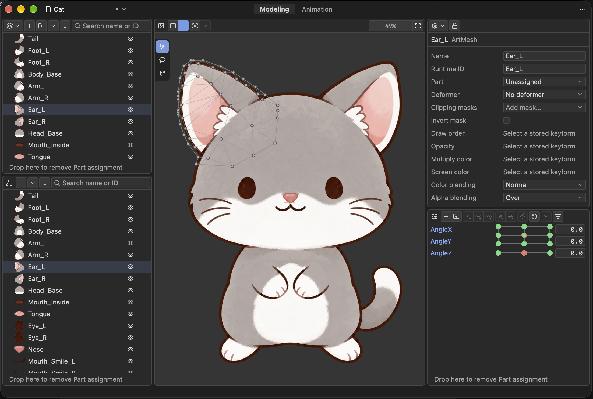

# Zipzi 2D

[English](README.md) · [简体中文](README.zh-CN.md) · 日本語

**AI と一緒に制作する、オープンソースの 2D モデリング・アニメーションツール。**

あなたの創作を、AI エージェントがモデリング作業でサポートします。Zipzi はデスクトップエディターと Python API をつなぎ、あなたとエージェントが同じモデルを確認・編集し、取り消し履歴を共有しながら作業を引き継げるようにします。

Zipzi 2D は、Rust と GPUI で開発された Live2D Cubism Editor のオープンソースの代替ツールです。名前は広東語の「摺紙」（*zip3 zi2*、折り紙の意味）に由来します。

[**Alpha をダウンロード**](https://github.com/getzipzi/zipzi-2d/releases) · [Python SDK](crates/zipzi-python2/README.md) · [問題を報告](https://github.com/getzipzi/zipzi-2d/issues) · [開発への参加](#開発への参加)



> **開発初期段階：**安定版はまだありません。API やファイル形式は変更される可能性があります。エディターは macOS に対応しています。Windows 版は開発用プロトタイプで、デスクトップ機能の検証を進めています。

## あなたのエディターと AI エージェントで、ひとつのモデルを。

AI コーディングエージェントに、やりたいことを伝えてください。エージェントは Python SDK でモデルを調べ、レンダリング画像を見て編集します。変更はエディターで確認でき、取り消すこともできます。同じドキュメントと取り消し履歴を共有して作業できます。

Python を実行できるエージェントを用意し、[SDK ガイド](crates/zipzi-python2/client/python/zipzi/docs/guide.md)を渡してください。

### 最初のコード：AI にすべてのメッシュをわかりやすく命名してもらう

**あなたが依頼し、AI エージェントがコードを書いて実行します。**以下の例は AI コーディングエージェントが生成し、起動中のエディターに接続して検証したものです。エージェントが Python SDK をどう使うかを示しています。自分でスクリプトを書く必要はありません。希望を伝え、エディターで結果を確認するだけです。

エージェントへの依頼：**「各メッシュを見て、わかりやすい名前を付けて。」**

[Python クライアント](crates/zipzi-python2/README.md#installation)をインストールし（CPython 3.14 が必要）、GPU 観察機能に対応したエディターを起動してモデルをひとつ開きます。画像を読み取れるコーディングエージェントが、次の 2 段階を実行できます。

**1. エージェントが各メッシュを観察します。**生成したスクリプトが、テクスチャ付きモデル上で対象メッシュのワイヤーフレームを強調した画像と、命名用の JSON 一覧を出力します。`observe` が画像を提供し、エージェントが意味を読み取ります。

```python
import json
from pathlib import Path
from uuid import uuid4

import zipzi
from zipzi import inspection, observation, spatial

output = Path("mesh-review-" + uuid4().hex[:8]).resolve()
output.mkdir()

with zipzi.connect() as runtime:
    sessions = runtime.sessions.list()
    if len(sessions) != 1:
        raise RuntimeError("Open exactly one model for this example.")
    session = runtime.sessions.attach(sessions[0].id)

    # すべてのページを取得。list() の 1 回の呼び出しでは全件を取得できない場合がある。
    meshes, cursor, source = [], None, None
    while True:
        page = session.meshes.list(cursor=cursor)
        if source is None:
            source = page.source
        if page.source != source:
            raise RuntimeError("Model changed; restart the inspection.")
        meshes.extend(page.items)
        cursor = page.next_cursor
        if cursor is None:
            break

    rows = []
    for index, mesh in enumerate(meshes):
        # 非表示の形状も含め、このメッシュの境界から表示範囲を決める。
        # {} はエディターの現在のポーズではなく、既定のパラメーター値で評価する。
        query = spatial.Bounds(
            targets=(spatial.MeshTarget(value=mesh.id),), include_hidden=True,
        )
        bounds = session.modeling.spatial(
            ({},), (query,), expected=source,
        ).wait().value.frames[0].results[0].value.model_bounds
        row = dict(id=mesh.id, old_name=mesh.name, new_name=mesh.name, image=None)
        if bounds is not None:
            x0, y0, x1, y1 = bounds
            margin = max(x1 - x0, y1 - y0, 1.0) * 0.15
            view = observation.View(
                width=768, height=768,
                roi=(x0 - margin, y0 - margin, x1 + margin, y1 + margin),
                topology=observation.Overlay(
                    targets=(observation.MeshTarget(value=mesh.id),),
                    wireframe=True, include_hidden=True,
                ),
            )
            # すべての観察を一覧取得時のデータに固定する。モデルが変わると
            # SDK は古いデータの読み取りを拒否するため、混在させず再実行する。
            images = session.modeling.observe(({},), view, expected=source).wait()
            report = inspection.save(images, output / f"mesh-{index:04d}")
            row["image"] = str(report.images[0])
        rows.append(row)

    # SessionId は型付きハンドル。次のスクリプト用にフィールドを保存する。
    worksheet = output / "names.json"
    worksheet.write_text(json.dumps(
        dict(session_id=dict(runtime=session.id.runtime, serial=session.id.serial),
             meshes=rows), indent=2, ensure_ascii=False,
    ), encoding="utf-8")
    print(worksheet)
```

エージェントに**出力された PNG を 1 枚ずつ開かせ**、周囲の画像も参考に強調されたメッシュを特定して、`names.json` の `new_name` だけを編集させます。ID と `old_name` は変更しません。オーバーレイは診断用の形状を選択するもので、絵そのものを切り抜く機能ではありません。周囲のテクスチャも表示されるため、非表示や遮蔽された部分は判別できないことがあります。不確かな項目や画像のない項目は元の名前を残すか、別のポーズを観察してから命名します。

**2. エージェントが名前をまとめて適用します。**提案された名前を確認したら、エージェントが以下のスクリプトを作成し、`names.json` のパスを渡して実行します。コードのコピーやターミナル操作は不要です。観察から適用まで、同じモデルを開いたまま変更せずにおいてください。

```python
import json
import sys
from pathlib import Path

import zipzi

review = json.loads(Path(sys.argv[1]).read_text(encoding="utf-8"))
rows = review["meshes"]
if len({row["id"] for row in rows}) != len(rows):
    raise ValueError("Duplicate mesh IDs in the worksheet.")
if any(not isinstance(row["new_name"], str) or not row["new_name"].strip()
       for row in rows):
    raise ValueError("Every mesh needs a nonempty name.")

with zipzi.connect() as runtime:
    # 型付きハンドルを復元する。エディターを再起動した場合は再観察が必要。
    session = runtime.sessions.attach(zipzi.SessionId(**review["session_id"]))
    # 改名はまとめて確定し、1 回で取り消せる。メッシュの消失や元の名前の変更は
    # 編集全体を中止させ、一部だけが改名された状態を残さない。
    with session.edit("AI: semantic mesh names") as edit:
        for row in rows:
            current = edit.meshes.get(row["id"]).value
            if current.name != row["old_name"]:
                raise RuntimeError("Mesh changed; inspect the model again.")
            if row["new_name"] != row["old_name"]:
                edit.meshes.rename(
                    row["id"], row["new_name"], expected_name=row["old_name"],
                )
    print("Review the names in the editor. Undo to revert, or save to keep them.")
```

プロジェクトは自動保存されません。名前のチェックでは、メッシュの改名や削除は検出できますが、形状やテクスチャの変更をすべて検出できるわけではありません。モデルを変更した場合は観察をやり直してください。その他のワークフローは[機能ガイド](crates/zipzi-python2/CAPABILITIES.md)を参照してください。

## 手作業での制作にも

メッシュ、パラメーター、デフォーマ、BlendShapes でモデルを作り、アニメーションワークスペースで動きを付けられます。メッシュの自動生成も、手作業での調整も可能です。Mesh Edit では変形後のモデル上で編集でき、元画像の表示にも切り替えられます。形状の変更に合わせて、保存されたシェイプを再サンプリングします。

Python スクリプトはローカル Runtime でも単独実行でき、エディター外の自動化にも使えます。モデリング、アニメーション編集、プレビュー、検査については [Python SDK](crates/zipzi-python2/README.md)をご覧ください。

## Zipzi 2D を試す

- **エディターを使う：**[GitHub Releases](https://github.com/getzipzi/zipzi-2d/releases) から Alpha 版をダウンロードできます。提供プラットフォームと動作要件はリリースノートを確認してください。
- **Python で自動化する：**[インストール・接続ガイド](crates/zipzi-python2/README.md)を参照してください。SDK は現在 CPython 3.14 を必要とします。
- **独自のツールを作る：**[Rust SDK](crates/zipzi-sdk/README.md) でモデルをプログラムから編集できます。

### 現在の機能

| 分野 | 対応内容 |
| --- | --- |
| モデリング | メッシュ、パラメーター、キーフォーム、パーツ、デフォーマ、BlendShapes、Glue |
| アニメーション | モーション、表情、物理演算、ポーズの編集とアニメーションプレビュー |
| プロジェクト入出力 | PSD のインポート、および Model3/MOC3、Cubism プロジェクト、ランタイム付随ファイルなどの関連形式。対応範囲や情報損失の扱いは形式と入出力方向によって異なります |
| 自動化 | Python セッション、一括編集、取り消し／やり直し履歴の共有、プロジェクト操作、モデル検査 |
| プラットフォーム | macOS、Windows 開発用プロトタイプ |

詳細は [SDK 機能ガイド](crates/zipzi-python2/CAPABILITIES.md)を参照してください。GPU 検査には対応ホストと利用可能な GPU が必要です。形式への対応は、すべてのモデルを情報損失なく往復変換できることを意味しません。

## 開発への参加

Alpha 版を試し、[困った点を教えてください](https://github.com/getzipzi/zipzi-2d/issues)。不具合報告にはビルドのバージョン、プラットフォーム、再現手順を添えてください。モデル素材は、共有する権利がある場合にのみ提供してください。

コードの貢献は、[リポジトリ構成](MONOREPO.md)、[エディターガイド](crates/zipzi-editor/README.md)、[Python SDK ガイド](crates/zipzi-python2/README.md)から始められます。詳しい資料は[ドキュメント一覧](docs/README.md)にあります。開発コマンドと変更箇所に応じたテストは以下のとおりです。

## 開発

Rust 1.95 以降、uv 0.10.7 以降、CPython 3.14 が必要です。macOS エディターには Xcode Command Line Tools と Metal 対応 GPU が必要です。[Windows 開発用プロトタイプ](crates/zipzi-editor/README.md)には MSVC、Windows SDK、利用可能な GPU が必要です。リポジトリのルートで実行してください。

```sh
uv sync --locked
python3 tools/workspace/cargo_domain.py --check

# 対象を絞った SDK 開発
cargo test --locked -p zipzi-sdk --test integration physics_editing::

# ネイティブエディター（macOS）
cargo run --locked -p zipzi-editor
./tools/test-editor.sh fast timeline::

# リポジトリのツールテスト。ネイティブアプリのビルドは不要。
uv run --locked python tools/test_tools.py
```

Python SDK の `./tools/test-sdk.sh python2` はネイティブアダプターを更新し、Local／Connected の動作と静的型を検証します。`python2-connected` は pure Python wheel をインストールして、実際の子プロセスでホスト検出とセッション接続を検証します。現在のデスクトップホストを指定するには `--editor-host /absolute/path/to/zipzi-editor` を追加してください。ルートの `pyproject.toml` と `uv.lock` が開発ツールを管理します。

## テスト

<details>
<summary>変更箇所に応じたテストコマンドとカバレッジ</summary>

まず変更をカバーする最小限のテストを選び、必要に応じて範囲を広げてください。コマンドはリポジトリのルートで実行します。利用可能なモードは `./tools/test-sdk.sh --help`、`./tools/test-editor.sh --help`、`uv run --locked python tools/test_tools.py --help` で確認できます。

| 変更箇所 | 最初に実行するコマンド |
| --- | --- |
| 単一の Rust crate／モジュール | `cargo test --locked -p <crate> --lib <filter>`; 必要に応じて統合テストのターゲットを追加 |
| Runtime の所有権／ジョブ／イベント | `./tools/test-sdk.sh runtime` |
| ローカルプロトコル／インストール済み Python クライアント | `./tools/test-sdk.sh python2-connected` |
| SDK の編集動作 | `./tools/test-sdk.sh fast <filter>` |
| エディターの適応型メッシュ生成 | `./tools/test-editor.sh fast adaptive_mesh::`; `./tools/test-editor.sh fast mesh_generation::` |
| SDK のアルファ値に基づくメッシュ生成 | `./tools/test-sdk.sh mesh` |
| wgpu バックエンド／ローカル GPU の一致性 | `cargo test --locked -p zipzi-render-wgpu --tests`; [ホストの選択](crates/zipzi-render-wgpu/README.md#application-routes-on-macos) |
| エディターの連携処理 | `./tools/test-editor.sh fast <filter>` |
| エディター UI（macOS／Metal） | `./tools/test-editor.sh ui <filter>` |
| Runtime Python SDK（`zipzi-python2`）、Local／Connected と型 | `./tools/test-sdk.sh python2` ([対象範囲](crates/zipzi-python2/README.md)) |
| 共有編集契約／独立した Python 生成 | `cargo test --locked -p zipzi-contract`; `uv run --locked python tools/test_tools.py -p test_python2_codegen.py` |
| Runtime GPU 観察／検査（利用可能な GPU が必要） | `./tools/test-sdk.sh python2 --observation` |
| Python の呼び出し復旧、Edit 状態、Job タイムアウト | `./tools/test-sdk.sh python2 --recovery` （任意：`P3ARecovery.test_name`） |
| Python コレクションのページング、Session の切断／終了、オフラインカタログ | `./tools/test-sdk.sh python2 --discovery` |
| 新クライアントのインストール、ホスト検出、セッション接続 | `./tools/test-sdk.sh python2-connected` （任意：`--editor-host /absolute/path/to/zipzi-editor`） |
| リポジトリのツール | `uv run --locked python tools/test_tools.py -p test_<tool>.py` |

フィルターとファイル名はプレースホルダーです。省略すると選択したテスト範囲全体を実行します。各 crate の統合テストは、その README と `tests/` を参照するか、`cargo test --locked -p <crate> --test <target> -- --list` で一覧を確認してください。Editor のシェル経由のテストは `ZIPZI_DEV_SESSION_DIR` を解除します。Editor の Cargo テストを直接実行する場合は手動で解除してください。

回帰、ストレス、ネイティブ受け入れ、パッケージ化された wheel のテストについては、[全体のカバレッジ、前提条件、CI](tools/README.md#test-coverage)を参照してください。両ドメインのシェルスクリプトは、モード未指定だと実行コストの高い **full** テストが既定です。単に `cargo test` を実行すると、`zipzi-core`、`zipzi-project`、`zipzi-sdk` のみが選択されます。ツールのテストは `tools/tests/`、crate のテストは各 crate 内、共有データは [`fixtures/`](fixtures/README.md) に置きます。

プロジェクトが管理する crate は、ルートの Cargo workspace とロックファイルを共有します。ローカルモデルは `models/local/` に置いてください。[モデル一覧](models/README.md)も参照してください。ソースアーカイブ、Python wheel、macOS アプリバンドルには、それぞれ[配布物の検証](tools/README.md#local-distribution-artifacts)があります。

</details>

## ライセンスと第三者の権利

SDK コンポーネントは [MIT](LICENSE-MIT)、エディターコンポーネントは [GPL-3.0-only](LICENSE-GPL-3.0) で提供されます。[LICENSING](LICENSING.md) に適用範囲と共有ファイルの出典を記載し、[第三者に関する通知](THIRD_PARTY_NOTICES.md)に依存ライブラリとベンチマークの例外事項を記載しています。

Live2D、Cubism、Live2D Cubism SDK、Cubism Core、Cubism Native Framework、および関連するサンプルデータは、Live2D Inc. および／または各権利者が所有、またはライセンスを提供しています。本プロジェクトは独立しており、Live2D Inc. との提携関係はなく、同社の許可、承認、支援を受けたものではありません。「Live2D」「Cubism」の名称は相互運用性の説明にのみ使用しています。

本リポジトリは、プロプライエタリな Cubism Core バイナリ、Cubism SDK パッケージ、Live2D のサンプルモデル素材を配布しません。Live2D の素材を使用するソフトウェアを取得、ビルド、リンク、公開、配布する場合、利用者は [Live2D Proprietary Software License Agreement](https://www.live2d.com/eula/live2d-proprietary-software-license-agreement_en.html)、[Live2D Open Software License Agreement](https://www.live2d.com/eula/live2d-open-software-license-agreement_en.html)、適用される[サンプルデータの利用条件](https://www.live2d.com/eula/live2d-sample-model-terms_en.html)など、すべての適用条件を遵守する責任があります。本リポジトリの MIT ライセンスは、第三者のソフトウェア、モデル、アートワーク、商標、その他の素材に関する権利を付与しません。
