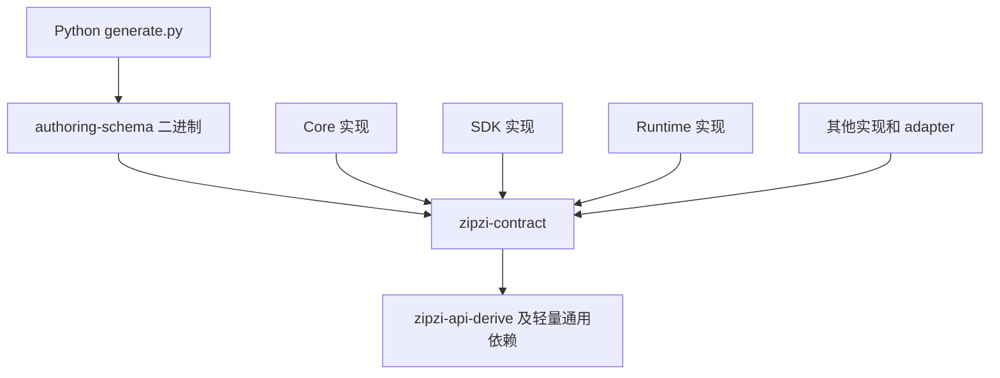

# Python SDK 契约拆分方案

日期：2026-10-30。状态：阶段 0–5 已完成（`a6e24cda`）；阶段 6 的实现、
macOS 集成与性能验收已完成，Windows CI 实际运行待验证。
实测结果和范围见[阶段 6 验收记录](python2-contract-acceptance.md)。

把 Python 生成所需的 Rust 类型、操作声明和编解码描述提取到独立契约层。
生成器只编译契约层；修改 Core、SDK、Runtime 内部实现后，生成阶段复用已有
Rust 产物。实际运行修改后的业务逻辑仍需构建相应实现，本方案不承诺整个 Python
验证循环都变成秒级。

继续以 Rust 声明作为唯一类型来源，不引入 IDL、不扫描 Rust 源码推断契约，也不依赖
常驻进程或 Connected 宿主。各 worktree 使用自身路径下的源码和缓存；无需协调一个
共享服务。

## 目标和范围

| 修改内容 | 完成后的生成行为 |
| --- | --- |
| Core、SDK、Runtime 内部函数 | 不编译这些实现包，契约导出器保持 fresh |
| Project、Animation、渲染或文件格式实现 | 不进入生成器的依赖链 |
| 契约字段、枚举、默认值、操作声明 | 编译契约层，生成并检查最新输出 |
| Python 生成模板和文档输入 | 使用当前契约重新渲染，复用未变的 Rust 构建 |
| 首次运行或清空构建目录 | 只构建契约层及其轻量依赖 |

完整隔离 Core／SDK／Runtime 是本次终点。只抽出 Runtime 类型但继续依赖 SDK／Core
可以是临时迁移状态，不能作为完成标准。

本次保持业务行为、Python 公共使用方式、共享缓冲区和资源生命周期。允许调整 Rust
类型归属、内部方法调用及协议身份；项目尚未正式发布，不做旧版本迁移或双协议支持。
Local／Connected 仍是现有执行路径，生成命令不选择或启动任何执行宿主。

## 当前构建为什么受实现变化影响

[generate.py](../../../crates/zipzi-python2/tools/generate.py) 每次先调用
`cargo run -p zipzi-python2 --features schema-export --example authoring_schema`。
渲染缓存发生在导出之后，无法省掉此前的 Rust 构建。

[zipzi-python2 的依赖](../../../crates/zipzi-python2/Cargo.toml) 包含 PyO3、Core、SDK
和启用 `gpu-observation` 的 Runtime。`schema-export` 排除了旧生成 adapter 的
源码，但没有消除上述依赖。

迁移前导出器（原 `crates/zipzi-python2/examples/authoring_schema.rs`）读取真实类型的
`ApiShape`、`ApiFields` 和二进制签名，还读取包含 Runtime handler 的注册项。
[Runtime build.rs](../../../crates/zipzi-runtime/build.rs) 又把多个实现包的源码纳入
SDK 构建身份，因此实现变更可以进一步触发生成链路构建。

此前对话记录的一次默认检查约为 107 秒，使用已导出 schema 重放约为 2 秒。
这只能证明应当区分 Rust 导出和 Python 渲染成本，不能作为每轮节省时间的承诺。
实施前按下文方法重新建立同机基线。

## 采用的结构

新增一个 MIT crate `zipzi-contract`，提供契约库及独立二进制 `authoring-schema`。
沿用现有 `zipzi-api-derive`。初期按模块组织契约，不同时拆出多层类型 crate。



箭头表示依赖方向；既有实现包之间的依赖省略。契约库不得反向依赖这些实现包。
导出器位于 `crates/zipzi-contract/src/bin/authoring_schema.rs`，不依赖 Python
native 包。Python 专用的命名和投影清单放在二进制的支持模块，不放进契约库公共 API。

建议模块如下，最终按类型清单调整文件粒度：

| 模块 | 内容 |
| --- | --- |
| `api_shape`、`binary_wire`、`serde_maps` | 形状描述、编解码基础设施、Serde 辅助函数 |
| `shared_vec` | 共享容器及其序列化、写时复制语义 |
| `model` | Core 模型记录、数学值、引用、枚举及字段依赖 |
| `authoring` | SDK 请求、意图、查询、报告、采样结果等数据 |
| `runtime` | 请求、响应、句柄值、来源、事件、能力及限制描述 |
| `operations` | 操作身份及其输入输出类型的声明 |

直接依赖以 `serde`、`serde_json`、已有 derive 宏和确有需要的轻量值类型库为限。
不得引入 Project、Animation、Live2D 或其他实现 crate 来填补漏迁的字段类型；
它们贡献的契约数据也必须纳入迁移闭包。不得通过 optional feature 把执行实现接回去。
契约类型不随 GPU、宿主平台或 `test-support` 改变形状；平台差异由能力值表达。

单一契约 crate 能减少依赖层次和迁移顺序的不确定性，代价是某个契约变化可能让所有
消费者重新编译。这是本方案接受的取舍：优先隔离频繁的实现变更；若契约变更本身成为
新的实测瓶颈，再按模型与上层 API 分包。契约包不引入与导出无关的业务算法。

## 类型与行为如何迁移

### 先确定完整类型闭包

以现有导出器的所有 roots、bindings、operation 输入输出、`ApiFields` 和二进制
根类型为起点，递归列出字段类型、泛型实参、类型别名、默认值函数和所需 trait 实现。
Schema 中的具名条目数量不等于实际要搬的定义数量；opaque、跳过字段和辅助类型
需要逐项确认，不能只按 JSON 中出现的名字复制文件。

实施清单至少记录：原定义位置、目标模块、字段依赖、固有方法、trait 实现、私有字段、
调用方和对应测试。还要识别 Animation／Project 的数据叶子，防止残留传递依赖。

### 同一个 Rust 类型由契约库定义

采用共享类型下沉，不建立一套独立 DTO 再与业务类型逐字段转换。原 crate 可 re-export
同一个类型以减少调用点改动；re-export 不承担保留旧 Rust 类型身份或二进制签名的作用。

| 现有成员 | 迁移规则 |
| --- | --- |
| 字段、枚举分支、Serde 属性、文档、编解码描述 | 随类型迁入契约库 |
| `Default`、纯构造、访问器、值比较 | 随类型迁移，保持原语义 |
| 轻量且只依赖自身值的校验 | 可以随类型迁移，不依赖文档或执行环境 |
| 编辑、求值、采样、规划、身份分配等业务行为 | 留在实现层，改为函数或实现层扩展 trait |
| 依赖 Document／Session／历史／资源仓库的方法 | 留在原实现层 |
| 类型或 trait 变为外部定义后不合法的实现 | 在类型所属层保留纯数据实现，或在实现层改用函数／本地包装 |

例如 `SceneOperation::into_intent()` 中的身份生成和编辑意图构造留在 SDK；
`ModelingCommand` 的执行方法留在 Runtime。对 `WarpBezier` 等数据与算法混合类型，
只下沉结构和必要值操作，几何求值算法仍留在 Core。

不能为快速消除编译错误把所有方法或私有字段公开。对跨层确实需要的构造、读取和修改，
提供明确接口；Runtime 仍验证句柄的实例、所有者、代次和有效性，构造一个值不授予权限。

### 数据与执行资源分开

`ModelingSampleBatch` 当前同时包含 `samples` 和 `TransferReservation` lease。
契约层仅定义需要投影的数据，Runtime 通过内部结果包装持有数据及 lease。其他带文档
快照、执行计划、取消状态、GPU 资源或资源仓库的对象同样处理。

包装拆分必须覆盖 Local、Connected、Job 和错误路径：序列化或转换成 Python 时不能
提前释放 lease；取消、失败和显式关闭时不能重复释放或漏记预算。计划句柄与报告可以
下沉，持有快照的可执行计划仍由 SDK／Runtime 管理。

保持 `SharedVec`、`Arc` 和现有大数组的所有权语义。数据移动或借用不应变成逐字段深拷贝，
不得为了分层增加几何或像素数组的 JSON 中转。

## 元数据和操作注册

把 `ApiShape`、`ApiFields` 所需设施、`BinaryWire` 基础及通用 serde helper 从 Core
迁到契约库。derive 宏输出路径改为 `zipzi_contract`；宏 crate 自身不依赖契约库。
契约库通过自身别名支持内部 derive；声明宏使用 `$crate` 定位设施。
仍在其他 crate 使用 derive 的自有类型需显式声明相应依赖。

把当前 `Registered<I, O>` 拆成两个职责：

- 契约库声明操作的稳定名称和输入输出类型，导出器由此读取 shape。
- Runtime 把该声明绑定到实际 handler，绑定接口在编译期要求相同的输入输出类型。

生成物需要调用 Runtime 时，使用同一操作清单生成或校验 adapter 的映射。
不能仅维护两份自由字符串列表。新增操作必须有缺失／重复绑定检查，输入输出类型
不匹配必须编译失败。生成器不负责验证 Runtime 的执行方法体；由 Runtime 编译和
绑定测试承担这一职责。

## 路径与协议身份

现有 shape 使用 Rust 类型名，二进制签名使用 `module_path!()`。类型迁移将改变这些
身份。本次统一更新导出器、生成模板中的路径映射、native adapter、协议身份及生成物，
不增加旧身份兼容层。对产生不兼容调用的签名变化同步更新 wire major 和相关说明，
所有客户端与宿主按同一版本构建。

业务字段、默认值、顺序、Serde 标签和二进制布局原则上保持原样。迁移前后做语义差异
检查，只有逐项登记的类型路径、对应签名及协议身份变化可归一化后比较；不能忽略整个
schema 区块来掩盖字段遗漏。操作名称和 Python 公共名称不因 Rust 路径变化顺带改名。

Runtime 的 SDK 源码身份继续用于运行产物诊断。其 `build.rs` 应纳入新增契约源码，
但生成器不得依赖这个 build script 或 SDK 构建身份。契约导出内容不得包含 worktree
绝对路径、时间戳或无关实现源码的 hash。

## 生成命令与本地缓存

保留现有 Python 入口和 `--check`、`--schema`、`--no-cache` 含义，默认导出改为：

```sh
cargo run --locked -p zipzi-contract --bin authoring-schema
```

生成器从自身文件位置解析当前 checkout 根目录，使用其
`target/python2/schema-cargo` 作为专用 Cargo target，通过显式 `--target-dir` 传入。
不受外部共享 `CARGO_TARGET_DIR` 指向其他 worktree 的影响，也不在 dev、test-support、
GPU 或 native 构建配置之间切换。此目录只构建轻量契约依赖，代价是首次单独预热。

渲染缓存继续位于当前 checkout 的 `target/python2`，以完整契约及全部模板输入校验。
默认命令始终读取当前 Rust 契约；`--schema` 仍仅用于明确的重放，不作为默认跳过
最新源码检查的捷径。保留原有缓存原子替换和输出归属检查。

生成、检查及生成产物写入使用当前 checkout 内同一个文件锁，避免两个调用交错写入。
`--check` 可以更新缓存，但不改 tracked 生成文件。不同 worktree 不使用全局锁或共享
生成服务；同一个 checkout 中同时人工编辑契约仍需工作协调，生成锁不锁源码编辑。

## 实施顺序

每阶段提交应保持可构建。迁移期间旧导出器仍可作为对照，最终删除旧入口和临时桥接。

| 阶段 | 工作 | 阶段完成条件 |
| --- | --- | --- |
| 0 类型盘点与基线 | 建立完整类型／方法清单，保存 schema 和构建耗时基线 | 能指出每个实现依赖如何移除，明确行为和资源归属 |
| 1 契约基础设施 | 新增 crate，迁移 shape／wire／serde／共享容器，修改 derive 路径 | 契约库无实现依赖，原消费者通过临时 re-export 构建 |
| 2 模型数据 | 迁移 Core 与其他底层的数据闭包，拆开几何算法方法 | 数据定义唯一，Core 相关聚焦测试通过 |
| 3 SDK 数据 | 迁移意图、请求、报告和采样数据，调整方法与 trait 归属 | SDK 聚焦测试通过，无反向实现依赖 |
| 4 Runtime 数据与注册 | 迁移句柄和事件等数据，拆分 handler 注册及资源包装 | Runtime 绑定、所有权、预算和生命周期测试通过 |
| 5 切换生成器 | 新二进制导出、模板路径更新、同步生成物、目录与锁规则 | 生成链只含契约依赖，旧入口移除，语义差异符合清单 |
| 6 集成与性能验收 | 更新打包、CI、文档并执行下文验收 | 正确性与依赖隔离全部通过，留下实际测量报告 |

工作量最大的部分是阶段 2–4 的方法归属、类型闭包和资源包装。先用阶段 0 的清单
细化工作量，不以未经试拆的固定周数作为排期。仓库未发布，无需为迁移状态长期保留
两套类型或执行实现。

共享文件的修改顺序需要统一：Cargo manifest／lock、derive、导出入口和生成模板先
约定接口，再迁移各域；生成物在类型与映射稳定后集中刷新。各域完成后必须在整合代码
上验证，不能只依据分支内的通过记录。

## 仓库集成清单

- 更新根 workspace、依赖及 lockfile；新包归入 SDK 测试域，运行 package-domain 检查。
- 更新使用 derive 的 crate 依赖、原类型的 re-export 与调用点，避免留下重复定义。
- 更新 `zipzi-python2/tools/test.py` 和相关生成门禁；保持正式测试检查最新契约。
- 更新 `distribution.py` 中旧 `authoring_schema` example 的构建与定位方式。
  发布验收从归档源码构建新导出器，不能引用活跃 checkout。
- 检查 `build_backend.py`、打包清单和发布版本工具是否包含新增 crate、derive 与导出源码；
  安装 wheel 继续不运行生成器。
- 更新 Runtime 源码身份范围、CI 路径过滤及测试选择；检查 macOS／Windows 构建消费者。
- 更新 `MONOREPO.md`、crate README、工具说明、生成职责说明与协议版本文档。

## 验收方法

### 依赖和生成正确性

建立工具级回归检查，从新导出器实际 Cargo 解析结果检查 normal／build 依赖闭包。
允许的仓库包仅为 `zipzi-contract` 与 `zipzi-api-derive`；其他业务实现包、PyO3 和
GPU 库不得进入该闭包，防止以后从字段类型或 feature 间接重新引入。

在临时测试 checkout 或夹具中完成下列检查，不改动开发者正在编辑的源码：

1. 分别修改 Core、SDK、Runtime 的实际内部函数体，默认生成检查仍通过；契约库和
   导出器保持 fresh，生成文件字节不变。只 touch 文件不算算法变更证据。
2. 修改契约字段、默认值、枚举分支及操作输入输出的代表性样例，检查能发现漂移；
   重新生成后再次检查通过。类型不匹配、漏绑定和重复操作有明确失败测试。
3. 删除缓存后能从当前源码重建；连续生成确定性一致，失败不能被旧缓存掩盖。
4. 迁移前后 schema 语义比较及编解码测试覆盖字段默认值、标签、顺序、签名和输入预算。

不增加双 worktree 并发验收。路径和锁的规则使用工具夹具验证即可。

### 行为与集成

开发阶段按变更域运行最小测试。新增契约单元／编解码测试放在新 crate；入口、缓存、
依赖和打包回归放在 `tools/tests/`。以下是实施时的测试入口，新 crate 命令在创建后可用：

```sh
cargo test --locked -p zipzi-contract
uv run --locked python tools/test_tools.py -p test_python2_codegen.py
uv run --locked python tools/test_tools.py -p test_python2_distribution.py
python3 tools/workspace/cargo_domain.py --check
uv run --locked python crates/zipzi-python2/tools/generate.py --check
```

Core／SDK 各阶段选择对应模块或 integration target。Runtime 阶段覆盖 handler、
资源结果、取消和失败清理，使用 `./tools/test-sdk.sh runtime` 或更小目标。
重点核对大数组共享、写时复制以及 Local／Connected 的 lease 释放和预算回收。

最终集成执行 Python Local／Connected、静态类型及安装包检查，验证归档源码可以独立
导出并构建。由于共享类型影响面广，最终再运行 SDK regression、Editor fast 及支持
平台的消费者编译检查；GPU 生命周期被涉及的部分补对应 observation 测试。
完整 SDK／Editor 全套不作为每阶段默认门禁。直接运行 Editor Cargo 测试前清除
`ZIPZI_DEV_SESSION_DIR`。

### 性能记录

同一机器、工具链、配置和无并行重构负载下记录改造前后：无变更检查、实现函数变化后
检查、契约字段变化后生成、专用目录冷构建。每个热场景预热后至少测五次，报告中位数、
范围、Cargo fresh／重编译包及 Python 渲染耗时。临时记录放在 `target/python2`。

硬性标准是实现变化不让契约导出器重编，并且其依赖中不存在业务实现包。
性能目标是实现变化后的热检查接近无变更基线；同机无负载时先以中位数不超过 5 秒
作为目标，超出时按 Cargo 启动、导出、渲染分别定位，不用关闭正确性检查换取速度。
冷构建与契约修改后的耗时单列，不套用热检查目标。

另外记录一次“实现修改 → 生成 → native 构建 → 聚焦 Python 用例”的总耗时，区分
生成阶段收益和仍必需的执行构建。这里不改变 Local／Connected 的选择，不承诺消除
native 编译成本。

## 完成标准

- [x] 契约类型和元数据只有一个 Rust 定义来源，生成器无业务实现依赖。
- [x] Core／SDK／Runtime 实现变化不触发契约导出器重编；契约变化可靠更新生成物。
- [x] 操作绑定保留编译期类型检查，缺失与重复绑定可检测。
- [x] 默认值、编解码、预算及资源生命周期验收通过，没有新增大数组深拷贝。
- [x] 生成入口不依赖运行进程，缓存和锁定位到当前 checkout。
- [ ] 归档源码、wheel、CI 和 Editor 消费者完成验证，旧导出入口和临时桥接清理完毕。
- [x] 实际性能报告区分热生成、契约变更、冷构建及完整验证循环。

剩余跨平台证据：归档源码、wheel 与 macOS Editor 全目标已通过；CI 配置已更新，
但本机没有执行 Windows matrix，故包含跨平台 CI 的合并完成项保留未勾选。
