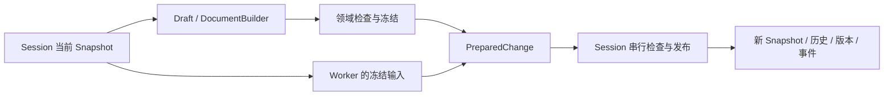

# Authoring 新内核重写方案

状态：第一至第三阶段已完成；下一阶段为宿主与客户端切换。日期：2026-11-06。
代码审计基线：`main@44111d1c`；实施起点：`main@0262b010`；实施分支：`codex/authoring-kernel`。

重新实现 authoring 的状态与执行内核。新内核以不可变模型、隔离 Draft、唯一发布入口、
线性快照历史和独立资源存储为基础，直接替换旧接口和调用方。
几何、变形、插值、拓扑、绑定规则、编解码和资源校验算法及其行为测试继续复用。

不兼容旧 Rust API、Runtime authoring 协议或 Python authoring 接口；不提供弃用别名、
兼容 facade、旧算法回退或新旧内核运行时分派。接口和客户端随内核一起切换。
工程格式沿用已有编解码能力，不为内部所有权变化引入文件迁移。

实施以正确性和结构收敛推进，不设置量化收益门槛，不建设逐分配计费证明。
内存与性能在重写完成后集中对照；明显卡死、持续增长和行为退化仍及时作为缺陷处理。

### 当前实施进度

第一阶段提交：`300e8a18`（`feat(authoring): complete immutable model and resource foundation`）。
阶段完成并通过对应验证后提交。第二阶段的切换范围与验证记录见下文。

- Contract `kernel`：区分 ContentId、SessionKey、Version、DraftId、DraftSource 与
  ResourceKey；版本/候选计数溢出拒绝推进。新值类型尚未进入 Runtime wire 或 Python schema。
- Core `state`：DocumentState / DocumentBuilder 覆盖全部持久领域，提供类型化增删改、
  根替换与顺序修改；OwnedDocument 承接完整 owned 输入，经规范化和验证后冻结。
  目录、记录、顺序、元数据根和参数 runtime ID 索引分别共享；无净变化复用原 ContentId，
  写失败后不能冻结候选。场景几何和绑定目前采用阶段一允许的记录级共享表示。
- Core `model_validation`：抽出只借用持久记录的共享验证与规范化规则，由 Builder 和只读模型使用。冻结检查跨领域身份、引用、几何、组织和全部业务领域；
  新路径不构造旧 Document，也不依赖旧事务、保存或发布状态。
- WriteSet：由触及记录和根产生净变化、顺序变化和固定步骤成本估计；单步内去重共享块，
  未变曲线不重复计入，改变的粗粒度几何块保守计入两端。估计不承担资源准入或逐分配计费。
- Project `resource_store`：复用现有 PreparedImageContent 与图片预算，ResourceStore 接管
  图片，ResourceView 持有不可变版本并按模型引用检查存在性与尺寸。外部文件先捕获为自有
  内容；资源持有者可跨 Store 生命周期读取，同一图片对象的不同版本可独立存活。

第一阶段已可独立构造、修改、冻结和读取完整持久模型。第二阶段接通原生文件解码/保存及
SDK 根入口，正式状态改由新 AuthoringSession 直接持有 Snapshot。
细粒度几何通道分离及各领域 authoring 算法迁入仍按后续阶段推进。
领域与格式转换现已迁入；宿主和遗留测试/示例源仍按阶段四、五切换与清理，D1–D13 尚未全部完成。

持久字段迁入时的归属清单（对应旧 DocumentContent 的全部字段）：

| 字段组 | 新归属 | 当前状态 |
| --- | --- | --- |
| id、export_settings、source_canvas | DocumentState 的文档身份与 ModelSetup | 已实现 |
| assets、asset_order | 共享图片记录/顺序；已解析内容只引用 ResourceKey | 已实现 |
| parameters、parameter_order | 共享参数记录/顺序及匹配的 runtime ID 索引 | 已实现，冻结检查绑定依赖 |
| parts/transforms/meshes/glues/offscreens 及各自 order | 场景共享记录与顺序根，记录内暂保留 owned 几何 | 已实现粗粒度表示 |
| bindings/scene_bindings/blend_key_tables/blend_constraints/blend_bindings 及各自 order | 绑定共享记录与顺序根，记录内暂保留 owned 通道 | 已实现粗粒度表示 |
| draw_order_groups、display_info、hierarchy_order、editor_state | 各自独立共享根，保留持久偏好 | 已实现 |
| expressions/expression_order、motions/motion_order、motion_groups、motion_roots | 业务记录及已有曲线/目录共享根 | 已实现 |
| pose、physics | 独立共享领域块 | 已实现 |
| missing_attachments、model3_settings、package_attachments | 附件与来源/opaque 元数据共享根 | 已实现 |

新增行为覆盖完整领域构造与共享、失败隔离、依赖变更后的重验证、顺序/根净变化、
曲线成本不随未变数据增长，以及共享附件去重、保活和回收。

2026-11-06 本地验证：

| 检查 | 结果 |
| --- | --- |
| `cargo test --locked -p zipzi-core` | 单元、集成和文档测试通过；单元测试 79 项，含新状态行为 20 项 |
| `cargo test --locked -p zipzi-project --lib` | 66 项通过，含新资源行为 8 项 |
| `cargo test --locked -p zipzi-contract` | 18 项通过 |
| `uv run --locked python tools/test_tools.py -p test_python_codegen.py` | 64 项通过 |
| `./tools/test-sdk.sh fast` | 单元 34 项通过；集成 506 项通过、5 项失败、2 项忽略 |
| workspace package-domain、所改 Rust 文件格式、`git diff --check` | 通过 |

SDK 的 5 项失败均在独立的 `0262b010` 基线 checkout 原样复现，涉及
`image_memory::captured_disk_image_pins_encoded_bytes_and_pixels_after_source_is_replaced`、
`motion_library::roots_groups_and_pending_content_roundtrip_with_stable_ids`、
`physics_authoring::reopened_field_address_survives_first_reorder_and_is_retired_by_reload`、
`resource_authoring::empty_images_are_native_resources_and_save_without_fake_pixels` 和
`scene_content::deformer_original::native_save_reopen_duplicate_and_history_retain_independent_canvas_originals`。
这些旧测试按目录工程访问当前 ZIP 工程，报文件缺失、NotADirectory 或 UNSUPPORTED_PROJECT_PATH；
本批次未修改这些既有失败。未执行 Runtime/Editor 全链路或 GPU/Windows 验证。

第二阶段实现位于 SDK 私有 `authoring` 模块，并直接从 crate 根导出：

- Snapshot 将冻结模型与精确 ResourceView 配对；正式与候选查询携带不同来源。
- Draft 独立持有 Builder 和资源增量，提供类型化改名、顶点编辑、批量创建和图片版本替换。
  成功 batch 推进 sequence；命令错误、被忽略的错误、无效最终图或 panic 均中止候选。
- PreparedChange 在发布前完成冻结和资源检查。新的 AuthoringSession 直接拥有 Snapshot，
  通过唯一安装点发布提交、Undo/Redo 与文档替换；来源、取消和计数溢出在安装前检查。
- 线性快照历史按 WriteSet 固定估计裁剪，使用 `target_bytes` 软目标；大步骤保留最近一步，
  Undo/Redo 不按字节拒绝或临时裁剪。发布时使用最新策略，失败或无净变化保留 redo。
- Core Builder 增加只读候选预览，不消费工作区；SDK 不通过旧 Session 或 Document 执行。
- Project `ProjectIo` 直接将 owned 解码值冻结为 DocumentState，接管并配对资源；没有旧
  Document 转换执行器。编解码共用严格 wire admission 与只读投影，归档格式保持原生 v22。
- 保存只将 ResourceKey 投影为归档内容路径。新旧格式消费者共用 ZIP 验证、预算、目标指纹、
  staging 和原子发布算法；保存不修改内容身份、资源键或历史。缺失/损坏图片保留明确未解析来源。
- SDK ProjectContext / SavedMarker 安装实际发布目标与 ContentId。保存持有独占 `&mut Session`
  借用；失败不改保存点，发布后的取消/目录同步警告按已发布处理。异步宿主排他任务接线属于阶段四。
- SDK 根入口已经直接切换，旧 EditSession / AuthoringSnapshot / ObjectHandle 等不再导出，
  旧 SDK 事务和 checkpoint 历史不进入编译路径。未使用新旧 facade 或运行时回退。

阶段边界：D6 的 Project 活文档所有权已退出正式 SDK 路径，D7/D8/D11 的旧 SDK 执行入口已切断；
旧领域/格式转换源文件中的 DocumentSession、checkpoint、计费和路径改写代码仍按阶段三至五删除。
旧 SDK 集成/mesh 测试与示例源保留为迁移输入，尚不能按旧接口编译。当前 fast gate 明确改为
`--lib --test authoring`，不将它宣称为原有全部领域覆盖。阶段三继续迁入领域算法和行为测试。

本阶段执行边界检查：`cargo check --locked -p zipzi-runtime --lib` 在 Observe 引用已删除的
AuthoringSnapshot / ConversionControl 等 SDK 接口处失败；这是阶段三/四尚未迁移的调用方，
不是已通过的 workspace 验证。Editor、Python native 和旧 SDK 的 regression/full gates 同样不在
本阶段通过范围；不添加兼容接口使它们暂时编译。方案第 10 节允许这样的中间切换提交。

当前可运行入口：`cargo run --locked -p zipzi-sdk --example native_authoring -- INPUT.zipzi NEW_OUTPUT.zipzi`。

2026-11-06 第二阶段验证结果：

| 检查 | 结果 |
| --- | --- |
| `./tools/test-sdk.sh fast` | 新 SDK 单元 14 项、原生工作流集成 6 项通过；包含三个已入库工程样本 |
| `cargo test --locked -p zipzi-sdk --doc` | 保存排他借用的 compile-fail 检查通过 |
| `cargo test --locked -p zipzi-project --tests` | 单元和集成共 159 项通过；包含新状态完整领域往返、旧文件格式互读和资源失败边界 |
| `cargo test --locked -p zipzi-core --lib state::` | 24 项通过 |
| `uv run --locked python tools/test_tools.py -p test_dev_entrypoint.py` | 10 项通过 |
| `native_authoring` 示例 | 对 pixel-binding.zipzi 实际执行加载、改名、Undo/Redo、另存并检查 ZIP 输出通过 |
| workspace package-domain、所改 Rust 文件格式、`git diff --check` | 通过 |

未运行 GPU/Windows 验证。上面的 Runtime 边界检查仍失败；该项及旧 SDK/宿主的未迁移 gates
不包含在本阶段通过结果中。

第三阶段实现（已完成）：

- 参数、普通绑定、BlendShape、网格/范围转换、场景/组织、换父级与分组、依赖删除、
  Mesh 拓扑、Motion/Expression/Pose/Physics、资源/附件、文档字段与 EditorState 全部
  通过 Builder 的记录/根写入口。只读变换返回受影响值；发布不扫描全领域重建差异。
- 领域锁覆盖所有者、子对象及稳定采样身份；移动保留身份/偏好，复制重建自有身份，
  删除清理孤立元数据。typed patch 检查预期值，任何普通命令错误中止整个 Draft，
  包括错误被调用者忽略的情况。失败、取消和无净变化保持正式状态与 redo。
- 普通/BlendShape 插值、网格重建、range mapping、reparent/grouping 与 manual mesh
  通道转移使用现有数值算法。转换额度仅描述采样组合与实际临时/输出载荷，独立于历史。
  Motion 曲线插点、同时移动、删除、插值、Bezier 手柄及时间缩放也已接入 Draft；
  SDK 私有曲线工作区只持有 clip 值，结果经 Builder 安装，不保留第二套提交协议。
- 冻结模型提供领域投影、引用/删除分析和求值；预览与动画按 ContentId 失效。
  复用原始形状捕获和骨骼显示规则，导入数值轴在初始化前完成稳定身份规范化。
- MOC3、CMO3/CAN3、PSD 和 sidecar 适配器直接读写 DocumentState/Builder；ProjectImporter
  返回冻结模型、捕获的 ResourceView 和来源保护路径。导入不修改正式 Session。
  原生工程编解码、ZIP 验证、预算、目标指纹、staging/原子发布及失败语义继续复用。
- D1–D6 已删除：Core 可变 DocumentContent/Document、transactions、checkpoint、
  TrackingState/allowlist、publication 全量比较及 SDK changes；Project DocumentSession /
  DocumentStore 活文档所有权及其旧保存路径已移除。document 模块仅保留值类型与纯规则。
  D12 的 Core 通用 retained/history 倍率准入已移除，保留实际大分配与图片/ZIP 限制。

2026-11-06 第三阶段验证（最终状态）：

| 检查 | 结果 |
| --- | --- |
| `./tools/test-sdk.sh fast` | 单元 66 项、authoring 集成 28 项；包含领域锁、失败隔离、历史、来源、资源版本、原生保存及三个入库工程 |
| 八个受影响库 `cargo test --locked -p … --lib` | Core 47、Project 69、SDK 66、Animation 6、CMO3 8、MOC3 2、PSD 5、MOC3-PSD 3 项 |
| Core `--test preview_state_tests` | 4 项；共享帧、拒绝保留、内容/代际失效与数值失败缓存 |
| SDK `--test alpha_mesh` / `--doc` | 39 项 / 保存排他借用 compile-fail 1 项 |
| Project `--test authoring_formats` | 4 项；model3/CMO3/PSD 捕获与几何往返、所有动画 sidecar 的原生往返及稳定 key 身份 |
| CMO3 `--test rotation_units` | 1 项，涵盖混合 Rotation/Warp、两种坐标方向、普通/BlendShape 多姿态与两次往返 |
| PSD `--tests` | 单元 5、导入 14、遮罩 15、macOS Metal 裁剪 6 项；1 项私有 PSD 素材测试按既有标记忽略 |
| MOC3-PSD `--test export_tests` | 2 项，包含真实入库模型的图层、隐藏图像及合成预览 |
| 所改 crate Rust 格式、package-domain、`git diff --check` | 通过 |

迁移边界：上述 focused gates 已通过；不宣称整个 workspace 或旧聚合套件通过。
Observe、Runtime、Editor、Python native/生成客户端仍消费已移除接口，第四阶段接线；
旧 SDK/Core/Project/格式集成 targets、示例及 archive prototype 中尚未迁移的源保留为
阶段四、五的行为迁移/删除输入，不能通过旧签名编译，也不是兼容执行路径。
本阶段迁入了对应领域数值和失败断言；旧 checkpoint/事务内部保证的测试随机制删除，
新 snapshot/WriteSet/Draft/资源与发布测试覆盖替代契约。未执行 Windows 与完整桌面验收。
本地 Metal 验证仅指上面的 PSD 裁剪六项，不代表 Editor/Observe 全链路完成。

## 1 新内核的边界

新内核包括持久数据表示、受控写入、事务发布、历史、来源版本与资源引用协议。
沿用现有 crate 布局，直接重划职责；首次实现不新增基础设施 crate。

| 层 | 负责 | 不拥有 |
| --- | --- | --- |
| `zipzi-contract` | 命令、查询、身份、错误、回执和 wire/schema 值类型 | Session、可变模型、资源租约及执行算法 |
| `zipzi-core` | 不可变 `DocumentState`、`DocumentBuilder`、模型查询、领域算法、结构验证与 WriteSet | 正式 Session、历史、保存点、文件路径和客户端任务状态 |
| `zipzi-project` | ResourceStore/ResourceView、编解码、导入准备、保存投影和原子文件发布 | 活跃正式文档、编辑事务、Undo/Redo 和历史策略 |
| `zipzi-sdk` | Draft、Snapshot、PreparedChange、AuthoringSession、历史与 SavedMarker；唯一正式发布入口 | 网络协议、线程调度和 UI 状态 |
| `zipzi-runtime` | Session 注册、客户端权限、Draft/Job/结果生命周期、传输、事件投递和任务资源保护 | 第二套模型修改、历史或发布算法 |
| Editor / Python / Observe | 类型化调用、交互与只读快照消费；Python 负责生成客户端和便捷 API | 独立的 authoring 正式状态或提交规则 |

依赖保持单向：Core 使用 Contract，Project 使用 Core/Contract，SDK 使用 Core/Project/Contract，
Runtime 使用 SDK。Core 中只有 ResourceKey 等资源值引用，不依赖 Project 的 lease 或文件对象。
渲染和动画按只读模型视图工作，不反向取得 Session 或可变文档。

## 2 核心类型与所有权

以下是本轮需要实现的角色，具体模块路径可调整，职责不能重新混合。

| 类型 | 所在层 | 数据与生命周期 |
| --- | --- | --- |
| `DocumentState` | Core | 冻结持久记录、目录与必要恢复索引，包含 ResourceKey 值；字段私有，只读 |
| `DocumentBuilder` | Core | 私有可变构造器，基于一个状态按需分离记录/数组，自动产生 WriteSet，验证后冻结 |
| `ResourceView` | Project | 某个快照需要的不可变资源版本及其持有关系；可跨线程共享 |
| `Snapshot` | SDK | DocumentState 与 ResourceView 的成对持有，保证读者使用的模型和资源匹配 |
| `Draft` | SDK | 来源版本、构造器、资源增量、候选 sequence、手势基线和有限工作区；只拥有未发布修改 |
| `PreparedChange` | SDK | 来源身份、已冻结并验证的候选 Snapshot、变更摘要；可以从 Worker 返回 |
| `AuthoringSession` | SDK | 直接拥有当前 Snapshot、发布版本、历史和保存标记；正式状态只有这个所有者能切换 |
| `ProjectContext` | SDK 使用的项目元数据 | 路径、目标指纹、来源保护和工程代次；文件操作由 Project 执行 |
| `DerivedCaches` | 各消费者的只读缓存 | 求值、查询与验证缓存，绑定精确内容及依赖；可回收，不进入持久状态 |

Runtime 拥有已打开的 AuthoringSession，并在串行调度点调用它。
Standalone 调用者直接拥有同一种 Session。Worker 不取得整个 Session 的所有权。
打开尚未完成的注册项可以处于 Opening 状态，但已经存在的 Session 不因为派发 Job 而被取空。

DocumentState 覆盖场景记录、全部绑定、参数、顺序/组织、持久 EditorState、Motion、
Expression、Pose、Physics、附件和 opaque 元数据。选择、播放、光标和临时预览属于会话或 UI。
恢复索引与内容一起冻结，或绑定内容身份安全重建；正式状态中不能出现新内容配旧索引。

三种身份有不同用途：

- `ContentId` 标识冻结内容节点，Undo/Redo 可恢复同一节点。
- `Version` 包含 Session、文档 generation 和单调 publication revision；任何正式内容切换都会推进它。
- `DraftSource` 包含 Draft 身份、base Version 和候选 sequence，用于候选查询与后台准备结果。

历史只恢复内容，发布版本不倒退。旧查询、Plan 和 Job 不会因 Undo 回到相同内容而重新有效。

## 3 数据写入与领域算法

持久内容只能由 DocumentBuilder 的类型化入口构造和修改；读取借用视图或共享描述符。
接口负责记录创建、替换、删除及受影响通道，不向调用层暴露绕过 WriteSet 的裸可变目录。

WriteSet 是写入过程的结果，不再通过提交后的全模型比较证明“哪些写入经过跟踪”。
对已触及记录可比较前后值，合并同一记录的重复修改并消除无净变化。
变更摘要、依赖失效和历史步骤成本由这份记录派生；它不替代模型验证。

领域算法读取状态或构造器的只读视图，返回结果值，或调用受控构造器写入口。
保留每个领域的类型和数值规则，不把所有操作压成字符串字段补丁或通用反射引擎。
需要完整结构验证的操作继续完整验证；可复用证明必须绑定内容与实际依赖。

共享规则：

- 记录共享；几何、拓扑、关键形状、Motion 曲线和附件大数组独立共享。
- 名称/属性变化只分离记录与必要目录，几何写入只分离相应通道。
- 顺序、目录和元数据各有共享根。批次在同一可变构造器内复用已分离的容器。
- 暂无细粒度必要的领域以整块共享，修改它时承担整块复制；无关编辑共享它。
- 筛选、删除和查询不隐式取得可变记录，不克隆无关 payload。

使用标准共享容器和已有 SharedVec 即可开始实现。页级目录、分块数组和更细缓存不作为前置任务。
导入/解码的 owned 数组尽量直接移动到构造器，冻结后成为与新建工程相同的表示。

## 4 Draft 与唯一发布协议

一个 Session 可以有多个隔离 Draft。数量和客户端权限由 Runtime 管理，
候选存在不构成 Session 生命周期级独占；后台计算与读取按任务规则并行。

正式提交分为两个明确边界：

1. **准备**：完成模型计算、结构验证、资源接管和冻结，得到 PreparedChange。
   简单命令可以在调用线程直接完成，不必注册独立 Plan 或 Job。
2. **发布**：Session 在同一个串行段中检查来源和调用身份，准备历史条目、裁剪及回执，
   然后一次安装当前 Snapshot、历史游标、版本和事件。安装后没有可恢复的业务失败点。

重计算和编码不放进串行发布段。发布段依据最新历史策略准备轻量元数据，
不用在 Worker 内复制历史栈，也不用维护跨线程的历史预留状态。
两个 Draft 基于同一 Version 时，先发布者成功，后发布者明确报过期；不自动重放、变基或合并。

Draft 的普通写命令或 batch 失败即中止该 Draft；之前未发布的修改一并丢弃。
已开始的正式提交尝试无论成功、校验失败、过期还是取消都结束 Draft，不承诺修正后重试。
传输或调度尚未接受请求时的 Busy/准入拒绝不消费 Draft，回执明确报告其状态。
panic 终止对应工作；正式发布尚未发生时原 Snapshot 保持有效。

专用 Plan/预览试算可以先在独立结果中准备，成功才安装到 Draft。
它们被拒绝时保持最后有效候选，不引入所有命令通用的 savepoint 或回滚日志。
batch 内统一累积、验证和冻结，最终形成一个历史步骤。

拖动按下时建立 Draft 与基线，松开时提交一次。需要基线计算的几何操作不累加误差，
有累积语义的笔刷继续使用其领域算法。取消只丢弃未发布内容，不用过时基线覆盖其他客户端的提交。

通知失败不回滚已经发布的修改。Runtime 保留调用结果及事件重同步机制；
相同调用的结果恢复不重新执行提交，也不复活已结束的 Draft。

## 5 后台任务协议

Work 只携带任务身份、来源身份、冻结输入、取消信号和任务资源；Completion 返回准备结果或错误。
删除 Work/Completion 搬运 AuthoringSession 的协议，正式 Session 始终留在宿主。

| 任务 | Worker 执行 | 宿主完成动作 |
| --- | --- | --- |
| 几何/绑定转换、批量修改 | 对 Snapshot 或独占 Draft 工作区计算，返回 PreparedChange 或可安装的领域结果 | 检查任务归属和来源，应用到目标 Draft 或调用唯一发布入口 |
| 打开/导入 | 解码、资源接管、模型验证，返回完整 Snapshot 与诊断 | 核对请求代次，再执行 Session 文档替换；按新工程语义重置历史 |
| 保存/导出 | 对冻结 Snapshot 构造文件投影并进行受控 I/O | 保存按第 8 节安装项目元数据；导出只返回结果，不修改模型 |
| 观察/求值 | 消费只读 Snapshot，返回有界结果 | 登记结果和租约；不进入文档发布 |
| Undo/Redo | 常规路径直接准备已有历史节点的恢复，不调用 Worker 重建整个 Session | 通过同一串行状态切换机制发布 |

若某项恢复准备确实需要后台工作，只移交目标快照与准备数据，不移交 Session/历史栈。
一个 Draft 被 Worker 独占计算期间不能同时接收写命令；这种 Draft 级状态不阻止其他隔离候选存在。

客户端断开或取消后，计算线程仍可能持有输入、输出或 GPU 资源。
直到实际释放前继续保留对应任务资源责任；迟到结果核对 Job/Draft/工程代次，不能发布到已替换的 Session。
任务失败主要释放其工作区，不需要“归还 Session”或从 worker 副本恢复正式历史。
保存等外部副作用仍保留专门的发布协议，不用“丢弃 Completion”冒充文件操作回滚。

## 6 新 API 与身份规则

新 Rust/Runtime/Python API 使用类型化命令、显式 Draft 和带来源的查询结果。
对象地址是 `ObjectKind + ObjectId`，嵌套对象使用稳定子 ID；位置型选择必须绑定查询来源。
每次使用都检查对象存在、种类、锁、所属文档及操作要求。

编辑命令作用于指定 Draft，来源绑定其 base Version 和 sequence。
从查询、拾取或分析结果形成的命令携带所依据的来源；任意过期结果不能自动解释成对当前对象的操作。
来自当前命令输入的稳定 ID 是定位值，不是保证旧对象实例仍存活的能力令牌。

删除跨版本有效的 ObjectHandle 和长期 FieldAddress 注册协议。
采用查询来源和 Draft 来源检查，替代按每个领域维护字段地址有效期、owner context 和 epoch 表。
代价是更保守的过期判定：无关正式修改后，旧查询可能也需重新读取。
不保留“字段未变就允许旧远程地址继续写”的旧保证。

保留有实际所有权意义的 Session、Draft、Job、Plan/结果句柄及客户端归属。
模型中的 UUID、引用关系和稳定顶点/关键帧身份仍由领域规则维护；不能把它们与被删除的远程代理注册混为一谈。
Python 便捷对象可以封装 ID 和来源，但不暗中注册一套服务器端字段代理。

Runtime 和 Python 从新的 contract/schema 一起更新。调整协议标识以明确拒绝旧客户端，
不协商回退到旧 authoring API，也不把旧请求翻译到新内核。
普通命令失败中止 Draft、Plan/预览准备失败保持候选，都是显式新契约，所有前端行为一致。

## 7 快照历史与容量策略

历史条目保存 Snapshot、操作说明、变更摘要和固定步骤成本估计。
Undo/Redo 恢复已有节点，不回放业务命令；清除 redo 和裁剪只在提交成功时安装。
HistoryState 报告步数、估计费用、软目标和是否超目标。

步数为独立上限，字节为裁剪目标。初始配置沿用现有默认数值，字段明确使用 `target_bytes`。
开始 Draft 和 Undo/Redo 不按历史字节拒绝；大步骤超过目标时保留最近一步与其恢复状态并报告超目标。
实际大分配由操作、资源和任务边界提前保护，历史软目标不能再次成为宿主硬历史限额。

步骤估计由 WriteSet 得出：记录本次新增/复制的元数据，估算新增、替换、删除的大块两端保留成本。
未变化的共享几何不收费，单步共享按身份去重，跨步骤允许保守重复估计。
粗粒度领域按被替换的共享块估算。估计用于保留策略，不是精确堆存活量。
不计算全部历史状态分配并集、各游标最大容量或保存点扣除，也不建立自计费账本。

提交时按时间顺序移除最早步骤，保证剩余历史连续。
Undo/Redo 不临时裁剪；主动调整配置或明确内存压力维护可以移除最旧 undo 前缀和最远 redo 后缀，
保留当前节点和连续可达区间。无法释放足够内存时限制新工作，不使仍有效的外部快照失效。
历史被淘汰不保证实际内存立即下降，因为 Plan、Preview 或 Snapshot 可能仍持有相同内容。

## 8 资源与保存

AssetId 是文档中的对象身份，ResourceKey 是不可变资源内容版本。
替换同一图片对象的内容时生成新的 ResourceKey，历史保留旧版本。
ResourceKey 不直接等于文件路径或 PNG 编码 hash，编码位置变化不会变成模型内容修改。

ResourceStore 复用现有内存图片、私有工作集、校验和租约能力。
外部可变文件在进入可撤销状态前必须被校验并接管，单独持有路径或 lease 不构成内容稳定保证。
缺失资源保留明确的未解析描述。失败导入不安装半完整引用。
Snapshot 的 ResourceView 维持实际资源寿命；关闭 Session 后外部快照仍能读取，最后持有者释放后才回收。

Project 的 load/import 返回准备好的模型与资源；save/export 接收冻结 Snapshot 对应的模型和资源视图。
Project 不拥有可以继续编辑的正式文档，不调用模型 commit 或交换历史 checkpoint。

保存流程：

1. Session 捕获保存输入的内容身份、工程代次和目标指纹；Runtime 保留该保存的排他项目任务状态。
2. Project 将 ResourceKey 投影成归档路径和编码描述符，准备 staging、校验结果和发布回执。
3. 按目标指纹与取消边界发布文件，返回明确的已发布/未发布结果及持久性警告。
4. Session 安装提前准备的 ProjectContext 和 SavedMarker。文件发布后不再有历史准入或模型安装失败点。

保存期间不启动新的文档替换或另一个目标冲突保存；本轮保持排他项目 I/O，
不同时增加“保存时继续编辑”的产品功能。Session 仍留在宿主，可提供已冻结内容的读取。
完成结果必须按保存输入和任务代次处理；取消越过文件发布点后按已发布事实返回，不能伪称文件未写入。

Save As 只改变项目元数据，不遍历或重写历史资源路径。
SavedMarker 记录实际保存的 ContentId，不持有完整 saved baseline。
Undo 回到保存节点时 clean；手工改回相同值但产生不同节点可以仍为 dirty。
无净变化的 Draft 不产生新内容节点或历史。该保守 dirty 语义成为新接口约定。

## 9 大分配保护与缓存

硬保护集中在图片解码、网格/采样展开、导入解包、编码、传输和任务输出边界。
检查尺寸、元素数、预计输出和同时存活的工作区；嵌套操作共享上下文，批次累计已生成结果。
保留真实格式限制、取消检查和资源专项预算，删除按整份持久文档乘常数猜测所有操作开销的准入。

普通字段更新使用有界输入和实际复制范围，不为每个字符串、目录节点、事件对象注册分配租约。
Runtime 管理并发、候选/结果数量和专项资源责任，消费同一操作描述，不重新实现模型成本公式。
内存报告区分受控大缓冲、工作区预留和保守估计；不承诺精确进程 RSS、GPU 或跨 Session 总分配上限。

缓存按内容及依赖有效性使用，可独立回收。缓存命中不能绕过来源和结构验证。
系统 allocator 终止不承诺可恢复；预算拒绝、容量溢出和可恢复准备失败不改变正式状态。

## 10 实施顺序

实施分支按下面顺序构造新内核。接口切换直接修改调用方，不通过保留旧签名维持兼容。
准备阶段可有尚未接线的新模块，但生产入口不提供新旧回退；每个切换批次更新其受影响调用方。
新路径从第一条完整工作流开始就使用新所有权，不包装旧 Session 作为内部执行器。

| 阶段 | 实施内容 | 阶段产物及删除动作 |
| --- | --- | --- |
| 一：模型与资源基础 | 定义新身份/来源值；实现 DocumentState、Builder、WriteSet 与 ResourceView 边界；完整领域先可用粗粒度共享表示 | 可独立构造、修改、冻结和读取状态；明确所有持久字段归属，不依赖旧 Document 的事务/保存状态 |
| 二：第一条完整 SDK 工作流 | 新 AuthoringSession 直接拥有 Snapshot；接通加载、改名/顶点编辑/批量创建、提交、Undo/Redo、带图片保存和另存 | 一条可运行的端到端新内核路径；使用新软历史和保存投影，直接替换 SDK 事务及 Project 活文档所有权入口 |
| 三：领域算法迁入 | 场景与组织、参数/普通绑定、BlendShape、删除/换父级、Mesh、Motion/Expression/Pose/Physics、资源/附件和 EditorState 全部通过 Builder | 复用算法与行为测试；删除裸 Document 写入口、局部 tracking 特例及提交时重建全领域差异的执行路径 |
| 四：宿主与客户端切换 | Worker 改为快照/准备结果协议；Runtime 串行发布；新命令/查询接通 Editor、Observe、Python Local/Connected 和生成契约 | 删除 Session 搬运、远程字段地址和跨版本代理；全部消费者直接调用新接口，不保留旧协议 facade |
| 五：删除收尾与正确性回归 | 逐项完成第 11 节删除清单；更新 crate 文档、脚本与测试入口；完成资源、并发、失败、保存和客户端回归 | 全部产品入口仅经过新内核；没有临时适配或未使用的旧状态机；实际未运行的平台检查明确记录 |
| 六：集中效果对照 | 用固定 main 代码起点和完成版本，对同一真实工程执行加载、编辑、批次、历史与保存工作流 | 报告内存、耗时、可用撤销和默认配置下的行为差异，确定后续优化；不扩展为逐分配核对 |

第二阶段的窄工作流用于把内核做成可运行整体，不作为量化收益闸门；第三阶段完成全部领域迁入。
尚未迁入的领域明确为未完成，不能通过回退旧内核冒充支持。
各阶段开始于 focused 编译/测试；整个调用链切换完毕后完成 workspace 与客户端相关构建检查。
不要求每个尚在准备中的中间提交对外可发布，也不为此编写兼容层。

## 11 必须删除的旧实现

此清单是重写的交付内容。删除旧执行机制，保留或迁移其中的模型规则、数据转换和行为测试。
文件若同时包含领域算法，不机械整文件删除；相应状态字段、入口和调用关系必须消失。

| 编号 | 当前位置与删除对象 | 新机制 | 主要收尾阶段 |
| --- | --- | --- | --- |
| D1 | [Core Document](../../crates/zipzi-core/src/document.rs) 的可变总对象，以及 `transaction_active`、`staged_edits`、`batch_build_active`、`saved_content` 和 saved-match 缓存 | DocumentState / Builder / Session / SavedMarker 分别持有状态 | 三 |
| D2 | [transactions.rs](../../crates/zipzi-core/src/document/transactions.rs) 的 `begin/stage/commit/cancel_transaction` 独立事务协议 | Draft 批量构造与唯一提交 | 三 |
| D3 | [checkpoint.rs](../../crates/zipzi-core/src/document/checkpoint.rs) 的旧 DocumentCheckpoint、fork/publish/exchange 和恢复时重建无关索引的路径 | 直接共享 Snapshot，恢复其状态根 | 二至三 |
| D4 | [tracking.rs](../../crates/zipzi-core/src/document/tracking.rs) 的 TrackingState、fork_tracked_candidate、逐入口覆盖 allowlist 和失去覆盖后的特殊回退 | Builder 写入口天然产生 WriteSet | 三 |
| D5 | [publication.rs](../../crates/zipzi-core/src/document/publication.rs)、[SDK changes](../../crates/zipzi-sdk/src/changes.rs) 中为提交分类而进行的全领域前后扫描执行路径 | 受影响记录的净变化与摘要；完整比较可留作测试 oracle，不留运行时兼容回退 | 三 |
| D6 | [Project DocumentSession](../../crates/zipzi-project/src/store/session.rs) 的 `document` 所有权、reset/publish/swap authoring 方法及依赖它的旧会话 API | Project load/save 输入输出值；正式状态由 SDK Session 直接持有 | 二至三 |
| D7 | [SDK EditSession](../../crates/zipzi-sdk/src/edit.rs)、[AuthoringSession](../../crates/zipzi-sdk/src/session.rs) 的旧实现、`candidate: Option<Document>` 与多层 staged/commit 接线 | 新 Draft、PreparedChange 与 Session 发布协议；同名类型也必须替换内部实现 | 二至四 |
| D8 | [SDK 历史类型](../../crates/zipzi-sdk/src/types.rs) 的完整 checkpoint 累加、begin-edit 的历史容量拒绝与转换器独立历史限额 | 线性 Snapshot 历史与 WriteSet 步骤软估计 | 二 |
| D9 | [Runtime](../../crates/zipzi-runtime/src/runtime.rs)、[jobs.rs](../../crates/zipzi-runtime/src/jobs.rs) 中派发时 `sdk.take()`、Work/Completion 持有 Session、归还 Session 和为此保存 frozen 副本的路径 | Session 常驻；Worker 仅持有输入快照/候选与任务资源 | 四 |
| D10 | [addressing.rs](../../crates/zipzi-runtime/src/addressing.rs)、[addresses.rs](../../crates/zipzi-runtime/src/runtime/addresses.rs) 的 CapturedAddress、FieldAddressId 注册、capture/patch 协议；SDK 跨版本 ObjectHandle/incarnation 与各领域 address/context epoch 表 | 稳定对象地址与带版本的查询/Draft 来源；保留模型引用索引和任务所有权句柄 | 四 |
| D11 | [SDK project_io](../../crates/zipzi-sdk/src/project_io.rs) 的历史资源遍历、bind/relocate checkpoint、历史 root 路径改写和完整 saved baseline | ResourceKey + ResourceView + 保存投影 + SavedMarker | 二至四 |
| D12 | [AuthoringLimits](../../crates/zipzi-core/src/document/binding_authoring.rs) 的通用 retained 倍率与 history 字段，以及 Runtime authoring/modeling/addresses/publication 的重复文档倍率准入 | 有规模依据的大分配保护、任务准入和独立历史策略 | 三至四 |
| D13 | 旧 Rust 导出、Runtime wire/schema 操作、Python 生成与手写代理、Editor/Observe 的旧调用和迁移适配 | 新契约直接更新全部消费者；移除旧别名、转换 facade 与未使用代码 | 四至五 |

删除 D9 不意味着删除保存排他状态、任务取消、外部资源租约或调用恢复。
删除 D10 不意味着删除模型依赖/引用索引或允许失效来源写入。
删除 D12 不意味着删除 PNG/ZIP 解码上界、采样组合限制及实际资源额度。
这些仍有独立正确性或资源保护用途，按新边界归属。

阶段五以代码搜索、调用链检查、编译和行为测试确认清单完成；
不能只把旧入口改名、搬到另一个模块，或藏在新 facade 下面。
同时更新 MONOREPO 和受影响 crate README 的职责说明，删除失效的开发命令与旧 API 示例。

## 12 正确性验证与完成定义

实施中持续覆盖：

- 不可变快照与 COW 隔离，WriteSet 覆盖创建/删除/替换及无净变化；原有模型数值规则保持。
- 普通失败中止 Draft、batch 不部分发布、预览专项拒绝保留有效候选；所有客户端返回一致生命周期。
- 多候选竞争、客户端归属、来源过期、Undo 后旧来源仍失效、任务取消/迟到结果及发布回执丢失恢复。
- Worker 失败或线程退出后 Session 仍存在，正式状态不需要从 worker 归还；资源直到实际释放才解除占用责任。
- 新建/导入/重开使用相同表示；历史分叉、裁剪、超目标大步骤与显式禁用历史。
- 同 AssetId 的新旧资源版本、外部文件接管、缺失/损坏资源、外部快照跨 Session 关闭存活。
- 保存目标冲突、未发布失败、发布点后的取消/持久性警告、Save As 与 Undo/Redo、保存点 dirty 语义。
- contract/schema/协议标识、Python 生成与类型检查、Editor/Observe 消费、Local/Connected 成功和失败路径。

保留领域行为测试并迁到新接口，不为保住旧测试签名引入兼容 API。
删除与旧保证绑定的测试时，补上新契约对应的有效性、权限、来源或失败测试，避免通过删断言掩盖能力缺口。
按 AGENTS 从受影响 Core/Project/SDK/Runtime 模块开始；共享契约改动执行 Contract 与 Python codegen 检查，
聚合接口改动后重建 Python native，调用链完成后扩大到相关 SDK、Runtime、Editor 与桌面构建。
GPU/平台文件验证按实际环境执行并注明范围，不将未运行表述为通过。

最后集中比较固定 main 起点与完成版本：同输入、构建模式和资源策略，观察真实工程加载、改名、
顶点编辑、批量创建、Undo/Redo、保存与另存。记录 Rust 堆存活量/峰值、进程内存、耗时、实际历史量和可编辑性，
区分估计与实测；私有模型和大输出留在忽略目录。不设数值验收门槛或逐分配计费目标。

完成意味着：新内核覆盖全部正式入口，状态所有权和依赖单向，正确性验证通过；
D1–D13 的旧机制和兼容入口已删除，文档与生成契约一致，最后交付集中对照结果及仍待优化的事项。
