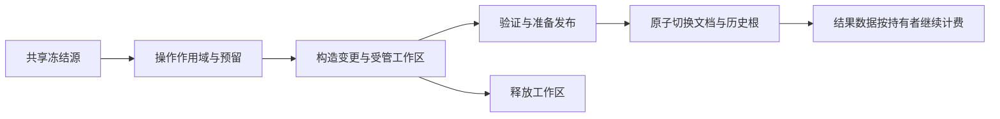

# 编辑内存与历史记录架构重构方案

状态：架构方案，尚未实施。日期：2026-11-04。

统一 Core、SDK 和 Runtime 的共享存储、编辑预算及历史保留计费，消除
`AUTHORING_MEMORY_LIMIT` 对整份文档大小的依赖。小操作支付实际新增分配和必要工作区；
确实需要全模型转换的操作支付对应的数据与索引成本。

历史记录按实际分配的数据块去重计算，并保留独立的步数上限。本方案同时定义
Undo/Redo 切换、保存基线更新和外部快照继续持有数据时的计费行为。

## 1 已确认决策

- 历史字节预算改为实际保留内存，撤销步数作为独立限制。
- 保留初始默认策略：单操作内存上限 64 MiB；每 Session 历史上限 256 MiB、50 步。
  Runtime 的全局额度与资源专项额度继续独立存在。
- 同一分配在宿主总账中只计一次。Document、Candidate、Plan、History 和 Preview
  增加共享持有者时，不重复收取记录内容的内存。
- Core、SDK Standalone、Python Local/Connected 和 Editor 使用同一套计费与准入机制。
- 项目尚未正式发布，直接替换旧接口和契约；不建立旧预算算法兼容层。
- 本次只交付方案。运行时实施按第 10 节分阶段推进。

## 2 当前实现与问题范围

| 当前入口 | 问题 | 重构方向 |
| --- | --- | --- |
| [AuthoringLimits](../../crates/zipzi-core/src/document/binding_authoring.rs) | 通用转换按 `retained × 6 + payload × 2` 计算，参数允许传入整份文档 | 删除该公式与接口，使用操作作用域和分配预留 |
| [普通绑定](../../crates/zipzi-core/src/document/binding_authoring/ordinary.rs)、[采样网格](../../crates/zipzi-core/src/document/binding_authoring/lattice.rs)、[BlendShape](../../crates/zipzi-core/src/document/binding_authoring/blend.rs) | 小型轴、采样点和绑定操作仍带入整文档 retained 成本 | 按变更记录、输出通道、转换工作区和报告统一申请 |
| [参数范围](../../crates/zipzi-core/src/document/binding_authoring/range.rs)、[换父级](../../crates/zipzi-core/src/document/binding_authoring/reparent.rs) | 保留内容大小与新增转换内存混用 | 冻结源共享，转换片段与验证工作区单独计费 |
| [场景编辑](../../crates/zipzi-core/src/document/scene.rs)、[创建父变形器](../../crates/zipzi-core/src/document/scene/grouping.rs)、[形状编辑](../../crates/zipzi-core/src/document/scene_content.rs) | 复制、分组和形状编辑还有整文档倍数检查 | 接入共同的记录写入与工作区接口 |
| [删除](../../crates/zipzi-core/src/document/deletion.rs)及其 parameter、leaf、migration 转换 | 普通对象删除已有专项估算，内部转换仍会进入旧预算路径 | 外层与子转换共享同一操作作用域，合并专项实现 |
| [RecordMap](../../crates/zipzi-core/src/document/record_map.rs)、[快照](../../crates/zipzi-core/src/document/checkpoint.rs)、[导出投影](../../crates/zipzi-core/src/document/binding_authoring/projection.rs) | 部分记录已共享；目录、其他记录和某些可写遍历仍可能复制无关数据 | 统一共享记录、目录及按需写入边界 |
| [SDK 历史](../../crates/zipzi-sdk/src/types.rs)、[提交](../../crates/zipzi-sdk/src/edit.rs) | 各 checkpoint 按完整逻辑大小计费，未对共享块求并集 | 使用历史根集合与实际分配身份计费 |
| [Runtime 计划](../../crates/zipzi-runtime/src/runtime/modeling.rs)、[写入](../../crates/zipzi-runtime/src/runtime/authoring.rs)、[总账](../../crates/zipzi-runtime/src/runtime.rs) | 宿主另加整文档倍数，并把持有者估算求和 | 宿主统一分配总账与配额；消费同一份操作预留 |
| [图片预算](../../crates/zipzi-project/src/resource_budget.rs) | 已有共享图片计费和准备/结果租约，但通用编辑内存仍以估算桥接 | 复用其预留及生命周期语义，接入公共父账本 |

上述为代码入口审计范围。此前“大肥鱼”验证覆盖 Manual Mesh 与普通对象/子树删除，
不作为其他转换路径已通过真实模型验证的依据。

## 3 计费口径与不变量

### 3.1 四个独立概念

| 概念 | 定义 | 用途 |
| --- | --- | --- |
| 文档逻辑大小 | 把完整模型视作独立值时的数据规模 | 诊断、导出与模型统计 |
| 活跃分配大小 | 按分配身份去重的受管 CPU 数据块及容器容量 | 全局内存准入与使用量 |
| 单操作峰值 | 操作期间同时存活的新增分配、临时工作区及新增结果 | 64 MiB 操作额度 |
| 历史保留大小 | 历史使 Session 额外保留的数据块及历史元数据，按分配身份去重 | 256 MiB 历史额度 |

“实际分配”统计程序掌握的布局、容器 capacity、共享控制块及受管分配元数据；
不等同于进程 RSS、系统 allocator 内部碎片或 GPU 驱动内存。边界外的解码器/库工作区
必须通过适配器提供可核验的容量上界，不能把未知开销记为零。

逻辑大小使用单独的值类型，不能传入操作内存准入 API。只读遍历涉及全模型，
不意味着复制了全模型；若遍历确实需要新索引或结果数组，则计入那些分配。

### 3.2 必须保持的不变量

1. 新分配和容器扩容先取得预留，分配成功后兑现；溢出和分配失败返回结构化错误。
2. 同一数据块在全局账本中仅有一个有效身份；跨阶段、跨根共享不重复计费。
3. 只读访问、筛选和删除目录项不触发内容复制；可写访问显式声明并收取复制成本。
4. 已兑现的预留转换成对应分配的持有费用，不同时保留两份全局费用。
5. 外部对象继续持有数据时，该数据的费用继续存在，不能随 Session/Job 注册项删除。
6. 嵌套转换与批量操作共享父作用域；费用取决于真实重叠生命周期。
7. 预算拒绝、取消、分配失败和过期计划不改变正式文档、redo、incarnation 或发布事件。
8. 验证正确性、锁检查、快照身份及原子提交继续成立；内存优化不提供跳过验证的权限。

## 4 分层职责

| 层 | 职责 |
| --- | --- |
| `zipzi-core` | 公共内存原语、共享记录与目录、分配清单、操作作用域、转换算法、受影响记录和验证依赖 |
| `zipzi-project` | 资源加载、图片/编码数据/解码工作区接入公共账本；保存和资源重定位保留持有关系 |
| `zipzi-sdk` | Session/Edit/Plan 的事务边界、历史策略、提交预留与 Undo/Redo 根切换 |
| `zipzi-runtime` | 宿主父预算、并发准入、Job/Plan/Preview 生命周期、客户端限额与总量报告 |
| `zipzi-contract` | 可序列化的限额、费用报告和错误字段；不包含 allocator、共享控制块或租约实现 |
| Editor/Python | 使用相同执行入口，显示额度、使用量与拒绝原因；不维护另一套模型成本公式 |

公共内存原语先放在 `zipzi-core::memory`，避免新增包与依赖环。
`zipzi-project` 已依赖 Core，图片预算可作为公共账本上的专项配额适配器。
Standalone SDK 创建本地父账本；Runtime 挂接同一接口的宿主父账本，不能重新计算文档倍数。
首版保持宿主全局额度默认值，Standalone 的本地父额度通过会话配置提供。

Standalone Session 被 Runtime 接管、资源跨池接入时，先在目标账本中原子登记分配清单，
成功后切换根的归属；不能仅替换预算指针而使既有块漏计。外部快照仍使用原预算域时，
保留对应域的持有记录；每个宿主域内部仍只收取一次。接入失败保留原 Session 与原账本。

## 5 共享存储与分配身份

### 5.1 记录与目录

内部持久内容统一采用不可变共享记录。Mesh、Transform、普通/BlendShape 绑定、Motion
之外，Part、Glue、Offscreen、参数、显示信息、EditorState、Pose、Physics 和 opaque 数据
也必须进入存储清单，避免遗漏仍会深复制的领域。

大数组作为可独立共享的数据块保存。修改名称或颜色不复制几何/关键帧数组；
修改某一形状只复制该形状需要写入的数据。公开 owned record 与 codec 保持值语义，
跨入内部存储时进行一次有预算的构造或接管。

记录目录和顺序容器支持页级结构共享。候选快照复用目录页，写入复制命中页与索引路径，
不再固定复制所有 HashMap bucket 和 key。封装层提供查询、过滤、移除与显式更新，
不向 planner 暴露裸可写集合或会隐式 detach 的 `values_mut`。
页大小和目录后端在阶段 1 通过 UUID 查询、批量删除、顺序调整和快照负载确定。

### 5.2 分配身份与清单

每个受管分配有独立 `AllocationId`、容量费用和生命周期 token。
身份不能由内容相等、文档对象 UUID 或可复用的裸地址单独决定。
相同内容的两次实际分配是两个块；两个快照引用同一块只计一次。

记录只拥有自身 inline/元数据费用，并引用子数据块清单，不能再次包含子块的完整费用。
容器扩容时对新旧分配同时存活的阶段预留峰值；实际分配容量确定后结算。
数据块不可变后费用固定，查询预算不扫描 positions、keyforms 或像素内容。

根和清单也需要计费。图遍历、去重集合、引用计数表及账本自身的容量不能成为未受限开销。
根登记与历史更新使用共享清单和变更集合增量处理；导入首次构建允许一次完整登记。

### 5.3 统一事务写入

`EditTransaction` 负责 `create/update/remove`，记录完整 WriteSet，
在复制前向操作作用域申请费用。更新封装为“读取原记录、构造新记录、验证、安装”，
避免先返回任意 `&mut T`、事后再估算。

WriteSet 包括创建、删除、修改和持久元数据；ReadSet/依赖信息用于验证与索引失效。
现有 tracking 只覆盖少量记录，必须逐领域扩展并保留完整性校验。
尚未具备增量证明的操作继续做有预算的完整验证；只读验证不复制无关模型通道。

## 6 单操作预算与执行生命周期

拟引入以下内部角色，具体签名随实施冻结：

| 角色 | 作用 |
| --- | --- |
| `MemoryPool` | 按实际分配身份记录活跃字节及未兑现预留，原子执行全局准入 |
| `MemoryScope` | 单操作及子操作的内存上限、取消与峰值统计 |
| `WorkspaceReservation` | 分配前取得的临时容量承诺，兑现后不与活跃分配重复相加 |
| `AllocationLease` | 随实际数据块存活，最后一个持有者释放后归还全局额度 |
| `PlanContext` | 冻结源、作用域、受预算约束的构造器、工作区及验证入口 |
| `PreparedPlan` | 快照身份、WriteSet、验证结果、已持有结果与后续发布需求 |



执行顺序：

1. 在复制输入、建立分析索引和创建候选之前建立作用域；输入展开和报告也受预算约束。
2. 共享冻结源，取得准确的 Session 版本和候选 sequence，逐项预留新增分配。
3. 子转换使用同一父作用域。先前结果尚存活时继续计费；已经释放的 scratch 可以复用额度。
4. 完成验证后准备发布清单和历史根变更，预留提交、回执、索引及事件的剩余需求。
5. 在不可失败的安装边界切换正式根和历史，再发布事件；安装后不再执行可能因预算失败的构造。
6. 工作区释放；已成为 Plan/Document/History 内容的块继续持有原分配费用。

64 MiB 约束的是操作期间新增分配的峰值，包含与 scratch 同时存活的新增结果，
共享源内容不再次计入。Plan 完成后保留的结果进入 retained plan 配额和全局总账；
不能把整个临时峰值永远挂在 Plan 上，也不能在结果接管前释放预留形成准入空窗。

取消请求不等同于工作线程已经释放内存。工作线程退出、工作区销毁或结果被明确接管后，
才能归还相应费用。外部 Rust Arc、Python 结果和后台快照与真实数据使用同一生命周期 token。

预算以块容量与可证明上界执行。第三方库无法逐项受控时，适配器在进入前预留完整上界；
无法给出边界的入口在实施清单中保持未完成状态。

## 7 历史按实际保留内存计费

### 7.1 去重与归属

每条历史时间线持有共享状态根和步骤元数据。当前游标决定哪些步骤可以 undo/redo，
不通过深复制在两栈之间搬运完整文档。`max_steps = 50` 限制保留的编辑步骤总数，
Undo/Redo 移动游标不产生新步骤；新提交保留当前分支并清除 redo。

令 `T` 为保留时间线全部状态根可达分配的并集，`M` 为步骤元数据，
`C(i)` 为游标位于状态 i 时正式文档与必须保留的 saved baseline 的分配并集：

```text
当前历史额外保留字节 H(i) = bytes((T ∪ M) \ C(i))
```

同一块被多条历史引用只计一次；与当前文档、saved baseline 共用的部分不重复作为
当前历史额外内存。计费包含目录页、记录、形状数组、历史元数据以及历史使其继续存活的
图片/编码资源。磁盘文件大小不等于内存费用；其内存描述符、缓冲和句柄存储仍需计费。

外部 Plan/Snapshot 对同一旧块的引用不从历史配额中扣除。这样释放外部快照不会突然使
历史超额；全局账本仍只计算该块一次。各持有者的诊断视图可能重叠，不能相加作为总量。

### 7.2 Undo 和 Redo 的容量保证

只限制当前 `H(i)` 会留下一个边界：添加大块内容后它属于当前文档，Undo 后它变成 redo
额外保留数据，可能让本来已接受的步骤无法双向执行。

历史准入因此同时计算已保留状态中实际可能出现的最大值：

```text
时间线所需历史容量 = max H(i)，i 遍历保留时间线中可到达的状态
```

256 MiB 限制该容量；报告同时提供“当前额外保留字节”和“时间线所需容量”。
两者都来自已分配块的身份和容量，不使用文档倍数或逐 checkpoint 累加。
时间线游标切换不会出现首次发现的大块 redo 费用。新增大块内容可能在提交时触及历史
上限，即使单次 Undo 的工作区很小，这属于保留双向历史所需的真实容量。

此保证针对历史保留配额。Undo/Redo 的少量执行工作区、回执与事件仍使用共同的
操作准入和发布边界，不能在切换正式根后才发现提交费用不足。

### 7.3 淘汰与原子性

新提交先模拟清除 redo、追加步骤及按时间顺序淘汰最早历史后的根集合，
同时检查字节容量和步数。只有提交整体成功才安装淘汰结果。
剩余历史必须连续，不保留跨越已删除前置状态的步骤。
单步所需容量仍超过上限时，拒绝该次可撤销提交；不自动发布为不可撤销编辑。

Undo/Redo、保存基线替换、历史资源重定位、清空历史和 Session 关闭都更新根归属。
保存成功后基线替换造成的历史归属变化，由同一策略进行连续历史淘汰并更新统计，
不把已经成功保存的文件回滚为失败。基线构造和保存工作区必须在保存发布前完成准入。
保存后的基线重算也覆盖保留时间线的容量保证。

淘汰历史可能降低历史配额使用量，却未必释放全局内存：外部快照仍在时数据继续计入
全局总账。内存压力下只回收可丢弃缓存与策略允许淘汰的历史；不能擅自使有效外部快照
失效，释放无效时返回包含 pinned 持有者信息的预算诊断。

## 8 Runtime 与公开契约调整

Runtime 把当前 candidate/frozen/plan/history 配额转为公共账本上的持有者策略，
全局 `accounted_bytes` 使用分配并集与未兑现预留，不再把每类完整文档估算相加。
保留 Session、Job、Plan、Preview 数量、采样组合数和分页条数等独立限制。
多个 Session 的共享资源在宿主历史总额度和全局总账中分别按集合去重，
不能简单相加各 Session 的重叠历史视图。

公共契约拟作以下破坏性调整，并统一更新 Rust、Runtime、Python schema/生成客户端和文档：

- `AuthoringLimits` 保留计算量限制，单操作额度明确命名为 `max_operation_bytes`；
  历史字节/步数统一归 `HistoryLimits`，移除转换器自行判断历史 retained 大小的字段。
- 替换语义混杂的 `ConversionCost`：分别暴露计算量、预计新增峰值、保留结果费用；
  费用报告不作为可复用的准入许可，实际执行必须持有效作用域/预留。
- `HistoryState` 区分 `retained_bytes`、`required_bytes`、undo/redo 步数及两个上限，
  删除把完整 checkpoint 相加的 `estimated_bytes` 语义。
- 内存使用报告区分活跃分配、未兑现预留、当前 retained 及作用域峰值；明确视图重叠规则。
- 保留可识别的 `AUTHORING_MEMORY_LIMIT`、`AUTHORING_HISTORY_LIMIT` 等错误类别，
  附带阶段、配额、当前使用、申请量、所需容量及主要数据类别。计算溢出保留独立错误。
- 取消 `check_conversion(retained_bytes)`、整文档倍率预算与独立专项预算公式。
  如果协议兼容性标识需要更新，随全链路切换一次完成。

现有图片额度保留对图片资源的限制语义，但图片活跃块、准备工作区和通用编辑分配
共享同一父准入；退役 `host_bytes + image_usage` 估算桥接，防止重复收费。
GPU 使用量仍由对应后端策略管理，本方案不把 CPU 字节报告解释为 GPU 总量。

## 9 迁移入口清单

下列入口必须全部完成；迁移过程中保留可查的完成状态，不用两个专项成功代表整体完成。

| 范围 | 必须覆盖的行为 |
| --- | --- |
| Manual Mesh | 单对象、连续拖动、多对象批量、依赖转移、计划持有与发布 |
| 普通绑定与采样网格 | 创建/删除绑定、增删轴、增删移动采样点、参数重映射、报告构造 |
| BlendShape | key table、constraint、binding、基准采样切换及约束清理 |
| 参数 | 范围/default 修改、轴降维、参数与参数文件夹删除 |
| 场景 | 创建、复制、复制绘制组、创建父变形器、换父级与保持子对象形状 |
| 形状内容 | Mesh/Warp/Rotation、Bezier、Warp 设置、原始形状捕获与恢复 |
| 删除 | 普通根、子树、DissolvePart、RemoveDeformer、采样点、业务记录及所有内部转换 |
| 动画与业务数据 | Motion、Expression、Pose、Physics、CDI/Model3、附件与 opaque 元数据 |
| 资源与投影 | 图片准备/替换、有效绑定导出投影、导入候选与保存资源重定位 |
| 执行入口 | Core、SDK Session/Edit/Snapshot、Runtime 同步/Job、Python Local/Connected、Editor |

与编辑源共享数据的 Preview、Observation、缓存和结果对象需要统一根登记与生命周期；
它们已有的算法专项工作区上界可以保留，不能再重复收取共享模型内容。

## 10 实施阶段与完成门槛

| 阶段 | 交付物 | 完成门槛 |
| --- | --- | --- |
| 0 清点与基线 | 固定代码版本、入口清单、当前倍率与复制点、默认限额、合成和本地模型负载 | 区分代码审计、成功执行、费用估算与分配实测；真实模型只在内存中操作 |
| 1 公共账本与存储 | AllocationId、预留/兑现/释放、持有者根、共享记录/数组/目录，确定目录后端 | 共享仅收费一次；新复制先收费；计数器/目录自身受限；增量更新不扫描无关通道 |
| 2 操作与发布 | PlanContext、事务写入、完整 WriteSet、验证工作区、发布预留，统一嵌套与批量 | 单操作内所有分配阶段被覆盖；预算/取消/分配失败保留最后接受状态和正式状态 |
| 3 历史 | 去重清单、时间线状态根、当前/最大所需容量、50 步策略、淘汰、Undo/Redo 与基线更新 | 大文档小修改不重复收取底层内容；双向历史容量有保证；外部 pin 不虚假释放 |
| 4 全入口接入 | 按第 9 节迁移所有领域及图片/源快照宿主计费，统一契约与 Python 生成 | 删除旧 API 使遗漏入口编译失败；源码检查无整文档倍率和无预算的 detach 旁路 |
| 5 验收与收尾 | 分配峰值、并发/故障回归、跨入口比较、默认策略下真实工程验证、文档更新 | 第 11 节全部通过，专项预算实现合并，旧兼容代码删除后再宣告架构重构完成 |

阶段 1—3 可先用代表性领域验证，但最终交付必须包含阶段 4、5。
保留现有有限预算保护，逐入口原子切换；不以临时无限预算作为迁移完成状态。

## 11 验收标准

### 11.1 存储与费用

- 相同内容的独立分配分别计费；跨文档/候选/历史的同一分配只计一次。
- 构造和扩容覆盖实际 capacity、新旧缓冲重叠、共享控制块、账本与去重清单成本。
- 测试保留大量无关网格、关键帧和 opaque 数据后的小修改；其新增内存随实际写入及
  目录路径变化，不按无关 payload 的总大小增长。
- 导出投影和筛选不复制无需修改的绑定；完整转换确实产生的大结果正常受限。
- 在声明覆盖的 CPU 分配边界内，作用域活跃分配峰值不超过兑现额度；隔离分配计数器
  对未接入的库工作区做适配器级校核，不能用 RSS 数字替代可重复的验收。

### 11.2 历史与失败

- 多步小属性修改复用大块数据；undo/redo 合计第 51 步触发连续历史淘汰。
- 多条历史共享同一旧形状只计一次；删除大对象、大量新增数据和图片替换覆盖双向容量。
- Undo/Redo 改变当前额外保留量时，已保留时间线仍满足所需容量；保存替换 baseline
  和重新打开资源也要覆盖该检查。
- 超预算、OOM 模拟、取消、过期计划、并发提交失败都不改变正式内容、redo 与事件序列。
- 淘汰后外部快照仍持有的数据继续计入全局；最后持有者释放后归还实际字节。
- 原子检查多个配额和多个预留，拒绝不留下部分扣费；销毁和重复释放不会泄漏或负计数。

### 11.3 入口与真实模型

合成用例逐项覆盖第 9 节，SDK Standalone、Runtime 同步/Job、Python Local/Connected
和 Editor 对相同操作使用同一准入结果，宿主额外收紧的全局/并发限制除外。

以本地“大肥鱼”工程验证：Manual Mesh、普通对象/子树删除、参数/采样点转换、
BlendShape、换父级、复制、创建父变形器及形状编辑。逐项记录计划与提交分配峰值、
费用清单、undo/redo 和默认额度下的结果；尚未执行的类别保持未验收。
不把未授权本地模型纳入仓库或 CI fixtures。

按阶段从受影响模块开始选择 focused gates，新增测试名称在实现时确定：

```sh
cargo test --locked -p zipzi-core --lib <affected_module>
cargo test --locked -p zipzi-project --test <affected_target> <filter>
cargo test --locked -p zipzi-sdk --test integration <affected_module>
cargo test --locked -p zipzi-runtime --test <affected_target> <filter>
env -u ZIPZI_DEV_SESSION_DIR cargo test --locked -p zipzi-editor-core --test integration <filter>
cargo test --locked -p zipzi-contract
uv run --locked python tools/test_tools.py -p test_python_codegen.py
./tools/test-sdk.sh python
./tools/test-sdk.sh python-connected
```

契约全面切换后执行 SDK/Runtime/Editor 的相关领域回归与桌面构建；不将一次 focused
gate 通过表述为全仓通过。原生 GPU/Windows 验收遵循各域现有前置条件。

## 12 范围边界与实施风险

本轮不改变工程文件格式、引入磁盘持久化历史、实现系统级 allocator/RSS 硬限制，
也不改变模型转换的数学语义。内存池、分配身份和租约不进入工程序列化。

主要风险是低估嵌套结构容量、遗漏导入/序列化临时数组、历史根重算代价、
跨线程资源接管与全局锁争用。通过统一构造边界、完整字段清单、增量费用缓存、
适配器分配测试及并发故障测试处理；冻结不可变块的字节统计不应在每帧重新遍历。

实施时若发现某领域无法证明分配边界或写入覆盖，将其作为明确的未完成项解决，
不退回整文档倍率，也不以提高默认额度关闭问题。
