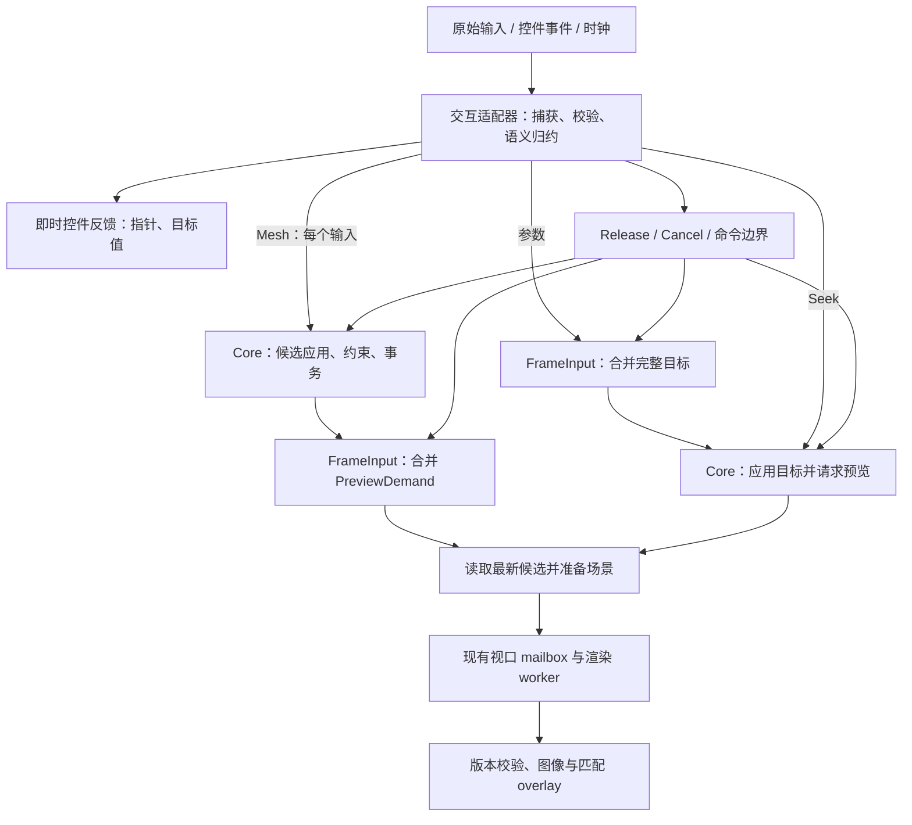

# Editor 密集输入调度架构

2026-11-10。设计依据为 `7dfe6c0`。Windows 和 macOS 的正式路径采用同一套策略。Mesh 保留逐事件候选并合并场景准备，参数轨道与双轴 Pad 使用 LeadingLatest。Seek 的鼠标移动和边缘滚动共用即时定位入口。Warp／Rotation 的候选优化直接生效。原始 Move 合并、Seek 延后应用和 F 的节奏实验已从运行代码移除，实测留在第 8 节。

[两个方向的深入研究](dense-input-two-directions.md)补充了源码调用链、9 份历史 trace 重分析和 24 个离线时序案例。研究后优先尝试 Mesh 保留逐事件候选、只合并场景求值；参数仍须在 setter 前合并。简单 ContinuousLatest 存在突发后长期多等一帧的反例，暂不作为默认替代。

实施方向是**按交互选择安全的合并位置，复用 LeadingLatest 调度，在操作边界同步收尾**。调度频率可以变化，操作结果、所有权和历史语义由交互本身决定。

| 决策 | 本 plan 的实施要求 |
|---|---|
| 默认节奏 | LeadingLatest：首个昂贵更新立即执行，后续合并；不承诺严格每帧一次 |
| Mesh 合并位置 | 每个输入继续更新合法候选；合并候选之后的场景准备需求 |
| 参数/Pad 合并位置 | 在 setter 前合并完整目标；setter 与随后的预览准备在同一次调度中完成 |
| Seek | Begin、Move、边缘滚动和 End 都即时定位 |
| 单次操作的等待 | 只设一处主节流点，不让输入、候选和 scene 各自再等一帧 |
| 严格限流 | 归档固定和自适应严格节奏的实验结果 |
| 修改范围 | 首批保留现有 Core 手势、Draft/历史与 worker 接收契约，不先全面重写工具系统 |

## 1. 现有证据与限制

历史 Mesh 样板在编辑起步后只保留最新 Move，窗口回调取出尾样本并开放下一轮。Shift 锁轴保留顺序，Up 使用自己的最终位置求值并提交。

[实验记录](../archive/benchmarks/2026-11-10-mesh-dense-input.md) 中，密集输入的请求数从 720 降至 358，更新间隔 P95 从约 33ms 降至 18ms，新预览接近 60Hz。普通输入请求数未减少。密集八点的位置差 P95 却从 27.74px 增至 37.16px，不能据此声称所有延迟和跟手指标都改善。测量止于 CPU 平台绘制返回，并非屏幕扫描完成；这些是实验版数据，不是本方案的性能承诺。

收益发生在 **Core 求值和场景准备之前**。[`request_preview_for_input`](../../crates/zipzi-editor/src/presentation.rs) 先调用 `preview_for_if_needed` 准备场景，再发送渲染请求；现有 [预览队列](../../crates/zipzi-editor/src/preview.rs) 虽会替换同视口的待处理请求，却无法收回之前已花费的主线程工作。

当前实现还有两个推广边界：

- 回调取尾样本后立即开放下一轮，下一输入可以再次求值，因此它不是严格的“每帧一次”。这是需要测量的延迟/工作量取舍；历史密集 trace 的 358 对推定尾→首场景间隔最短约 7.45ms，没有小于 4ms 的情况，不能认定紧邻重复是当前主要瓶颈。
- “绝对目标”不等于“可安全丢弃所有中间样本”。[`ControlGesture::update`](../../crates/zipzi-editor-core/src/tools/controls.rs) 在部分 `PreviewConstraint` 失败时保留最后合法候选。若序列为合法 A、合法 B、非法 C、在 C 松手，丢掉 B 可能改变最终保留的结果。当前普通轨迹测试没有证明这一类序列等价；推广前必须补证或缩小合并范围。

历史详细诊断中，Mesh 单点/八点的同步输入均值约 2.65/2.70ms，候选更新约 0.08/0.09ms，场景准备约 1.98/2.01ms；Warp/Rotation 的候选更新则约 2.27ms。这些数据决定先合并 Mesh 场景、后研究高成本候选的顺序，不作为新实现的性能承诺。参数 [`PreviewState::replace`](../../crates/zipzi-core/src/preview.rs) 会先完整求值再接受新值，必须在 setter 前合并，不能沿用 Mesh 的位置。

## 2. 分层与责任



| 层 | 负责 | 不承担 |
|---|---|---|
| UI 交互适配器 | 原始事件转为领域输入；捕获归属；修饰键、坐标基准和生命周期；即时反馈 | 跨领域猜测哪些命令可丢弃 |
| `FrameInput<K, S>` | 一个 owner 的 pending 槽、回调票据、调度状态；可承载完整目标或场景准备需求 | 执行 `EditorCommand`、管理 Undo、读取全局活动文档 |
| EditorCore 手势 | 阈值、锁轴、累计角度、路径、候选合法性、提交或取消 | GPUI、窗口帧率、平台时钟 |
| 预览与渲染 | 按失效范围准备场景，复用现有按视口合并和版本接收 | 将渲染完成当作用户编辑成功 |

纯状态模块 `crates/zipzi-editor/src/frame_input.rs` 由 `ViewportSurface` 和 `ParametersPanel` 各自持有槽并注册 GPUI 回调。捕获发现和清理复用现有机制。 [`InputRegion` / `CapturedInput`](../../crates/zipzi-editor/src/input_routing/region.rs)

同一组件支持两种接入位置。Mesh 的 pending 保存当前候选的场景准备需求，参数的 pending 保存完整目标。每个操作只有一处等待。

只有测量显示候选成本为主要瓶颈时，才在对应 Core 工具中拆分 `ingest → prepare → apply`。

## 3. 按语义选择归约方式

判断依据是“删去中间样本后，领域状态和收尾结果是否等价”，不能只按 MouseMove、Slider 或工具名称分类。首期实现完整目标的 `Latest` 和场景需求的合并；后者保留全部候选更新，由适配器合并 dirty 范围并携带最新 trace。下表用于领域分类，不提前建设 Fold/Ordered 的通用 trait 或队列框架。

| 类别 | 归约规则 | 适用场景与前提 |
|---|---|---|
| `Latest` | 同一操作、目标集合和语义阶段内替换旧目标 | 参数绝对值、Pad 完整双轴值；已证明路径无关的拖动 |
| `Fold` | 按原顺序更新轻量状态，保存完整累计结果 | 平移累计量、连续旋转的展开角度；夹取、吸附和坐标基准也必须按原语义处理 |
| `Ordered` | 保留有序路径/时间信息，或增量归约成等价领域状态 | 套索、笔刷覆盖、依赖压力和驻留时间的操作、保留最后合法候选的操作 |
| `Immediate` | 即时执行，不跨越边界合并 | Down、Release、Cancel、离散命令、文本提交、模式/选择变化、尚未证明可合并的更新 |

关键约束：

1. **Latest 必须是完整目标。** Pad 用一个 `(x, y)` 样本；不能用最后一次单轴命令覆盖另一轴。跨控件的参数 patch 不自动合并，确有同批语义才按稳定参数 ID 合成完整目标。
2. **Fold 不等于相加原始 delta。** 例如值 9、上界 10、先 `+5` 再 `-5`，逐次夹取的结果是 5，而先求和再夹取得到 9。移动缩放锚点、反向滚轮也会改变语义。当前 [滚轮导航](../../crates/zipzi-editor/src/viewports/navigation.rs) 已有插值与反向处理，不能直接套 Latest 或新增尾部插值。
3. **旋转先逐事件展开角度，再合并昂贵预览。** 现有 `RotationDrag` 累计相邻角度变化；只留终点会丢圈数。Shift 的首次锁轴同样先逐事件处理，锁定后才能判断后续目标是否可替换。
4. **Ordered 不允许无界积压或静默丢路径。** 优先把轻量路径处理与昂贵场景求值分开；确需排队时设置样本/字节上限，到限就按顺序消费一批，即使临时超出预览预算。路径简化须有独立误差契约和验证，不能因队列满而默认抽点。
5. **时间积分保持原分段。** [Inflate](../../crates/zipzi-editor-core/src/tools/inflate.rs) 使用 elapsed、固定步长和单次 elapsed 上限。不可把几个 tick 的总时长附在最后位置上；需保留位置随时间的变化和原有步进规则。
6. **约束失败属于语义。** 若合法性校验无法廉价独立完成，仍需逐样本校验候选，只合并后续场景准备。不得把“最后合法候选”悄悄改为“最后已调度合法候选”。Mesh 首期直接保留现有候选执行路径；如果某子类必须在输入之间读取当前求值场景，该读取构成同步求值边界，未经验证不延后。

## 4. 通用槽、票据与状态机

以下是调度接口的设计形状。首期由 `FrameInput<K, S>` 持有带 owner 和代次的票据，样本的 trace、批次信息和修饰键阶段由 Mesh 适配器维护。

```rust
struct Sample<S> {
    sequence: u64,
    input_trace: u64,
    received_at: Instant,
    semantic_epoch: u64,
    payload: S,
}

struct FrameInput<K, S> {
    owner: Option<K>,
    generation: u64,
    pending: Option<Sample<S>>,
    scheduled: Option<FrameTicket<K>>,
}

// offer_latest(owner, sample) -> ApplyNow / Retained，以及是否需注册回调
// offer_demand(owner, sample) -> 同一调度状态，适配器先合并失效范围
// take_for_frame(ticket)      -> Option<Sample<S>>
// drain_for_barrier(owner)    -> Option<Sample<S>>
// invalidate(owner)           -> 丢弃 pending，使旧票据失效
```

`K` 使用具体交互 token。Mesh 复用 `ViewportInteractionToken`，参数使用包含 document、控件实例和 capture serial 的身份。

Mesh 的 `PreviewDemand` 携带最新输入 trace 和批次计数。适配器从当前候选为受影响视口准备预览，利用现有 `DocumentSession::scene()` 共享缓存。参数使用完整值向量，Pad 两轴作为一个样本。场景范围由调用方合并。

`FrameTicket` 同时绑定 owner 和注册代次。即使旧手势和新手势落在同一控件，或者同一手势先清槽再注册，旧回调也不能清除新 pending 或新 scheduled 标记。失效先更新本地代次，再做可能触发订阅的领域清理；执行样本前先从槽中取走，避免通知重入时重复应用。

默认调度复制当前样板的 **LeadingLatest** 节奏。下表的“应用”指执行所选合并位置之后的工作：Mesh 是准备 scene，参数是 setter 加预览准备；不是统一延后原始输入。

| 状态/事件 | 动作 |
|---|---|
| 尚未起步或不能证明可合并 | 适配器即时处理，直到 Core 明确进入可归约阶段 |
| 未登记回调 + 可合并更新 | 立即应用，登记一次下一帧回调 |
| 已登记回调 + 同语义更新 | 完整目标替换 pending；PreviewDemand 合并 dirty 范围并更新 trace；保留原回调时机 |
| 匹配的帧回调 | 清除该票据，取最新样本，重新校验后应用；恢复允许 leading 的状态 |
| 不匹配的回调 | 完全不操作当前槽 |
| 边界事件 | 按下一节同步 drain、最终应用或失效，不等待回调 |

Latest 每槽最多一个 pending、一个有效回调票据。有限的旧闭包可能仍存在于 GPUI 队列中，但只能成为无操作回调。不得在每次 Move 都注册闭包或重置 timer。

帧回调只是一次调度机会，不是 GPU 完成或显示完成信号。当前 vendored [GPUI 帧循环](../../vendor/gpui-fast/src/window.rs) 在该轮 draw/present 之前执行回调，回调中再登记的工作留给后续轮次；测试用 `simulate_next_frame` 驱动。不硬编码 16ms，不修改平台事件循环。窗口隐藏/销毁按生命周期清理，不能依赖一个可能暂停的帧源收尾。

执行前的适配器校验包括：弱实体仍有效、token 仍属于该操作、目标文档/控件/绑定仍有效、语义阶段匹配、当前没有阻塞状态。Core 继续验证 Draft/Version 与外部发布冲突；不能把自身正常预览造成的 revision 变化一律判断为过期，也不能只验证“还是同一 document”。

## 5. 边界与最终一致性

通用层只提供 drain/invalidate，具体交互决定收尾。正常释放和生命周期清理必须使用不同入口，不能依赖一条可能发出 Release 的清理函数。

| 边界 | 处理规则 |
|---|---|
| 正常 Release，携带完整最终目标 | Latest 使回调失效，使用最终目标同步应用并结束；仅在覆盖等价已成立时可丢 pending |
| 正常 Release，没有最终值 | 同步消费 pending 后结束；Ordered/Fold 先消费未结算信息，再完成领域收尾 |
| 修饰键、吸附模式变化 | 若旧阶段仍有效，先 drain 再处理边界，增加语义代次；锁轴/累计状态依旧按事件顺序更新 |
| 布局、相机、时间范围变化 | 适配器按领域规则冻结基准、重投影或取消；不得用新坐标基准解释旧样本而不声明 |
| Escape、失焦、模态阻塞、目标删除、实体销毁 | 立即使槽失效；沿用领域的取消/保留策略，不偷偷提交未应用输入 |
| Save、Undo/Redo、选择/工具/文档切换 | 在旧操作仍有效时，按既有编辑生命周期先 settle 或 cancel，再执行命令；不得让命令先结束 Core 编辑而 UI 还持有延迟写入 |
| 外部 Runtime 发布导致捕获过期 | 丢弃旧 pending，经现有冲突/取消路径处理；不向新版本强制补写 |
| 应用失败 | 保留领域原有报错、最后合法候选或回滚规则；失效 token 时清槽，不能自动重放到新操作 |

历史仍由领域管理：Mesh 一次拖动最多一次历史提交；参数预览和播放头定位不因此新增 Undo 步骤。Release 必须完成模型/时间状态的收尾，但无需同步等待 GPU；最终预览请求走原有异步路径，后续不再有旧输入写回。

场景需求另有必须覆盖的规则：B 已成功、scene 尚未准备，随后 C 被拒绝，即使 C 返回 `model_changed=false` 也不能清除 B 的 dirty。Release 没有产生新候选变化时，仍须处理已存在的 dirty；取消则先撤销需求，再回滚和请求正确画面。参数 Release 与 applied 比较，不能因为等于控件当前 desired 就跳过未应用的最终值。

控件显示区分三个状态：`desired`（用户当前目标）、`applied`（Core 已确认）、`presented`（已接收的画布版本）。滑块/数字可以即时显示 desired，模型图像与编辑 overlay 必须继续来自同一个已接收帧。失败或失效后恢复领域认可的值；不能为了视觉跟手，把新顶点 overlay 叠在旧模型图像上。

继续沿用当前连续手势/参数预览/动画 scrub 的中间帧接收规则，不要求 presented 必须等于最新 desired。否则输入始终快于 worker 时可能没有任何结果可显示。手势结束与外部版本失效仍按原有精确终态和接收边界处理。

## 6. 接入位置与顺序

### 6.1 Mesh：逐事件候选，合并场景需求

从 `mesh_move_frame` 的周期管理提取通用调度状态，新增 PreviewDemand 接入；原 `pending_mesh_move` 路径保留为独立实验对照，不直接升级为全部 Mesh 的默认路径。每个 Move 继续调用现有 `update_canvas_gesture_with_modifiers`，完整保留阈值、Shift、累计状态、候选合法性、错误处理和投影失效。

在 `apply_modeling_input` 的结果处理与 `redraw_canvas_for_input` 的昂贵请求部分之间拆出局部入口：

| 入口职责 | 行为 |
|---|---|
| 处理输入结果 | 即时更新 capture、错误、notice、状态栏和必要控件反馈 |
| 登记交互场景需求 | 首个有效需求立即准备；后续只标记 dirty 并保留最新 trace |
| 回调准备场景 | 校验 token 后读取当前候选，为受影响视口准备并发送请求 |
| 正常收尾 | 撤销旧票据，应用释放位置并完成领域提交，再处理终态预览需求 |
| 取消清理 | 清除需求与旧票据，沿原领域回滚路径重绘 |

不整体延后 `redraw_canvas` 或 `redraw`，它们还包含反馈、Runtime EditorContext、视口、动画时钟和通知等职责。不冻结 scene/projection revision，不跳过 `reconcile`。新主路径的候选次数保持逐事件语义，scene 次数才是应下降的指标。

Windows 原生对照验证了不限流、原始 Move Latest 和 PreviewDemand 三种路径。正式路径采用 PreviewDemand。实验数据见第 8 节。

### 6.2 参数轨道与双轴 Pad：第二个消费者

- 轨道和 Pad 各自把指针事件转换为 Begin、Change、Release 和 Cancel。SlideNumber 和文本提交保持即时。[拖动生命周期](../../crates/zipzi-editor/src/panels/parameters/drag.rs)
- Begin 即时处理属性输入准备、参数焦点等边界副作用；Change 更新 desired，并将完整目标送入 Latest。Pad 两轴一次 `SetPreviewParameters`，不能分两次求值。
- 合并发生在 `set_preview_parameters` / `PreviewState::replace` 之前；一次调度执行 setter 和随后预览准备，不再给 scene 增加一轮等待。输入端先验证有限值、范围和目标身份；对求值失败/恢复的样本序列明确契约并测试，不能把跳过中间错误当作已证明等价。
- `update_rows` 在当前 capture 有未确认 desired 时用 desired 刷新控件。setter 确认按 sample sequence 对齐，跨文档或结构变化时清除 desired 并从新状态重建。[参数回写](../../crates/zipzi-editor/src/panels/parameters/sync.rs)
- Release 使用最终控件值；Pad 明确从释放位置生成完整双轴目标。布局重建、过滤/隐藏、失焦、取消都使旧 token 失效，不通过 `handle_release` 意外补写。
- 延迟执行前在 Runtime 同步之后复核编辑上下文、模型版本、预览版本、选择和其他编辑的所有权。实际预览值写入也核对 Runtime 版本。[Core 入口](../../crates/zipzi-editor-core/src/workspace/lifecycle.rs)

每次求值接受或拒绝整个目标。被覆盖的中间目标可以跳过求值及其错误。实际执行的目标如果失败，继续使用上次成功的参数和画布，控件恢复到已应用值，后续合法输入可以恢复该拖动。

### 6.3 时间轴 Seek

Seek 按下时暂停并定位。鼠标移动与边缘滚动共用 `seek_to_pointer`，按当前标尺、时间范围、时长、帧率和吸附状态即时定位。应用前校验 scrub token 和模型版本。松手按本次释放位置和当前映射同步定位。 [Seek 入口](../../crates/zipzi-editor/src/panels/timeline/seek.rs) · [Core scrub 身份校验](../../crates/zipzi-editor-core/src/timeline/identity.rs)

边缘计时器从按下开始驱动平移，时间范围改变后按当前指针位置重算。 [边缘滚动](../../crates/zipzi-editor/src/panels/timeline/navigation.rs)

播放头拖动与正常播放使用不同语义。正常播放按时钟推进，不能改成“播放每个积压输入”。关键帧/Bezier handle 拖动另行验证约束、吸附、碰撞和单次历史后再接入。

### 6.4 高成本候选、路径与累计操作：按瓶颈推进

Core 中按操作逐步引入 `ingest(event)` 与 `apply_preview(intent)` 的内部边界：前者维护阈值、锁轴、圈数、路径和时间，后者生成候选。不能假设所有 ingest 都廉价，也不要求一次性重写全部工具。

对必须逐样本生成候选才能判定合法性的操作，先合并后续场景准备；对能用累计状态完整表达的操作，再合并候选生成。每项分别证明等价并计数测量。终态投影到最近合法解可以作为未来领域规则设计，但属于交互语义变更，不能伪装成调度优化。

Warp/Rotation 优先按“首次启动 → 逐事件摄取 → 准备/校验 → 应用候选”拆分，分别记录 last_ingested 与 last_applied。几何逆解成功不代表所有 SDK 写入均已验证；若合并准备结果，必须分开 latest_valid_prepared 与 latest_feedback，保留拒绝 C 后应用合法 B 并显示 C 约束的语义。

E 的首轮原生诊断将瓶颈定位到场景绑定规范化。参数驱动的 Warp 拖动准备并写入单个关键形，Rotation 复用同一个关键形入口。候选已验证时，Core 解析采样坐标并校验本次的关键形载荷，复用现有轴、采样网格和评估布局。遇到依赖或结构变动时重新走完整校验。拖动继续逐事件生成候选，因此角度累计、约束错误、松手和 Undo 沿用原有顺序。

套索当前主要记录路径，在完成时区域选择；选择笔刷逐段遍历候选并累计权重，先测 overlay/通知和遍历开销。Inflate 已有帧驱动 BrushTick，不增加第二层帧限流。三者不因通用组件可用就自动接入。

## 7. 更优调度的候选与取舍

### 7.1 首选：先减少重复工作，而非继续降低输入频率

深入研究确认 Mesh 已有惰性 scene 边界，首个实验不必先重构 `ingest`：每个 Move 继续维护合法候选，只调度 `request_preview_for_input` 的昂贵部分。历史 Mesh 诊断中场景准备约占同步输入的 75%，但参数 setter 内部已完整求值，不能复用同一个合并位置。具体成本与接口见[深入研究第 2 节](dense-input-two-directions.md#2-方向一逐事件语义与昂贵工作分离)。

第一轮按第 6 节做局部改动：Mesh 候选在每个输入时执行，PreviewDemand 在回调里准备当前场景；普通稀疏输入仍即时准备。无需先建立 Ordered 队列，也不把全部候选积到回调中重放。更广泛的局部预览批次只在后续确有多来源同批工作时增加。

### 7.2 实验项：尾样本也占用下一轮额度

以下是已归档的 `ContinuousLatest` 实验定义。实验固定合并位置，独立比较调度节奏。

1. 空闲后的第一个有效更新仍立即执行并登记帧回调。
2. 回调有 pending 时应用最新值，但保持节流状态并再登记一轮；该轮到来前的新输入只覆盖 pending，不再次 leading。
3. 回调无 pending 时退出节流状态，不再登记；下一输入重新享有立即执行。
4. Release/Cancel/语义边界仍即时，不受额度限制。

该状态机在持续密集阶段将常规应用压到每帧回调一次，但减少一次 leading 不等于消除一次无用计算；它可能失去本可赶上显示的响应机会。首次起步、同步边界不受严格次数上限约束。回调产生的新请求还需经过 scene 和 worker，不能假定一定赶上该轮图像采纳。

后续离线研究已构造稳定反例：一次起步突发后恢复 60Hz 输入，两策略都每秒应用 60 次，但 Continuous 可持续增加约 15.67ms 等待。历史密集实验的 358 对尾→首场景间隔也没有小于 4ms 的情况，不能认定当前主要问题是紧邻重复。保留该策略作为对照实验；若做过载自适应，必须以原始输入密度等独立信号退出，不能只等 pending 为空。详见[深入研究第 3–4 节](dense-input-two-directions.md#3-方向二更严格的帧调度)。

F 首轮把合并位置固定在 Mesh 的场景准备。已有 Windows 四事件突发记录中，714 次场景准备有 357 次来自 leading，这些 leading 请求都没有关联到 CPU 侧的画布绘制。这为独立节奏对照提供了测量依据。

F 第二轮对照了按输入密度切换的节奏。一个帧回调周期内至少收到三个 Move 且有待准备的场景时进入严格节奏，进入后每周期两个 Move 就能维持。首个只有零到一个 Move 的周期处理完尾样本便开放即时起步。计数在场景合并前采集，每次回调清零。释放、取消、修饰键切换和捕获失效一并清除计数和票据。

短冷却仅在证实存在短间隔重复时研究：以最近昂贵工作结束时间为基准，合并很短窗口内的需求，截止点不随输入重置；帧与 timer 共用一个 pending 和代次去重。现有数据不支持先引入这一机制。截止时间调度则需可靠的帧 deadline 与阶段成本估计，当前 `on_next_frame` 本身不足以支撑。

### 7.3 只有持续超预算时才加入预算和后台求值

帧合并无法解决单次求值本身超过帧预算的问题。进一步工作分为两种：

- **窗口预算：** 若多个活跃来源仍挤占主线程，在窗口内增加只管理可执行资格的轻量协调器，领域 pending 仍归实体所有。轮转处理 owner，使用等待年龄避免饥饿，预留 UI 绘制时间；同步收尾优先。帧周期与耗时取实测估计，不绑定 60Hz。非抢占的单次重计算仍可能超预算，不能宣称硬实时保证。
- **后台候选：** 只对支持不可变快照计算的领域开放。每个 owner 最多一个运行任务与一个最新待处理 intent，任务携带 owner、generation、sequence 和基准版本。可安全取消时协作取消；不可中断的任务完成后按现有版本/所有权规则验收，过期结果不发布。结果接收后才推进 applied；Release 完成或明确等待最终目标，不能把“已入队”当作提交成功。

渲染 worker 的繁忙程度仅作为拥塞信息，不能把 GPU 完成作为所有输入、命令和取消的硬门闩。保持现有多视口 mailbox、公平性和图像/overlay 版本契约；不要同时叠加多个不可见的等待队列。后台求值不是首批推广的前置条件。

## 8. 验证与观测

### 确定性正确性和工作量

- 通用状态机：首个有效工作即时；完整目标只应用最新、场景需求合并全部 dirty 范围；无新输入也会处理尾部需求；重复/旧票据无效；invalidate 后同 owner 重启仍隔离；回调中通知重入不重复应用；两个 owner 互不覆盖。
- 真实控件入口：Mesh 阈值、Shift 早期锁轴及切换；参数轨道、Pad 两轴、数字输入；Seek 暂停、吸附、边缘滚动和释放位置；区分各自历史契约。
- 生命周期：pending 后 Release/Cancel、焦点丢失、模态、隐藏/重建、文档切换、目标删除、Save/Undo、外部发布冲突。既验证没有旧值写回，也验证最终操作确实完成。
- 语义差分：对同一原始轨迹运行不限流与归约版本，比较最终文档/候选、累计量、选择、错误/约束状态、历史与 Undo。重点加入合法 A/B 后非法 C、回到边界、越界再反向、旋转跨 ±π/多圈、笔刷驻留与折线路径。
- dirty 收尾：合法 B 待显示、非法 C 返回未变化时需求仍存在；Release 没有新模型变化时仍提交并请求最终画面；参数 Release 等于 desired 但不同于 applied 时仍执行。
- 确定性计数：分别统计输入、语义摄取、候选求值、场景准备、渲染请求。同步边界与起步单独计数；不把 LeadingLatest 写成“每帧至多一次”的错误断言。计数降低必须同时满足终态正确。

Mesh PreviewDemand 验收应看到候选语义按原序保留、scene 次数降低；参数验收应看到 setter 内求值次数降低。`evaluation_count()` 是 scene 缓存缺失计数，不能用它代替候选次数。基础策略测试与未来严格策略实验分开，后者必须覆盖“一次突发后恢复每帧一个输入”的持续等待反例。

纯状态单测放新模块；控件接入测试放 Editor `headless_tests` 对应域；Core 语义测试留在受影响模块。先按根 `AGENTS.md` 的 focused gates 运行，不为文档修改跑完整 Editor/SDK 套件。现有 Mesh 样板测试见 [tools_selection.rs](../../crates/zipzi-editor/headless_tests/canvas/tools_selection.rs)。

### Native 性能对照

复用 [Windows 基准](../../tools/benchmarks/README.md)，新增参数、Pad 和 Seek 的真实入口轨迹。实验分两轮，不在同一对照里同时改变合并位置和调度节奏：

1. **先比较合并位置。** 固定 LeadingLatest 节奏，对照 Mesh Off、现有原始 Move Latest、新逐事件候选 + scene 合并；参数/Pad 对照 Off 与 setter 前完整目标合并。先通过语义验证，再比较性能。
2. **有证据再比较节奏。** 固定第一轮选定的合并位置，才对照 LeadingLatest、ContinuousLatest，以及必要的短冷却/过载策略。第二轮不是首批推广的前置条件。

固定模型、窗口、GPU、刷新率和墙钟轨迹，分开编译与测量，交替运行并重复。覆盖稀疏、稳定高频、四事件突发、突发后恢复单次输入、帧边界输入、慢求值和多视口；不同显示刷新率分别测，macOS 单独验证。报告实际到达率，不能把 benchmark 配置的 HZ × burst 当作实际输入率。

trace 记录 owner/序号、原始输入时间、入槽/替换、归约数量、flush 原因、语义摄取、候选准备/写入、帧回调开始/结束、场景准备、请求、接收和 CPU 提交。合并后沿用最新需求所对应的原始 input trace，同时保留该批最早未处理时间，避免只计最后样本而掩盖等待。路径批次记录序号范围和样本数。尾回调中的工作也计入每秒主线程工作量，不能只用 input_sync_ms 的下降声称 CPU 工作减少。

验收同时看：每秒候选/场景次数、主线程耗时、首次响应、输入到应用/CPU 提交 P50/P95/P99、更新间隔、最长停顿、最终 Release 延迟。另按墙钟采样已显示姿态年龄和位置误差，包含两次新帧之间旧姿态停留的时段；CPU trace 与屏幕观感分别记录。

验收要求语义差分通过，并分别报告普通与密集输入下的稳定性、位置误差和尾延迟。具体性能容差在测量前为各 workload 固定。正式路径按 Windows 实测和手动反馈收敛，macOS 原生验收随后进行。

#### Windows 首轮对照

同一 Release 二进制、D3D11 和 Mao 模型。三个模式交替运行普通和四事件突发的宽幅八字轨迹，每组两次，每次各测 360 个单点和八点 Move。下表是密集组的两轮中位数，斜线两侧分别为单点和八点。时间边界为 CPU 平台绘制返回。

| 模式 | 实际 Move/s | 候选处理次数 | 预览请求次数 | 新预览间隔 P95 (ms) | 运动位置差 P95 (px) |
|---|---:|---:|---:|---:|---:|
| 即时 | 205.7 / 204.6 | 360 / 360 | 360 / 360 | 37.26 / 31.90 | 28.80 / 28.31 |
| Move Latest | 245.1 / 232.2 | 175 / 174 | 175 / 174 | 18.05 / 24.51 | 36.52 / 39.74 |
| 场景需求 | 237.7 / 238.4 | 360 / 360 | 178 / 179 | 19.75 / 19.30 | 34.68 / 34.30 |

新路径的候选处理加场景准备耗时从约 374 / 370 ms/s 降至 251 / 257 ms/s，已包含帧回调内的对应工作。松手至当前画面为 22.44 / 25.67 ms → 24.12 / 24.07 ms。普通组实际约 63 Move/s，三个模式均请求 360 次，场景需求与即时路径的运动位置差 P95 相差不到 0.4 px。密集组的位置差回退约 6 px。原始 trace 和汇总位于本机 `target/mesh-scene-scheduling/`。本轮覆盖单个 Windows 环境和两类轨迹，第 8 节的其余原生条件留待后续验证。

#### 参数轨道和 Pad 的 Windows 对照

同一 Release 二进制、D3D11 和 Mao 模型，通过原生窗口的轨道和 Pad 注入普通输入与四事件突发。每个组合交替测两轮，每轮 240 个 Move，共 16 轮。两模式的最终值、显示形变和历史检查均通过。下表为密集组的两轮中位数，箭头从即时模式指向 LeadingLatest。

| 控件 | 实际 Move/s | setter 与预览请求各自次数 | 输入及帧回调 CPU (ms/s) | 新预览间隔 P95 / P99 (ms) | 松手至当前画面 (ms) |
|---|---:|---:|---:|---:|---:|
| 参数轨道 | 223.3 → 237.7 | 236 → 120 | 410.4 → 274.5 | 32.55 / 41.66 → 33.03 / 33.47 | 11.82 → 12.43 |
| 双轴 Pad | 211.0 → 237.7 | 240 → 120 | 417.2 → 276.6 | 32.67 / 47.61 → 33.48 / 38.38 | 12.31 → 17.15 |

普通组实际约 63 Move/s，两模式的 setter 次数一致，关联到新预览的输入延迟 P95 在 17.44–17.66 ms。密集组的 Pad 在相关 CPU 绘制返回处的位置差 P99 从 0 增到 3.65 px。密集组前端工作量下降，Pad 松手延迟增加约 4.8 ms。采用共同的轨道和 Pad 路径时接受这一取舍。原始 trace、二进制哈希与汇总在本机 `target/parameter-drag-scheduling/final/`。

#### Seek 的 Windows 对照

同一 Release 二进制、D3D11 和 Mao 的 Natural Timeline 夹具。普通与四事件突发各跑即时和 LeadingLatest 两轮，每轮测量 240 个 Move。八轮均验证松手同步定位、对应画面到达及曲线与历史一致。下表为密集组的两轮中位数。

| 模式 | 实际 Move/s | scrub 更新 / 预览请求 | 主线程输入及尾回调 (ms/s) | 输入到关联预览 P95 (ms) | 新预览间隔 P95 (ms) | 松手至当前画面 (ms) |
|---|---:|---:|---:|---:|---:|---:|
| 即时 | 124.5 | 240 / 240 | 54.41 | 68.93 | 36.96 | 42.75 |
| LeadingLatest | 117.9 | 120 / 120 | 25.52 | 121.36 | 42.48 | 63.30 |

普通组实际约 33 Move/s，两种模式均应用 240 次。关联预览延迟 P95 为 98.16 → 98.57 ms，新预览间隔 P95 为 34.29 → 34.00 ms。密集组相关 CPU 绘制返回处的指针位置差 P95 为 254.23 → 287.70 px。密集组的预览和松手延迟增加，正式路径采用即时定位。原始 trace、二进制哈希与汇总位于本机 `target/timeline-seek-scheduling/`。

#### Windows 手动 A/B 体验

2026-11-10，使用同一 Release 二进制、D3D11 和 Mao 工程，对照即时处理与启用 Mesh、参数／Pad 和 Seek 调度的窗口。手动体验中，Mesh 顶点移动的改善最明显，参数轨道拖动也明显改善，时间轴 Seek 的体感接近。

#### E · Warp／Rotation 候选写入的 Windows 对照

Windows D3D11 和 Mao 模型，前后两个 Release 构建交替运行。普通和四事件突发分别跑两轮，每轮每种控件测量 120 个 Move。各组都生成 120 次预览请求，并通过松手追上最终候选、提交和 Undo 检查。单独的 180 样本突发诊断中，绑定规范化从每个 Move 两次降到零次。候选阶段均值从 Warp 的 1.99 ms 降至 0.18 ms，Rotation 从 1.92 ms 降至 0.17 ms。

| 控件 | 普通单次同步耗时 P50 (ms) | 突发单次同步耗时 P50 (ms) | 突发画面姿态年龄 P95 (ms，墙钟采样) |
|---|---:|---:|---:|
| Warp | 4.49 → 2.59 | 4.45 → 2.56 | 43.05 → 43.00 |
| Rotation | 4.36 → 2.55 | 4.32 → 2.61 | 43.46 → 43.33 |

普通组的姿态年龄 P95 也下降，Warp 为 42.38 → 38.33 ms，Rotation 为 41.87 → 35.84 ms。突发组的实际到达率约 128–131 Move/s，Rotation 输入到关联画面的 P95 从 14.99 ms 增至 20.40 ms。该指标只统计关联到新画面的输入，每轮约 30 个样本。按 1 ms 采样已提交姿态的年龄时，两组的密集拖动表现接近。这里的画面提交边界为 CPU 平台绘制返回。

#### F · Mesh 场景合并位置固定时的节奏对照

同一 Release 二进制、D3D11 和 Mao 模型，固定逐事件候选与场景合并。LeadingLatest 和 ContinuousLatest 各测两轮持续四事件突发、两轮起步突发后逐次投递，每轮分别测单点和八点各 240 个 Move。所有轮次保持 240 次候选处理并通过松手和 Undo 检查。下表为持续突发的两轮中位数，箭头从 LeadingLatest 指向 ContinuousLatest。

| Mesh 拖动 | 场景请求数 | 场景准备 CPU (ms/s) | 新预览间隔 P95 (ms) | 墙钟姿态年龄 P95 (ms) | 松手至当前画面 (ms) |
|---|---:|---:|---:|---:|---:|
| 单点 | 118 → 58.5 | 228 → 127 | 22.66 → 18.56 | 30.50 → 30.58 | 25.46 → 31.06 |
| 八点 | 119 → 58.5 | 226 → 126 | 26.42 → 17.94 | 31.29 → 30.47 | 23.57 → 26.26 |

单点的墙钟指针位置差 P95 为 68.13 → 71.39 px，八点为 71.42 → 71.09 px。恢复组实际约 54–56 Move/s，场景请求约 240 次，两种节奏的墙钟姿态年龄与位置差接近。这组实测覆盖的是该 Windows 投递节奏，离线反例覆盖固定帧相位。持续突发的单点松手延迟增加 5.60 ms，超过测前设定的 15% 容差。E、F 的原始 trace、运行配置、容差、二进制哈希和汇总在本机 `target/dense-input-ef/`。

#### F · 自适应节奏与恢复验收

在同一 Windows D3D11 Release 和 Mao 模型上，LeadingLatest、ContinuousLatest、自适应节奏分别交替跑三轮持续四事件突发和两轮恢复，共 15 轮。恢复组先发 24 个四事件批次，再逐次投递 240 个测量 Move。每种节奏都保持逐事件候选，松手同步提交，之后可 Undo。以下持续突发结果为三轮中位数，箭头从 LeadingLatest 指向自适应。

| Mesh 拖动 | 场景请求数 | 场景准备 CPU (ms/s) | 新预览间隔 P95 (ms) | 墙钟姿态年龄 P95 (ms) | 松手至最终画面 CPU 提交 (ms) |
|---|---:|---:|---:|---:|---:|
| 单点 | 119 → 56 | 216.87 → 114.29 | 19.68 → 18.00 | 28.80 → 30.19 | 23.56 → 24.75 |
| 八点 | 119 → 57 | 224.62 → 116.29 | 19.64 → 17.86 | 28.62 → 30.29 | 23.52 → 24.94 |

持续突发的实际到达率约 241–255 Move/s。自适应的墙钟位置差 P95 从 67.36／66.12 px 增至 68.69／69.24 px，输入到关联画面 P95 从 13.97／13.82 ms 增至 15.68／15.89 ms，八点接近 15% 容差。松手后的最终预览约 3.2–3.8 ms 即已发布，较长的等待主要发生在发布到 CPU 绘制返回之间。以 CPU 绘制返回与画布身份轮询分别比较，两项松手时间均在预设容差内。

恢复组实际约 56 Move/s。自适应在起步密集段重挂了 23–24 次严格帧回调，逐次投递段重挂为零，仍有 240 次场景请求。固定严格节奏在同一逐次投递段重挂的中位数为 47.5／49.5 次。确定性的单 Move／帧测试也验证了第一个稀疏帧即退出，下一输入立即执行。恢复段自适应的输入到关联画面 P95 为 18.18／17.04 ms，LeadingLatest 为 18.98／16.97 ms。

自适应节奏通过这一组 Windows 容差，八点关联延迟接近上限。正式路径采用 LeadingLatest，实验代码已移除。原始 trace、配置、容差、二进制和汇总位于 `target/dense-input-f/`。

## 9. 分批落地

通用槽测试覆盖 leading、尾样本、合并与旧票据隔离。Mesh 入口测试覆盖合法候选后跟约束失败、同步松手提交、取消回滚与场景准备计数。参数入口测试覆盖首个有效目标、双轴原子更新、控件回写、同步松手、失败恢复和捕获失效。Seek 入口测试覆盖即时按下、移动与松手、吸附和映射重算、静止指针的边缘滚动，以及 Escape 和失焦释放捕获。

E 已减少参数驱动的 Warp／Rotation 候选验证成本。F 已完成固定合并位置的严格节奏和自适应节奏实验，以及突发恢复验收。

移除开关后的 Windows D3D11 Release 冒烟测试用 Mao 模型各发送 180 次 Move。Mesh 单点和八点分别发出 90 和 88 次场景请求，参数轨道与 Pad 分别执行 88 和 86 次 setter，Seek 即时应用全部 180 次移动。原始 trace 位于 `target/dense-input-defaults/`。

| 阶段 | 交付 | 完成条件 / 后续依赖 |
|---|---|---|
| A：基线与通用状态 | 补齐最后合法候选、dirty/Release 与旧回调测试；提取 LeadingLatest 槽和票据；分开候选/scene/回调计时 | 默认即时路径语义清楚，旧样板作为独立对照，调度测试通过 |
| B：Mesh 场景合并 | 所有输入保留 Core 候选路径；新增 PreviewDemand 和局部请求入口；三模式原生对照 | 约束/锁轴/历史一致；scene 工作减少；普通与密集响应均按第 8 节验收 |
| C：参数与 Pad | setter 前合并完整目标；明确 Begin/Release/Cancel，维护 desired/applied；同次调度准备预览 | setter 求值次数下降；双轴原子、终值正确、不回跳、不结束他人的编辑；真实入口对照通过 |
| D：Seek | 复用 scrub token，统一 Move/edge tick 的即时定位 | 保留 Begin/End 和帧接收规则；延后调度结果已归档 |
| E：高成本候选，条件执行 | 在测量仍有瓶颈的 Warp/Rotation 等工具中拆分摄取、准备、应用；其他路径工具按各自成本决定 | 每类单独证明累计量、约束/错误等价和资源有界；不阻塞 B–D 的推广 |
| F：节奏实验 | 固定合并位置，完成严格节奏和自适应节奏 A/B | 突发恢复、姿态年龄与尾延迟已记录；正式路径采用 LeadingLatest |

默认架构为 **LeadingLatest + 按交互选择安全的合并位置 + 同步边界**。本轮先降低 Mesh 的场景准备次数与参数的 setter 求值次数；只有后续数据表明仍有瓶颈，才增加候选拆分或调度复杂度。
