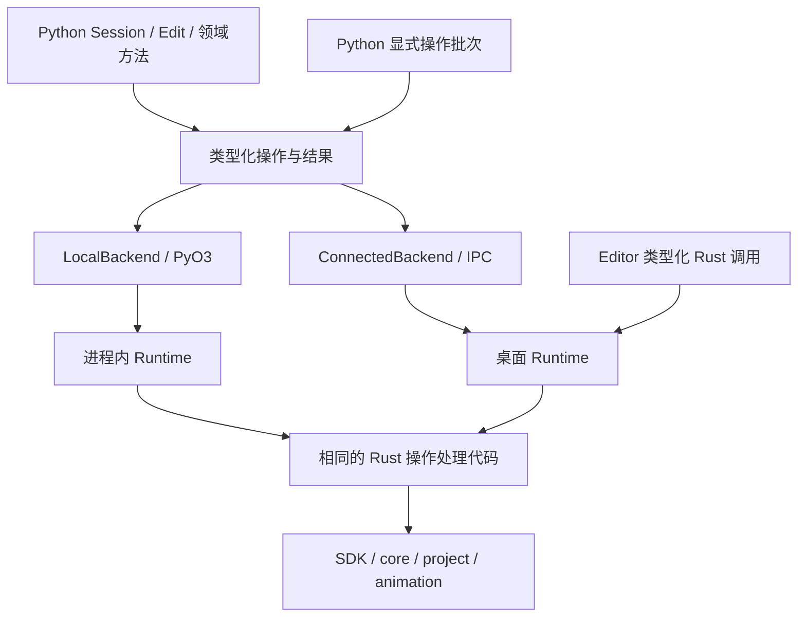

# zipzi-python2 Python SDK 建设计划

日期：2026-10-25，2026-10-26 收尾。状态：**P3A-0–6 已完成验收；本轮 P0 稳定性沿用用户明确豁免，模型/服务修订身份门禁按用户决定移除。P3 剩余工作归 P3B；P4–P7 按本文依赖推进。** 结果见[实施记录](python-sdk-rewrite/README.md)、[能力清单](../../crates/zipzi-python2/CAPABILITIES.md)和[包说明](../../crates/zipzi-python2/README.md)。

**2026-10-26 收尾完成：**正式分发、生成摘要、当前文档及受影响验证已收敛。用户确认验收运行配置为 `gpt-6.1-sol/high`，明确删除模型/服务身份门禁；配置与可选服务元数据只记录，不参与通过或停止派发判定。固定功能门禁原评分 38/42、补充复核 41/42 和已有确定性/安装/Editor 证据保留。具体结果见 [P3A-6 完成决定](python-sdk-rewrite/p3a-6.md#2026-10-26-移除服务身份门禁并完成-p3a)。

本次计划修订以提交 `ad868c8a`（独立新包基础）、`7cf4bed`（资源与 Plan）、`f2ef33c`（生命周期与 P0 门禁）、`1e0043f`（P2 网格生成）、`acc54907`（宿主/会话接回）、`c0e186b`（R3 事件/参数/批量）和 2026-10-25 工作区为依据。当前主线按 [Runtime R0–R4](sdk-runtime/python2-r0-r4.md) 推进；已提交的[事件、参数及批量读取](sdk-runtime/python2-r3-events.md)贯通新包 R3 最小链路；工作区中的[网格绑定和显式 CPU 采样](sdk-runtime/python2-r4-bindings.md)接回首批 R4 数值链路，生成器随能力推进。本文区分已提交基础、已有验证记录、工作区实现和后续目标，不改写此前验收结果。

本计划按用户决定，从一个全新的 `crates/zipzi-python2` 开始。把 `zipzi-python` 视为不存在：不读取或导入其实现，不复用其包装、stub、构建入口或测试 recipe，不以其接口数量、行数和性能作为交付基准，也不承担迁移、兼容或删除旧包的任务。先前放在旧 crate 内的 P1 试验代码已迁入新包；旧 crate 的接线改动已撤回。

本计划独立于 [SDK Runtime 设计](sdk-runtime-design.md)和[实施计划](sdk-runtime-implementation-plan.md)，不重写其 R0–R7 阶段。可复用的是共享 Rust SDK/core/project/animation、Runtime 和它们独立的领域测试。为新 Python 能力补强这些共享层，也必须计入本项目的实现与复杂度。

**P3A「统一 API 与 agent 契约重构」已完成，下一步核对 P3B/P4 与 Runtime R4 的实际剩余项。** 包的主要调用者是 agent；公开契约、生成/手写边界和已有独立行为预期继续适用于后续领域。P3B/P4 未因本次 P3A 完成而自动通过，后续依赖见第 9 节。

当前 `zipzi-python2` 也没有兼容包袱：允许删除、重命名及改变返回类型，不保留旧别名、双入口、弃用期或迁移层；共享领域语义、资源正确性和独立行为预期继续保留。历史验收只证明当时的接口，不自动证明新契约通过。

## 1. 决定与目标

**建立 agent 能发现、正确调用、恢复失败并验证结果的类型化 Python 客户端。公开方法的正常与恢复路径遵守同一契约，Local/Connected 进入相同 Rust 执行路径。**

1. 包目录和 Cargo 包名为 `zipzi-python2`。纯 Python 分发名为 `zipzi`；可选原生分发名为 `zipzi-native`，导入名分别为 `zipzi` 和 `zipzi_native._native`。当前两份分发版本为 `0.1.0a1`；历史 `zipzi-python2` / `zipzi-python2-native` 产物及成绩保留原身份，不混作当前发布产物。
2. LocalBackend 与 ConnectedBackend 共用 Rust Runtime 类型化处理器。本地经 PyO3 进入显式拥有的进程内 Runtime，连接模式绑定已有宿主对象，不创建工程镜像或自动退回本地。
3. SDK/core 定义领域默认值、身份、不变量、算法、编辑、历史与求值；Runtime 管理会话、候选、来源、任务和预算；Python 只组织类型、生命周期、恢复和错误呈现。
4. 公共便利方法构造同一组类型化操作；显式批次按序执行，提交独立发生。不暴露任意字典/JSON 作为主要创作路径。
5. 只声明明确选出的操作。生成器负责领域值、转换、统一的领域方法包装、返回投影及其文档；包装调用手写执行原语，不生成领域规则、资源策略、事务状态机或行为预期。
6. 新包的 Python 源码、薄桥接、构建配置、P0/P1 工具和包级测试均放在 `crates/zipzi-python2`。共享 Rust 行为留在 SDK/Runtime；仓库级工具回归遵循根测试布局。

本项目不引入通用 RPC/IDL 平台、远程网络服务、Python 插件执行引擎或完整 asyncio API。同步调用和显式 Job 支撑首版；资源、动画、GPU 和格式 IO 是明确的后续能力，不阻塞第一条 CPU 调用链。

## 2. 当前进度与 P0 基线

### 2.1 已有实现与证据

下表保留各早期切片的范围与当时待办，不作为当前 API 使用说明。后续完整 R4 接线见 [R4 记录](sdk-runtime/python2-r4-complete.md)，P3A 当前实现/验收见 [P3A-6](python-sdk-rewrite/p3a-6.md)，当前用法见[包 README](../../crates/zipzi-python2/README.md)。历史“已验证”不代表本次重跑了全部测试；R4 接线完整也不代表其最后性能/发行退出门槛通过。

| 切片 | 当前事实与代码位置 | 仍未交付 |
| --- | --- | --- |
| 独立包与分发 | `crates/zipzi-python2`；纯包 `client/` 与原生 `native/` 分开；Cargo/测试域已接入 | 发布构建矩阵及 CI 门禁；配对 sdist 见本轮验收 |
| 公共 API | [meshes.py](../../crates/zipzi-python2/client/python/zipzi/meshes.py)、[ops.py](../../crates/zipzi-python2/client/python/zipzi/ops.py)：Geometry、MeshSpec、Snapshot 和 Create/Rename/SetPositions | 其余领域和更复杂 Plan 意图；操作联合现已覆盖 Mesh、图片与 ApplyPlan |
| 生命周期 | [_lifecycle.py](../../crates/zipzi-python2/client/python/zipzi/_lifecycle.py)：Runtime/Session/Edit/Job、明确的恢复归属 | 选定 P1 矩阵已通过；P4 长任务/格式和 P6 平台验收另列 |
| 本地执行 | [PyO3 桥接](../../crates/zipzi-python2/src/lib.rs)进入 [LocalHost](../../crates/zipzi-runtime/src/host.rs)；输入在释放 GIL 前取得所有权；本地不经 JSON 字符串或 Value 树；网格转换已生成 | 工作区已有 Buffer/二进制实现和测试，验收范围需按 P4 单独核对，不沿用小资源结论 |
| 连接执行 | [ConnectedBackend](../../crates/zipzi-python2/client/python/zipzi/backends/connected.py)进入相同 Runtime 处理器；保留不可变字节和原 RequestId；发现/启动、会话绑定、类型化事件/参数、批量查询及真实 Editor recipe 已通过 | R4 完整 Modeling、二进制负载和完整发行构建配对 |
| 网格与历史 | 创建、位置、改名、候选查询、顺序批次、commit/Undo/Redo、保存重开 | 已接回选定网格绑定/关键形与显式 CPU 采样；拓扑、BlendShape 和完整建模能力仍待扩展 |
| 行为和类型测试 | P3 场景/身份记录包含 57 项源码行为和 16 条类型反例；[当前测试](../../crates/zipzi-python2/tests/test_api.py)继续扩展 | 数量以对应记录为准；P3A 重新验证恢复返回、公共状态、文档、自省及安装包任务 |
| 初步安装 | 记录中两个 wheel 分别构建，并在纯包连接环境及纯包+原生本地环境执行 [installed_recipe.py](../../crates/zipzi-python2/tests/installed_recipe.py) | 安装 recipe 已覆盖纹理、候选 Plan、混合历史及新宿主保存重开；真实 Editor、全领域安装及 sdist 待验收 |
| 代码生成 | P2 原记录为 18 个产物；加入场景后当前为 20 个受管产物，覆盖选定值/操作/codec/接线 | P3A 统一领域包装和返回投影，补齐已有参数/绑定/采样等机械声明；覆盖率不等于公开契约完整 |

共享 Rust 和新包现均有图片、来源绑定 Plan 的固定行为测试。工作区中的 `ImageCreateSpec`、PreparedImage 资源表、图片快照及 `EditOperation` / `PlanIntent` 已由两后端和独立 wheel 验证；仅承诺当前选定的小资源/改名 Plan 试点，不等于完整 P1 或后续领域已完成。

本轮 API 评估确认了下一阶段需要消除的缺口：创建网格、场景单项读取和提交在恢复后返回类型发生变化；捕获结果未知异常后 Edit 上下文可以正常退出；批量结果/快照结构不一致；没有公开的 Session 关闭及完整分页路径。另有方法缺少语义 docstring、恢复返回注解无法运行时解析、大数组默认 repr 无界等 agent 使用问题。P3A 必须先将这些观察变成独立回归用例，再修改实现；这份计划本身不构成修复或验收证据。

### 2.2 P0 试点测量与统计范围

首次四项 Local 测量和资源/Plan 补测的结论保留在[实施记录](python-sdk-rewrite/README.md)；历史缺失项不计为已通过。

当前 schema-2 基线的验收范围覆盖 Local/Connected 的小查询、单项编辑、100 项批次、位置数组、256×256 RGBA 准备/创建/提交/释放和正式 Plan 创建/应用/提交/释放。每个后端分别使用 5 个独立计时进程、5 个独立探针进程；每项 4 次预热和 32 个计时样本。延迟使用无计数分配器的 Release 产物；Rust 探针使用独立 instrumented Release 产物，CPU 宿主也分别复制并校验哈希。

已记录 Python JSON/native 调用、Python 堆存活/峰值、实际 Runtime JSON 编解码、Plan 准入的计数式序列化、Rust 分配次数/请求分配字节及存活/峰值、原生数值数组输入物化、显式负载复制和实际图片资源存活字节。Connected 探针保留空控制窗口，不隐式扣减控制消息或使用逻辑输入大小补复制量。

统计边界必须随数字一起解释：Rust 堆为该扩展/宿主内所有 Rust 线程请求的 Layout 字节，排除 Python/C 堆、分配器元数据及 realloc 内部瞬时存储；复制计数覆盖原生 RGBA 输入/PyBytes 输出、图片 Vec→Arc 和 Runtime 网格快照数组，**不是全部领域 Clone 或进程 memcpy 总量**。这比把缺项填零更窄，但可在明确的复制位置上独立验证。原生数组物化计数不覆盖 Connected 的 typed JSON 数组转换，其零值不能解读为没有物化。后续新增负载须扩大探针范围后再设相应门禁。

基线冻结 P50/P95 比率、进程间 P50 噪声、显式复制/物化/调用增长和请求 Rust 堆峰值门禁，并有独立复测与负控制用例。比较要求相同工作负载脚本、平台、Python、样本/预热数；产物或客户端变化允许用于测回归，工作负载漂移则拒绝比较。阈值只针对这份 CPU 宿主试点，不宣称真实 Editor 或跨机器延迟。

P1 选定矩阵见[验收表](python-sdk-rewrite/p1-lifecycle-matrix.md)。P0 总体仍追踪 P3–P5 新领域、二进制大负载、CPU 采样/动画和 GPU；这些后续工作负载不反过来阻塞当前 P1 试点。P2 可据当前选定类型和行为提取最小生成器，不能把本表当作完整后续领域的性能保证。

## 3. 能力范围与共享边界

| 能力 | 实现责任 | 交付阶段 |
| --- | --- | --- |
| Runtime/Session/Edit/Job、结构化错误、恢复 | 共用少数手写生命周期原语；Rust Runtime 是实际状态来源 | P1 |
| 统一 API、完整调用恢复、分页/关闭、文档与 agent 契约 | 生成领域包装 + 手写公共执行原语；新增共享能力仍由 Runtime 承担 | **P3A，下一阶段** |
| 网格创建、位置、候选查询、批次 | 选定 SDK 类型和 Runtime 处理器，Python 提供明确签名 | P1 |
| PreparedImage、正式/候选 Plan、保存/重开 | 共享资源及 Plan 来源规则，Python 显式拥有 token/lease | P1，P3/P4 扩展 |
| 场景组织、参数/绑定/BlendShape、拓扑、Glue/Offscreen、Ref/Address | 已有切片纳入 P3A；剩余领域按新契约扩展 | P3B |
| 图片、附件、二进制负载、预算、原生工程和现有格式 IO | 共享资源所有权、先准入、显式 Job、取消与断连负例 | P4 |
| 动画、Expression/Physics/Pose、独立 Preview、CPU 采样、空间查询 | Rust 求值和来源，Python 不实现另一套算法 | P5 |
| GPU Observer、离线 inspection 工作流 | Rust 设备/观察能力与 Python 文件/报告组织分开 | P5 |
| 纯包/可选原生包、文档示例、CI、宿主发现 | 独立安装与构建验证；显式工作流和工具有可运行入口 | P6 |

未选定能力标为计划项，不发布只会报“不支持”的空壳。Proposal/Review 等未来新增 Runtime 能力单列，不能把它们算成已获得的 Python 能力。

## 4. 新架构与边界



图中的两套 Runtime 是不同进程中的不同实例，复用同一实现；不共享进程间指针。ConnectedBackend 只绑定宿主对象，不创建本地工程镜像。安装本地扩展也不改变一个已建立连接的执行位置。

| 层 | 保留的手写责任 | 禁止新增的责任 |
| --- | --- | --- |
| SDK/core | 领域默认值、对象身份、不变量、规划、编辑、历史和求值 | Python/wire 类型依赖 |
| Runtime 类型化处理器 | 所有权检查、来源、候选执行、资源/任务预算、事件 | 另一套 Mesh/Binding/Motion 算法 |
| 本机 transport | framing、握手、请求身份、去重/恢复、有界上传与下载 | 直接操作可变 SDK 会话 |
| PyO3 | Python 值与 Rust 类型转换、缓冲区所有权、等待时释放 GIL | 自有 Command 执行器、补 runtime ID、自建历史 |
| Python 核心 | 公共包装、上下文管理、已知/未知结果、资源释放与错误呈现 | 领域修复、隐式提交、后台镜像完整工程 |

LocalBackend 已使用显式拥有的 LocalHost：只有 owner 线程进入 Runtime，调用/等待有容量限制，worker 完成通知由宿主主动消费。后续沿用该宿主，不另建 Python 事件泵。同步等待释放 GIL；执行线程不反向调用 Python 用户回调，不在持有 Runtime 锁时等待依赖该线程的 Job。已有完成消费、GIL 与关停证据应保留，资源/Plan 扩展要补相应持有与失败用例。

`Job.close()` 等待真实结果并释放结果槽，**不等于取消**。已公开的 `cancel()` 独立请求取消，排队任务报告 CANCELLED，已进入 IO 报告实际结果；`state()` 不消费结果。成功与失败均缓存，cancel/status 待确认时不能被 wait 误消费。

本地 Runtime 的生命周期由显式上下文拥有，关闭会释放它的会话，不自动保存。关闭 Connected 客户端只释放该客户端资源，宿主正式会话继续驻留。两者生命周期有实际差异，不用模拟网络断线来强求形式一致。

## 5. 重构后的最终公开 API

最终 API 由 [P3A 方案第 2 节](python-sdk-rewrite/p3a-api-agent-contract.md#2-重构后的最终公开-api)统一定义，包括领域命名、Snapshot/Batch/Page、查询与分页、写入与 Plan、Session/Job 生命周期、完整调用恢复、能力自省和目标 recipe。P3B–P5 新增领域沿用该契约；完整公共符号目录在 P3A 登记和验收，不以删除已有能力缩小范围。

## 6. 一份契约与生成/手写边界

生成器负责选定 Rust 声明对应的值、操作、转换、领域方法包装、返回投影和文档；共享 Call、生命周期、传输、Runtime 状态与领域算法保留手写责任。完整声明来源、调用路径、责任矩阵、代码组织和生成/发行门禁以 [P3A 方案第 3 节](python-sdk-rewrite/p3a-api-agent-contract.md#3-一份契约与生成手写边界)为准。

## 7. 必须手写的执行与资源规则

Edit 失败与恢复、Plan/快照来源、图片/Buffer 所有权、有界传输与 IO、结构化错误动作、并发和 Session 关闭的详细规则集中在 [P3A 方案第 4 节](python-sdk-rewrite/p3a-api-agent-contract.md#4-必须手写的执行与资源规则)。这些规则延续共享 SDK/Runtime 的语义，适用于 P3A 和后续领域扩展；独立 Rust 行为回归及 Python 两后端验证均须保留。

## 8. 新包结构与分发

所有新包代码位于 `crates/zipzi-python2`：

```text
zipzi-python2/
  Cargo.toml                # Rust 包 zipzi-python2
  src/lib.rs                # 薄 PyO3 Runtime 适配
  pyproject.toml            # 原生分发 zipzi-native，Maturin
  native/zipzi_native/       # 只包含原生 namespace
  client/pyproject.toml     # 纯 Python 分发 zipzi
  client/python/zipzi/      # 公共类型、生命周期、领域模块和 backends
  tests/                    # 同 recipe 两后端、类型用例、安装验收
  tools/test.py             # 独立构建和 P1 验证
  tools/baseline.py         # 新包自身 P0 性能采集
  CAPABILITIES.md           # 本项目能力范围与交付证据
```

| 分发 | 内容 | 行为 |
| --- | --- | --- |
| `zipzi` | 纯 Python 类型、异常、包装和 ConnectedBackend | 不依赖原生扩展；导入不创建 Runtime、不探测 GPU、不启动宿主 |
| `zipzi-native` | `zipzi_native._native`，仅 LocalBackend | 依赖匹配的公共包；不安装或覆盖 `zipzi/`；检查契约/构建配对 |

两个分发分别构建，不靠同名 wheel 覆盖来选择后端。是否提供安装 extra，以实际元数据和安装验证决定。首版只声明经验证的 CPython 3.14；扩大平台/版本矩阵需要额外 CI 证据。源码可运行、wheel 可构建、安装后可用和完整发布验收分别记录。

目录按 [P3A 代码组织](python-sdk-rewrite/p3a-api-agent-contract.md#34-p3a-的生成范围与代码组织)区分 generated、公共调用原语、backends、lifecycle、领域模块和可选 inspection；重构后的发行包同时包含可离线读取的文档目录、短指南与 recipes。用户类型不暴露 PyO3 pyclass，token 只藏在包装中；公共异常身份全在纯 Python 中定义。

## 9. 从当前进度继续实施

### 9.1 阶段总表与依赖

| 阶段 | 当前状态 | 下一步与退出门槛 |
| --- | --- | --- |
| **P0 范围与基线** | 选定六项两后端负载的比较门禁已建立 | P3A 冻结重构前基线；相同领域工作量比较，新包装/文档/分页单列成本 |
| **P1 手写完整链路** | 选定生命周期矩阵已验收 | 历史记录保留；P3A 按新接口复用独立预期并补遗漏故障 |
| **P2 提取生成器** | 网格、资源/Plan 及配对源码发行已验收 | 历史记录保留；P3A 扩展到统一领域 facade、返回投影和文档 |
| **P3 已有 Modeling 切片** | 场景/组织、选定 BlendShape/拓扑与 SDK Ref/标签地址已有证据 | 纳入 P3A，保持数值、身份和资源行为；完整领域不标完成 |
| **P3A API 与 agent 契约重构** | **P3A-0–6 已通过** | [P3A-6 完成决定](python-sdk-rewrite/p3a-6.md#2026-10-26-移除服务身份门禁并完成-p3a)：D/C、安装、Editor 和固定功能门禁已有证据；本轮 P0 稳定性沿用用户豁免；模型/服务身份改为记录信息，无此验收门禁 |
| **P3B Modeling 剩余能力** | P3A 前置已满足，阶段待完成 | 以现有完整 Modeling/地址接线和 R4 记录核对剩余领域与独立 recipe，避免重复建设 |
| **P4 资源与工程** | 工作区已有 Buffer/二进制资源代码与测试，完整阶段未验收 | 已有公开能力纳入 P3A；后续完整格式/IO、昂贵工作取消、公平调度、总预算/峰值及安装证据独立交付 |
| **P5 动画与观察** | 未开始 | Motion/Expression/Physics/Pose、独立 Preview、空间/观察和 inspection；已有 CPU 建模采样归 P3A/P3B，不重复延期 |
| **P6 分发与使用** | 双 wheel、配对 sdist 和真实宿主选定链路已有证据 | 每阶段同步安装、文档/agent 验收；最后补齐平台、发行 app 位置与全能力组合 |
| **P7 全量收尾** | 未开始 | 汇总新契约全部承诺、性能/资源、生成/手写边界、agent 任务及发行证据 |

新的执行顺序为：**冻结当前实现/证据 → P3A-0 至 P3A-6 → P3B 与 P4 剩余工作 → P5 → P7**。P0/P6 贯穿各阶段。P3B/P4 的公共 Python 扩展以 P3A 为前置；已有二进制工作和独立 Rust 领域研究继续保留，不回退、不冒充已验收。若 P3A 需要某项尚未完成的 Runtime 分页/关闭/预算能力，明确纳入 P3A 子任务，不能靠 Python 镜像、无限重试或跳过测试绕过。

### 9.1.1 本轮重构的范围控制

P3A 的范围与排除项见[独立方案第 1 节](python-sdk-rewrite/p3a-api-agent-contract.md#1-目标与范围)。已有 Buffer/二进制工作保留，按冻结时实际能力纳入新契约；完整资源/格式/动画/GPU 的后续工作仍按本表推进。重构不增加旧 API 兼容层，也不把未经验证的工作改记为完成。

### 9.2 已验证切片：PreparedImage 完整链路

2026-10-25 工作区已完成以下小资源试点，并通过两后端源码、类型及独立 wheel 验证。保持这些断言，P4 再扩大负载与格式范围。

- 公共 `PreparedImage` 具有明确的 owner、close/context 和不可变像素读取；独立准备不改文档/历史。Edit 接纳准备资源后取得自己的引用，调用方关闭准备对象不影响候选、正式内容、Undo 或快照。
- 新包覆盖准备、读回、创建/替换以及释放；两后端执行相同预算与来源规则。字段/命名在手写链路中定稿，不提前生成。
- P1 可以沿用有界小负载 JSON 控制消息；本节 P1 验收时的试点上限为 1 MiB，保留为历史范围。当前 Buffer/二进制工作另按 P4 记录实际限制、测试和发行证据，不据此宣布 P4 完成。
- 必测：先准备 A/B 后提交 A，B 仍可读；丢弃未使用准备对象释放负载；接纳后关闭准备对象仍可提交/Undo/Redo；取消和失败释放无根负载；跨 Runtime/client 的引用拒绝。
- 独立准备失败与 Edit 写操作内部失败分别验证。创建、读取、释放响应丢失均有所属对象可恢复，不能留下只有 token 却无 Python 恢复持有者的资源。

**完成证据：**同一新包 recipe 在 Local/Connected 核对像素、来源、历史和资源计数，并扩展安装 recipe。资源统计可使用受控宿主测试接口，不为测试给公共 API 暴露可变 SDK 会话。

### 9.3 已验证切片：正式/候选 Plan 与跨领域组合

以已经选定的网格/图片改名等少量意图验证 Plan 生命周期，不把全部 Rust Plan 形状一次性发布。

- 独立规划返回拥有来源和资源的 Plan 及纯值报告；规划失败不污染候选。应用经过共同的 Edit 写入口，过期/错误引用按该入口的失败契约处理。
- `apply_many` 已从 MeshOperation-only 扩到网格、资源接纳和 Plan 应用的有限联合，保留一个候选执行入口；不要另加一套 `apply_resources` / `apply_plan_batch` 事务状态机。
- 正式 Plan 仅适用于对应版本的初始候选；候选 Plan 匹配确切 Edit 和序号。后续修改、错误会话/客户端、已释放对象及 Undo 引用失效分别验收。
- **批次中的 Plan 来源必须明确。** 首个试点采用 Plan 只能处于批次开头的保守规则；后续项可在其结果上继续编辑。不能在前序项已改候选后，仍用入口序号把旧 Plan 当作有效；违规时无正式部分发布，失败作用域有测试。该限制已通过两后端成功/失败用例验证，列入当前试点契约。
- 单项成功及整批成功各推进一次候选序号；恢复原请求不再次推进。批次中途失败后整个 Edit 不可提交，不能返回“整批未执行”来诱导重试。

**完成证据：**网格+图片+Plan 在一个 Edit 内组合，提交形成一个历史步骤；只读报告、过期拒绝、释放、丢响应恢复和两后端固定结果均通过。

### 9.4 已验收：P1 生命周期矩阵和 P0 试点指标

当时 36 项公共行为用例保留原有 19 项断言，新增恢复/取消/过期/worker/close 边界。以下要求均有选定切片的源码、共享 Rust 或安装证据，后端适用范围在[矩阵](python-sdk-rewrite/p1-lifecycle-matrix.md)逐项标明：

1. 请求记录过期、客户端过期和宿主重启；过期结果不能使用新 RequestId 重放写入。
2. 图片/Plan 的创建、应用、释放，以及 Job 启动/终态查询的恢复归属；其他对象不能消费待确认结果。
3. 排队 Job 取消、已进入 IO 的实际结果、worker 失败、close/最终 owner 释放；无下一次 Python 调用时仍消费完成。已有 Rust 覆盖要标出 Python 是否实际验证。
4. 预算拒绝与执行失败区分；错误后来源和历史不变；只读失败不毒化 Edit，Edit 内普通准备失败不可被捕获异常绕过。
5. 两种隔离安装环境运行扩展后的完整 P1 recipe。纯包/原生包拥有不同 namespace；两个公开 SDK 若都使用 `zipzi`，测试环境必须独立，不能用混装后恰巧导入某份源码作为验证。

**当前选定 P1 试点已满足退出门槛**：图片、网格、Plan、历史、保存重开和上述失败链路均有证据。共享 Rust、Python 源码、探针产物与正常安装包分别记录；不据此宣布 P4 长任务、P5 动画或 P6 发布矩阵完成。

### 9.5 已验收：P2 最小生成器

满足 P1 和试点 P0 门槛后，从已验证链路的重复值、转换和接线处提取。首批只覆盖已经验收的网格、资源和 Plan 形状，不先给未实施领域生成 public stub。

在[第一批网格链路](python-sdk-rewrite/p2-mesh-generator.md)基础上补齐资源/Plan：同一 Rust 声明导出类型、操作、直接 PyO3/wire 转换、两后端查询接线及便利方法，共 18 个受管产物。有限形状新增 bool、u64/usize、拥有的 bytes 和有序字符串映射；PreparedImage/Plan 保留手写生命周期。配对 sdist 中纯包携带 Python 来源和产物，原生包还携带 SDK 依赖闭包、Rust 声明、导出器和生成器；由解包源码检查生成并重建 wheel，安装时不生成。具体证据见[P2 补齐记录](python-sdk-rewrite/p2-resources-generator.md)。

退出门槛：声明与处理器静态配对；生成确定且只检查模式不写入；手写文件受保护；正反类型用例、结构转换、实际两后端行为和安装 recipe 通过；本地没有新增 JSON 往返；生成前后的调用次数、复制/资源峰值及耗时按试点基线比较。该阶段的历史退出证据保持；接下来先执行 P3A，再按 P3B–P5 扩充可生成的类型子集。

### 9.6 当前阶段：P3A 统一 API 与 agent 契约重构

P3A 的详细设计、7 个子任务及退出条件已拆到[独立方案](python-sdk-rewrite/p3a-api-agent-contract.md)。实施顺序为冻结契约/失败基线 → 完整调用恢复 → 统一值/操作/规划 → 生成包装与发现/生命周期 → agent 文档 → 综合验收；依赖和交付物见[任务表](python-sdk-rewrite/p3a-api-agent-contract.md#5-实施任务与交付物)。

[P3A-0](python-sdk-rewrite/p3a-0.md) 至 [P3A-6](python-sdk-rewrite/p3a-6.md) 已完成当前范围验收。2026-10-26 用户明确取消模型/服务身份门禁，只记录 `gpt-6.1-sol/high` 运行配置及可选元数据；本轮 P0 稳定性保留原豁免和失败数据。P3B/P4 继续沿用公共契约，完整 R4/P4 性能、资源和发行退出条件独立核对。

### 9.7 P3A 之后的任务调整

- **P3B**：继续完整场景绑定、转换、集合关系、剩余 Ref/Address。通用分页、文档和恢复已由 P3A 提供，领域任务只补实际语义与必要声明；新增值/操作不再先另写 Python codec 再决定是否生成。CPU Modeling 的数值能力继续归 Runtime R4，与 P5 动画分开。
- **P4**：承接已有 Buffer/二进制实现，补正式发行能力配对、完整图片/附件/格式 IO、磁盘资源固定、重定位和导入替换的 generation 规则。昂贵准备/规划/采样采用独立命名的 `submit_* -> Job[T]`，同步有界方法不得按负载大小偷偷改返回类型。总预算、实际资源峰值、队列/公平性/取消和二进制各阶段恢复必须验收；传输选择只在手写 adapter 中发生。
- **P5**：新增动画/独立 Preview/空间/观察领域；使用同一 Snapshot/分页/Job/错误与文档约定。当前 CPU Modeling 采样仅补新领域行为；不得重复建设快照、后端或恢复状态机。GPU 不影响纯值导入，缺设备能力在能力视图中明确。
- **P6**：文档、自省和安装任务从 P3A 开始常态化；旧版 wheel 的通过记录保留，不代替新契约重验。保留已有 sdist 证据，重构后再次验证目录/文档/源代码配对；最后补平台和发行 app 安装位置，不重新把已完成源码分发列为首次实现。
- **P0/P7**：比较相同领域工作量，分别报告公共包装、分页与摘要、二进制、后台任务和 agent 上下文开销。接口改名导致基线脚本变化时保留旧记录，提供工作负载等价说明并建立新冻结基线，不能直接跨 schema 比数值或降低门槛消除回归。P7 汇总所有承诺能力；外部 Runtime 的未来能力仍不算本包交付。

## 10. 验证与复杂度门禁

### 10.1 独立行为验收

1. 无原生可导入类型/异常并连接宿主；安装扩展不改变公开类型身份。真实静态检查验证正反类型用例。
2. 便利方法和对应操作值只有一条路径；两后端内容、来源关系、回执、错误字段和历史一致。随机 ID 可归一化，关系与版本推进不可忽略。
3. 前序候选修改可见；批次中途失败无正式部分发布；捕获普通错误不能提交；Busy/预算准入与结果未知独立测试；no-op/取消保留 redo。
4. apply/批次/commit/上传/Job 启动及查询丢响应，均按原请求恢复；不重复创建、上传或推进序号。过期、客户端过期和宿主重启明确失败。
5. A/B 准备、候选/Plan/快照/Undo 持有及最后引用释放；至少 100 轮取消/淘汰直接断言底层条目/存活字节，不单靠 RSS。
6. 大记录/重复选择、分页变更、有界下载、无后续调用的 Job 完成、关闭/取消/worker 失败；临时复制与转换峰值提前准入。
7. 安装后的建模—保存重开 recipe及真实 Editor 共享历史/刷新；P4/P5 扩展到导出/动画。P3A 不要求尚未实现的领域；适用 CPU 必跑，GPU/授权素材记录条件。

行为预期来自独立 SDK 结果、固定几何/像素和历史断言。生成器只能验证类型和 codec 一致性，不能生成唯一的行为预期。

### 10.2 责任与性能计数

每阶段分别报告：手写公共/生命周期、手写契约/转换、生成产物、共享 Runtime/SDK 新增代码；生成器、测试和工作流/工具另列。新包从零开始计数，不设从其他包减少某个百分比的指标；移入 Rust 的复杂度不能隐藏。

常规新增操作的目标成本为一项声明、必要的领域/Runtime 处理器和独立行为测试。领域语义始终正常设计实现；不为提高生成占比扩大 schema 或生成空壳。

持续检查：公共 API 不以任意字典/JSON 为主要入口；本地不绕过 Runtime；桥接不修补身份或持久化默认结构；生命周期共用少数原语；常规 metadata/no-op 不强迫全量模型/历史克隆；Editor/本地不被迫走 JSON；已接线、已生成、已验证分开计数。

### 10.3 测试入口

遵循根 [README 测试表](../../README.md#tests)和[工具测试说明](../../tools/README.md#test-coverage)。以下命令是目前已经存在的入口。涉及共享 Rust 工作区的验收必须注明具体 revision/dirty 状态，不能把 `ad868c8a` 的记录套用于后续资源/Plan 修改。

```sh
# 先检查实际参数；两个领域 shell 脚本无参数会运行昂贵全量。
./tools/test-sdk.sh --help
uv run --locked python crates/zipzi-python2/tools/test.py --help
```

新包自身入口为：

```sh
./tools/test-sdk.sh python2
./tools/test-sdk.sh python2 PythonSdk.test_shared_recipe
./tools/test-sdk.sh python2 --release
./tools/test-sdk.sh python2 --release --instrumented
uv run --locked python crates/zipzi-python2/tools/baseline.py --output target/python2/baseline-first
cargo test --locked -p zipzi-runtime --test authoring --test resources --test modeling --test protocol
cargo test --locked -p zipzi-sdk --test integration image_edit::
cargo test --locked -p zipzi-runtime --test host
cargo test --locked -p zipzi-sdk --test integration mesh_editing::
uv run --locked python tools/test_tools.py -p test_python2_tools.py -v
python3 tools/workspace/cargo_domain.py --check
```

新包行为测试及类型用例在 `crates/zipzi-python2/tests/`；生成器等仓库工具的回归仍在 `tools/tests/`；共享领域 fixture 在 `fixtures/`。不依赖其他 Python SDK 的环境、测试入口或安装产物。

### 10.4 公共契约、文档与自省验收

D01–D08 及 docstring、离线自省、精确类型、示例、紧凑输出和随包指南要求统一维护在 [P3A 文档验收](python-sdk-rewrite/p3a-api-agent-contract.md#6-公共契约文档与自省验收)。这些门禁必须在 P3A 完成，并持续适用于后续阶段，不推迟到 P6 收尾。

### 10.5 行为与 agent 任务退出矩阵

C01–C08 确定性回归、G01–G08 安装包 agent 任务、42 次运行的通过门槛及失败阻断规则统一维护在 [P3A 行为与 agent 验收](python-sdk-rewrite/p3a-api-agent-contract.md#7-行为与-agent-任务退出矩阵)。确定性测试与 agent 可用性分别记录，均不能替代第 10.1 节的独立领域行为与资源验证。

## 11. 完成的定义

`zipzi-python2` 完成需要：本项目明确承诺的能力均接线且独立验证；两后端共用 Rust 领域路径；公开签名、返回、恢复、来源、事务、资源和 Job 规则一致；生成与手写职责可从唯一目录追踪；随包文档、自省和 agent 任务达标；所有阶段有实际源码/安装/宿主/性能证据。

**P3A 已完成，下一步是 P3B/P4 与 Runtime R4 剩余工作的核对和交付。** 沿用已通过的公共契约；以现有实现和独立证据核销旧待办，再补实际缺口。Runtime R0–R7 编号及状态独立维护，P3A 完成不等于 Runtime R4 完成。P0/P6 持续跟随，P7 汇总完整发布范围。

每完成一个切片，更新能力清单和实施记录，只保留简明验收结果：改动范围、必要检查及结果、未满足项和用户明确豁免项。临时日志、JSON 清单、哈希和测量报告不写入计划目录；不为重建已删除的历史产物反复验收。不因删除旧 API 而删除独立行为预期。阶段结论留在[实施记录](python-sdk-rewrite/README.md)，计划据此调整状态与下一步，不把目标改写为完成结果。
