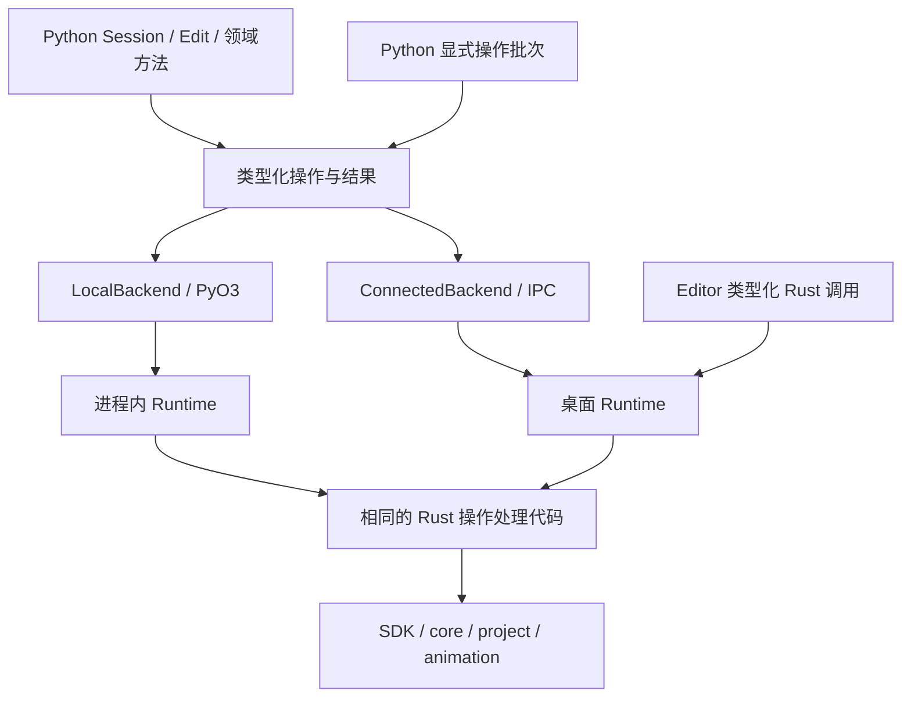

# zipzi-python2 Python SDK 建设计划

日期：2026-10-25。状态：**新包已建立；P1 选定试点及生命周期矩阵已验收；P0 试点两后端计时/探针与比较门禁已建立，统计范围见下文；P2 尚未开始；P6 已有初步构建和安装证据**。见[实施记录](python-sdk-rewrite/README.md)、[能力清单](../../crates/zipzi-python2/CAPABILITIES.md)和[包说明](../../crates/zipzi-python2/README.md)。

本次计划修订以提交 `ad868c8a`（独立新包基础）、`7cf4bed`（资源与 Plan）和 2026-10-25 核对到的工作区为依据。该提交之后的工作区已补齐资源与 Plan 试点的共享 Rust 接口、新包两后端及安装验证；具体测试与切片限制见实施记录，随后补齐的生命周期与 P0 计数仍属于工作区实现，不能按旧提交复现；基线记录客户端/测量脚本和两个 Rust 产物的哈希。本文区分已提交基础、已有验证记录、工作区实现和后续目标；不改写此前验收结果。

本计划按用户决定，从一个全新的 `crates/zipzi-python2` 开始。把 `zipzi-python` 视为不存在：不读取或导入其实现，不复用其包装、stub、构建入口或测试 recipe，不以其接口数量、行数和性能作为交付基准，也不承担迁移、兼容或删除旧包的任务。先前放在旧 crate 内的 P1 试验代码已迁入新包；旧 crate 的接线改动已撤回。

本计划独立于 [SDK Runtime 设计](sdk-runtime-design.md)和[实施计划](sdk-runtime-implementation-plan.md)，不重写其 R0–R7 阶段。可复用的是共享 Rust SDK/core/project/animation、Runtime 和它们独立的领域测试。为新 Python 能力补强这些共享层，也必须计入本项目的实现与复杂度。

## 1. 决定与目标

**建立类型明确、执行路径统一的全新 Python 客户端。先用完整调用链验证设计，再生成机械包装。**

1. 包目录和 Cargo 包名为 `zipzi-python2`。纯 Python 分发名为 `zipzi-python2`，导入名为 `zipzi`；可选原生分发名为 `zipzi-python2-native`，导入名为 `zipzi_native._native`。
2. LocalBackend 与 ConnectedBackend 共用 Rust Runtime 类型化处理器。本地经 PyO3 进入显式拥有的进程内 Runtime，连接模式绑定已有宿主对象，不创建工程镜像或自动退回本地。
3. SDK/core 定义领域默认值、身份、不变量、算法、编辑、历史与求值；Runtime 管理会话、候选、来源、任务和预算；Python 只组织类型、生命周期、恢复和错误呈现。
4. 公共便利方法构造同一组类型化操作；显式批次按序执行，提交独立发生。不暴露任意字典/JSON 作为主要创作路径。
5. 只声明明确选出的操作。生成器负责值类型、机械转换、简单入口和分发接线，不生成领域规则、资源策略、事务状态机或行为预期。
6. 新包的 Python 源码、薄桥接、构建配置、P0/P1 工具和包级测试均放在 `crates/zipzi-python2`。共享 Rust 行为留在 SDK/Runtime；仓库级工具回归遵循根测试布局。

本项目不引入通用 RPC/IDL 平台、远程网络服务、Python 插件执行引擎或完整 asyncio API。同步调用和显式 Job 支撑首版；资源、动画、GPU 和格式 IO 是明确的后续能力，不阻塞第一条 CPU 调用链。

## 2. 当前进度与 P0 基线

### 2.1 已有实现与证据

以下“已验证”指[实施记录](python-sdk-rewrite/README.md)已记载的源码/安装验收，不代表本次文档更新重新运行了全部测试。

| 切片 | 当前事实与代码位置 | 仍未交付 |
| --- | --- | --- |
| 独立包与分发 | `crates/zipzi-python2`；纯包 `client/` 与原生 `native/` 分开；Cargo/测试域已接入 | 完整 sdist、发布构建矩阵及 CI 门禁 |
| 公共 API | [meshes.py](../../crates/zipzi-python2/client/python/zipzi/meshes.py)、[ops.py](../../crates/zipzi-python2/client/python/zipzi/ops.py)：Geometry、MeshSpec、Snapshot 和 Create/Rename/SetPositions | 其余领域和更复杂 Plan 意图；操作联合现已覆盖 Mesh、图片与 ApplyPlan |
| 生命周期 | [_lifecycle.py](../../crates/zipzi-python2/client/python/zipzi/_lifecycle.py)：Runtime/Session/Edit/Job、明确的恢复归属 | 选定 P1 矩阵已通过；P4 长任务/格式和 P6 平台验收另列 |
| 本地执行 | [PyO3 桥接](../../crates/zipzi-python2/src/lib.rs)进入 [LocalHost](../../crates/zipzi-runtime/src/host.rs)；输入在释放 GIL 前取得所有权；本地不经 JSON 字符串或 Value 树 | 小资源/Plan 转换和预算已接线；二进制大负载未实现，字段转换仍手写 |
| 连接执行 | [ConnectedBackend](../../crates/zipzi-python2/client/python/zipzi/backends/connected.py)连接已有绝对 socket，进入相同 Runtime 处理器；请求保留不可变字节和原 RequestId | 宿主发现/启动、二进制负载和完整契约/构建配对 |
| 网格与历史 | 创建、位置、改名、候选查询、顺序批次、commit/Undo/Redo、保存重开 | 绑定、拓扑、资源引用等完整建模能力 |
| 行为和类型测试 | [test_api.py](../../crates/zipzi-python2/tests/test_api.py)中 36 项测试；多数覆盖两后端或多个故障；Pyright 正例与三项精确反例 | 已覆盖 PreparedImage/Plan 与选定生命周期矩阵；后续领域按阶段另验收 |
| 初步安装 | 记录中两个 wheel 分别构建，并在纯包连接环境及纯包+原生本地环境执行 [installed_recipe.py](../../crates/zipzi-python2/tests/installed_recipe.py) | 安装 recipe 已覆盖纹理、候选 Plan、混合历史及新宿主保存重开；真实 Editor、全领域安装及 sdist 待验收 |
| 代码生成 | 当前公共类型、两端转换与接线全部手写 | 尚无生成器或生成绑定；P2 不能标为进行中或完成 |

共享 Rust 和新包现均有图片、来源绑定 Plan 的固定行为测试。工作区中的 `ImageCreateSpec`、PreparedImage 资源表、图片快照及 `EditOperation` / `PlanIntent` 已由两后端和独立 wheel 验证；仅承诺当前选定的小资源/改名 Plan 试点，不等于完整 P1 或后续领域已完成。

### 2.2 P0 试点测量与统计范围

保留 [首次四项 Local 记录](python-sdk-rewrite/p0-baseline.json)和 [资源/Plan 补测](python-sdk-rewrite/p0-resources-baseline.json)作为历史证据；其中缺失项仍是 `null`，不改写成后来获得的结果。

当前 [schema-2 基线](python-sdk-rewrite/p0-p1-baseline.json)覆盖 Local/Connected 的小查询、单项编辑、100 项批次、位置数组、256×256 RGBA 准备/创建/提交/释放和正式 Plan 创建/应用/提交/释放。每个后端分别使用 5 个独立计时进程、5 个独立探针进程；每项 4 次预热和 32 个计时样本。延迟使用无计数分配器的 Release 产物；Rust 探针使用独立 instrumented Release 产物，CPU 宿主也分别复制并校验哈希。

已记录 Python JSON/native 调用、Python 堆存活/峰值、实际 Runtime JSON 编解码、Plan 准入的计数式序列化、Rust 分配次数/请求分配字节及存活/峰值、原生数值数组输入物化、显式负载复制和实际图片资源存活字节。Connected 探针保留空控制窗口，不隐式扣减控制消息或使用逻辑输入大小补复制量。

统计边界必须随数字一起解释：Rust 堆为该扩展/宿主内所有 Rust 线程请求的 Layout 字节，排除 Python/C 堆、分配器元数据及 realloc 内部瞬时存储；复制计数覆盖原生 RGBA 输入/PyBytes 输出、图片 Vec→Arc 和 Runtime 网格快照数组，**不是全部领域 Clone 或进程 memcpy 总量**。这比把缺项填零更窄，但可在明确的复制位置上独立验证。原生数组物化计数不覆盖 Connected 的 typed JSON 数组转换，其零值不能解读为没有物化。后续新增负载须扩大探针范围后再设相应门禁。

基线冻结 P50/P95 比率、进程间 P50 噪声、显式复制/物化/调用增长和请求 Rust 堆峰值门禁，并有独立复测与负控制用例。比较要求相同工作负载脚本、平台、Python、样本/预热数；产物或客户端变化允许用于测回归，工作负载漂移则拒绝比较。阈值只针对这份 CPU 宿主试点，不宣称真实 Editor 或跨机器延迟。

P1 选定矩阵见[验收表](python-sdk-rewrite/p1-lifecycle-matrix.md)。P0 总体仍追踪 P3–P5 新领域、二进制大负载、CPU 采样/动画和 GPU；这些后续工作负载不反过来阻塞当前 P1 试点。P2 可据当前选定类型和行为提取最小生成器，不能把本表当作完整后续领域的性能保证。

## 3. 能力范围与共享边界

| 能力 | 实现责任 | 交付阶段 |
| --- | --- | --- |
| Runtime/Session/Edit/Job、结构化错误、恢复 | 共用少数手写生命周期原语；Rust Runtime 是实际状态来源 | P1 |
| 网格创建、位置、候选查询、批次 | 选定 SDK 类型和 Runtime 处理器，Python 提供明确签名 | P1 |
| PreparedImage、正式/候选 Plan、保存/重开 | 共享资源及 Plan 来源规则，Python 显式拥有 token/lease | P1，P3/P4 扩展 |
| 场景组织、参数/绑定/BlendShape、拓扑、Glue/Offscreen、Ref/Address | 先补共享 SDK/Runtime 类型化能力，再接 Python | P3 |
| 图片、附件、二进制负载、预算、原生工程和现有格式 IO | 共享资源所有权、先准入、显式 Job、取消与断连负例 | P4 |
| 动画、Expression/Physics/Pose、独立 Preview、CPU 采样、空间查询 | Rust 求值和来源，Python 不实现另一套算法 | P5 |
| GPU Observer、离线 inspection 工作流 | Rust 设备/观察能力与 Python 文件/报告组织分开 | P5 |
| 纯包/可选原生包、文档示例、CI、宿主发现 | 独立安装与构建验证；显式工作流和工具有可运行入口 | P6 |

未选定能力标为计划项，不发布只会报“不支持”的空壳。Proposal/Review 等未来新增 Runtime 能力单列，不能把它们算成已获得的 Python 能力。

## 4. 新架构与边界



图中的两套 Runtime 是不同进程中的不同实例，复用同一实现；不共享进程间指针。ConnectedBackend 只绑定宿主对象，不创建本地工程镜像。安装本地扩展也不改变一个已建立连接的执行位置。

| 层 | 保留的手写责任 | 禁止新增的责任 |
| --- | --- | --- |
| SDK/core | 领域默认值、对象身份、不变量、规划、编辑、历史和求值 | Python/wire 类型依赖 |
| Runtime 类型化处理器 | 所有权检查、来源、候选执行、资源/任务预算、事件 | 另一套 Mesh/Binding/Motion 算法 |
| 本机 transport | framing、握手、请求身份、去重/恢复、有界上传与下载 | 直接操作可变 SDK 会话 |
| PyO3 | Python 值与 Rust 类型转换、缓冲区所有权、等待时释放 GIL | 自有 Command 执行器、补 runtime ID、自建历史 |
| Python 核心 | 公共包装、上下文管理、已知/未知结果、资源释放与错误呈现 | 领域修复、隐式提交、后台镜像完整工程 |

LocalBackend 已使用显式拥有的 LocalHost：只有 owner 线程进入 Runtime，调用/等待有容量限制，worker 完成通知由宿主主动消费。后续沿用该宿主，不另建 Python 事件泵。同步等待释放 GIL；执行线程不反向调用 Python 用户回调，不在持有 Runtime 锁时等待依赖该线程的 Job。已有完成消费、GIL 与关停证据应保留，资源/Plan 扩展要补相应持有与失败用例。

`Job.close()` 等待真实结果并释放结果槽，**不等于取消**。已公开的 `cancel()` 独立请求取消，排队任务报告 CANCELLED，已进入 IO 报告实际结果；`state()` 不消费结果。成功与失败均缓存，cancel/status 待确认时不能被 wait 误消费。

本地 Runtime 的生命周期由显式上下文拥有，关闭会释放它的会话，不自动保存。关闭 Connected 客户端只释放该客户端资源，宿主正式会话继续驻留。两者生命周期有实际差异，不用模拟网络断线来强求形式一致。

## 5. 公共 API 的形状

模块按领域组织：`meshes`、`parameters`、`bindings`、`resources`、`scene`、`animation`、`project`。根模块只导出 Runtime 入口、Session/Edit、常用值和异常，不重新导出所有内部类。

下面演示新包的网格接口，需安装可选本地分发。资源/Plan 示例和完整试点限制见包 README 与第 9 节。

```python
from pathlib import Path
from tempfile import TemporaryDirectory
from uuid import uuid4
import zipzi
from zipzi import meshes, ops

with TemporaryDirectory() as folder, zipzi.local() as runtime:
    session = runtime.sessions.create(str(uuid4()))
    geometry = meshes.Geometry(
        (42, 7, 99),
        ((0., 0.), (1., 0.), (0., 1.)),
        ((0., 0.), (1., 0.), (0., 1.)),
        ((42, 7, 99),),
    )
    with session.edit("create face") as edit:
        face = edit.meshes.create(meshes.MeshSpec("Face", geometry))
        snapshot = edit.meshes.get(face)
        edit.meshes.set_positions(
            face, vertex_ids=snapshot.geometry.vertex_ids,
            positions=((2., 3.), (3., 3.), (2., 4.)),
        )
        edit.apply(ops.Rename(face, "Final"))
    saved = session.project.save(Path(folder).resolve() / "project").wait()
    assert saved.manifest.is_file()
```

已有连接入口是 `zipzi.connect(endpoint=absolute_socket_path)`，只连接正在运行的宿主。当前 `create` 返回持久 ID 字符串，Snapshot 包含不可变 tuple 和 Source；尚未公开具备 incarnation/epoch 的 Ref/Address。`Edit.apply_many` 接受有限的 Mesh、图片接纳/替换及 ApplyPlan 联合；Plan 必须位于批次开头。

以下继续规定扩展时的目标约束：

具体约定：

- **CreateSpec、Patch/Intent、Snapshot 分开。** 创建表达必要输入，修改表达领域意图；不让调用者从查询结果补齐一整份内部持久化记录才能改名。完整替换仅在有明确语义的领域提供。
- **便利方法与操作对象只有一条执行路径。** `rename` 构造同一个 `Rename` 操作；适配层不维护第二份默认值或事务行为。操作对象用于组合和批量，不是额外的 Python Command 执行引擎。
- **读取是显式请求。** `get` / `list` / 批量查询返回带来源的快照；访问快照属性不发 RPC。列表支持有界分页和固定来源或过期检测，不能悄悄拼接不同 revision 的分页。
- **只为有价值的行为保留便捷包装。** 默认所有领域写入在 Edit 中完成，不再同时为每项操作生成 Session 自动开事务版、Edit 版和另一套字典版。高层工作流另行手写并说明历史边界。
- **显式批次按序执行，提交单独发生。** 批次不允许 commit/save/close 或嵌套批次；执行失败后整个候选不可提交，不发布部分正式结果。批次不提供独立 Undo，也不设置隐藏延迟队列。
- **批次内身份可预先表达。** 创建操作可显式带持久 ID，后续操作用该 ID 指向本批次新对象；省略 ID 时由 SDK 生成并返回。首版不实现跨结果的 Future 引用语言；需要服务器生成结果再计算下一步时使用顺序调用。
- **ID、Ref、Address 不混用。** 持久 ID 可用于显式重新查找；有效引用带所属 Runtime/Session 与 incarnation，地址额外带上下文 epoch。Undo 可恢复 ID，但不复活过期 Ref/Address；其检查由 SDK/Runtime 负责。
- **数值与大数组语义明确。** 标明浮点精度、索引范围、顺序、形状、endianness 和非有限值策略；Python 只做表达/编码检查，领域合法性由 Rust 判定。快照是不可变值或只读、由接收方持有的缓冲区。
- **公开能力只反映实际支持。** 区分契约可表达的操作、该后端实现的操作及设备能力。不因没有 GPU 而无法导入建模类型；未实现项不靠运行时空壳冒充覆盖。

## 6. 一份契约如何落地

“一份契约”不等于把所有 Rust public 字段自动发布给 Python。先人工选择操作和公共语义，再派生绑定。

### 6.1 唯一声明位置

以 Rust 中明确选出的领域输入/结果类型及 Runtime 操作注册为来源。复用已有 SDK 类型时引用其定义；需要不同公共形状时定义明确的 DTO，并手写映射到 SDK，不能把持久化 schema 原样当成 API。

每项操作登记：稳定操作名、输入/结果类型、目标对象、查询/编辑/规划/生命周期/任务类别、来源要求、处理器、能力、Python 便利入口和行为测试编号。所有权、失败后状态和预算策略引用手写实现，不把元数据扩张成业务规则语言。

一个字段结构只手写一处。生成器读取由 Rust 类型声明导出的有限 schema；该 schema 是生成中间产物，不再手写对应 JSON schema、Python dataclass 和 `.pyi` 三份规范。操作注册在 Rust 编译时绑定具体输入/结果和处理器，类型不匹配或缺处理器必须失败。P0 能力清单只记录本项目选定的承诺与交付证据，不从其他 Python 实现扫描出 API 规范。P1 先手写类型与适配，P2 再提取唯一声明及生成器。

第一版只支持试点需要的基础标量、显式可选值、记录、带标签联合、序列、受限映射及资源引用。Rust 宏/derive 或 schema 导出工具只实现这个子集；遇到新形状先评审公开语义，不建设能够理解任意 Rust 语法和泛型的编译器。具体依赖在试点后选择，本文不预先引入第三方 IDL 平台。

### 6.2 调用与执行

当前网格调用已经经过“手写便利方法 → 类型化 MeshOperation → 后端适配 → Runtime 类型化处理器 → SDK”。P2 替换其中机械声明和连接，保留执行及生命周期行为。本地桥接直接转换值与缓冲区，不经 JSON 字符串或完整 `serde_json::Value` 树；连接后端使用 wire 编解码。

内部 PyDict、记录映射或 tuple 可以作为机械转换载体；禁止的是将任意字典/JSON 当成公共创作协议，或让本地为复用连接编码而走 JSON。P2 不为消灭所有内部 dict 而新增复杂对象层。

网格路径已由 `Runtime::edit_meshes` / `mesh_snapshot` 承担共享语义，wire 与 PyO3 分别适配明确的 Rust 结果。图片、Plan 和后续领域也按这一边界接入，不能在两后端分别实现。可以有一个内部 `invoke` 入口，但公开 Python 签名必须有具体类型；不能靠 `Any`、动态方法名反射或 `getattr` 生成看似完整的 API。

本地调用不需要 socket 的 RequestId 重放缓存；连接去重在进入同一语义处理器之前完成。去重恢复不得再次执行 SDK 操作或推进候选序号。领域输入转换不是领域验证，两后端遇到相同有效输入必须得到同样的领域结果。

### 6.3 生成边界

| 可以生成 | 必须手写 |
| --- | --- |
| Python 值类型、枚举、操作类型、明确的返回类型及公共导出 | Session/Edit/Plan/Job 等有生命周期的包装逻辑 |
| wire 编解码、Python/Rust 机械字段转换、结构形状检查 | SDK 默认值、不变量、身份处理、算法和领域错误 |
| 简单便利方法、Rust 注册/分发连接、能力目录的声明部分 | Runtime 预算、候选/资源/任务状态机与事务入口 |
| 签名文档、协议 schema、类型与 codec 一致性测试材料 | 上下文管理、连接恢复、清理策略与高层工作流 |
| 确定性生成和产物漂移检查所需元数据 | 行为 recipe、正确结果、故障注入和性能断言 |

生成产物放在明确的 generated 目录并提交仓库，禁止手改；手写文件不在覆盖范围内。生成器必须支持只检查不写入的模式，固定输入重复生成无差异。sdist 含生成所需来源与已生成产物，wheel 使用一致的产物；安装和运行时不执行生成器。

扩展常规操作的目标成本是：**一项声明、必要的 SDK/Runtime 处理器、独立行为测试**，其余机械连接生成。新增领域语义仍需正常设计和实现，不能宣称新增一行声明就自动具备功能。

P2 先从新包已经出现的重复处提取，不重建一份“理想全量 schema”：

| 当前手写位置 | P2 处理 |
| --- | --- |
| `meshes.py`、`ops.py`、`_values.py` 的值字段和机械读写 | 从选定 Rust 类型派生，保留公开导入路径与 P1 行为断言 |
| `backends/_native_types.py`、两后端方法签名、PyO3 字段提取/结果组装 | 生成明确的机械映射；本地仍直接转换，连接仍受 framing 与恢复约束 |
| `EditableMeshes` 等简单便利方法 | 生成构造同一操作的包装，不生成自动开事务的平行入口 |
| `_lifecycle.py` 的状态、`_errors.py`、transport 恢复、LocalHost | 保持手写；不能把状态转移、重试或线程策略塞进 schema |
| `tests/test_api.py`、类型反例、固定像素/历史预期 | 保持独立；生成前后以相同预期验证，允许必要的公开 API 调整但须记录原因 |


## 7. 必须手写的执行与资源规则

### 7.1 Edit 与结果恢复

Runtime 是候选实际状态的来源。Python 维护已知状态以及连接结果是否待确认；不重新实现 SDK 的事务状态机。

| 事件 | 要求 |
| --- | --- |
| SDK 普通编辑失败 | 候选进入不可提交状态，捕获 Python 异常也不能继续提交 |
| Python 参数无法转换 | 当前 Edit 在公共层标为不可提交，并协调释放/abort；即使清理暂时失败也不得恢复为可提交 |
| 已确认未执行的 Busy/预算准入拒绝 | 保留候选；新请求可重试。若子操作已经开始，不能谎报整个批次未执行 |
| 写入响应丢失或超时 | 保存请求身份、摘要和所属对象，阻止后续写入；按原请求查询/恢复，不自动重放新请求 |
| `with` 退出 | 正常且可编辑才 commit；普通异常按明确状态清理；结果未知时保留恢复对象，不擅自 abort；清理错误不覆盖原异常 |
| 成功候选修改 | 普通单项、显式批次和导入均经相同入口推进候选序号；同请求恢复不重复推进 |

失败作用域必须明确：独立 `prepare_image` 或只读查询失败不污染 Edit；一个 Edit 写操作内部的图片准备/导入失败属于该写操作的失败路径。不能依赖 Python 追加 abort 请求掩盖服务器遗漏。

### 7.2 Plan、快照和对象引用

Plan 持有自己的来源和资源，报告返回纯值；应用必须匹配正式基准或确切候选身份/序号，不能只比较 revision。过期 Plan 的报告仍可读，但执行明确拒绝。释放 Plan 不破坏已经转移给候选的资源。

正式/候选查询、CPU 采样、Preview 和观察结果都带明确 SourceRef。独立 Preview 不写正式内容或另一客户端的预览。需要固定磁盘资源的快照必须固定实际不可变内容，不能只保存一个以后可能改变的文件路径。

### 7.3 图片、大数组与 IO

- `PreparedImage` 和可复用 `Buffer` 是拥有内容的资源对象。准备不等于加入文档；候选接纳、提交、历史和快照各自保留必要引用。准备 A/B 后提交 A，B 仍须可读；丢弃未使用资源可回收。
- 普通 Python 方法接受 bytes/明确的数组输入，后端负责有界传输；不公开一组平行的 `*_from_blob` 创作方法。确需重复使用同一大负载时显式准备 Buffer。
- 首个试点可以复用现有有界 JSON transport；这只是暂时实现。大数据阶段加入独立二进制负载通路及相同请求恢复规则，避免把图片或大型数组变成 JSON 数字列表。控制消息仍保持小而可诊断，不同时更换全部控制协议技术。
- 本地入参默认取得不可变所有权；可变 Python buffer 必须复制或执行明确的只读固定契约。未证明安全前不承诺零复制；GIL 释放后不得借用可能被 Python 修改的内存。
- 查询展开、编码、缓存复制、上传扩容、Vec→Arc 转换及下载前都要准入。计费区分实际负载、共享持有和保守估算，包含临时峰值；长结果采用有界分页/下载，不先完整展开再检查 frame。
- 文件路径表示所选执行宿主可访问的绝对路径；客户端 bytes 表示上传内容，二者不可混淆。IO 是明确的 Job，结果区分接收、执行完成和持久化成功；取消不冒充已经撤销写入。

这些规则复用共享 SDK/Runtime 的资源与预算能力。独立的 Rust 回归测试必须保留；Python2 还须逐项接线并验证候选准备失败、写入口来源推进及传输/转换峰值，不能把 Rust 已实现记为 Python 已交付。

## 8. 新包结构与分发

所有新包代码位于 `crates/zipzi-python2`：

```text
zipzi-python2/
  Cargo.toml                # Rust 包 zipzi-python2
  src/lib.rs                # 薄 PyO3 Runtime 适配
  pyproject.toml            # 原生分发 zipzi-python2-native，Maturin
  native/zipzi_native/       # 只包含原生 namespace
  client/pyproject.toml     # 纯 Python 分发 zipzi-python2
  client/python/zipzi/      # 公共类型、生命周期、领域模块和 backends
  tests/                    # 同 recipe 两后端、类型用例、安装验收
  tools/test.py             # 独立构建和 P1 验证
  tools/baseline.py         # 新包自身 P0 性能采集
  CAPABILITIES.md           # 本项目能力范围与交付证据
```

| 分发 | 内容 | 行为 |
| --- | --- | --- |
| `zipzi-python2` | 纯 Python 类型、异常、包装和 ConnectedBackend | 不依赖原生扩展；导入不创建 Runtime、不探测 GPU、不启动宿主 |
| `zipzi-python2-native` | `zipzi_native._native`，仅 LocalBackend | 依赖匹配的公共包；不安装或覆盖 `zipzi/`；检查契约/构建配对 |

两个分发分别构建，不靠同名 wheel 覆盖来选择后端。是否提供安装 extra，以实际元数据和安装验证决定。首版只声明经验证的 CPython 3.14；扩大平台/版本矩阵需要额外 CI 证据。源码可运行、wheel 可构建、安装后可用和完整发布验收分别记录。

逻辑上区分 generated、backends、lifecycle、领域模块和可选 inspection；P1 可以先使用少量手写文件，P2 后生成产物进入明确目录。用户类型不暴露 PyO3 pyclass，token 只藏在包装中；公共异常身份全在纯 Python 中定义。

## 9. 从当前进度继续实施

### 9.1 阶段总表

| 阶段 | 当前状态 | 下一步与退出门槛 |
| --- | --- | --- |
| **P0 范围与基线** | 选定六项工作负载的两后端计时/计数及比较门禁已建立 | 保持第 2.2 节统计边界；新领域随阶段补齐，隐式 Clone 不冒充已计数 |
| **P1 手写完整链路** | 选定网格/资源/Plan、历史、IO、两后端和生命周期矩阵已验收 | 保持独立预期与正式 wheel 验收；后续领域、平台与 Editor 验收另列 |
| **P2 提取生成器** | 未开始 | P1 资源/Plan 语义及代表性形状稳定后提取；同一组独立预期继续通过，缺处理器、非法声明、漂移均失败 |
| **P3 Modeling 与身份** | 未开始 | 场景、参数、绑定/BlendShape、拓扑、Glue/Offscreen、Ref/Address；有限生成扩展以完整领域 recipe 验收 |
| **P4 资源与工程** | 未开始；P1 只提供小资源试点 | 二进制负载、完整图片/附件与格式 IO、重定位/长任务；资源峰值及取消/断连回归通过 |
| **P5 动画与观察** | 未开始 | CPU 采样、Motion/Expression/Physics/Pose、独立 Preview、空间/观察、离线 inspection；数值/隔离及条件 GPU 验收 |
| **P6 分发与使用** | 配置、wheel 构建和网格/纹理/Plan 安装试验已有证据 | 持续扩展安装 recipe；完成 sdist、配对失败、独立环境、宿主发现、真实 Editor 与全部领域验收 |
| **P7 全量收尾** | 未开始 | 汇总承诺能力、性能/内存、生成/手写责任；所有本项目承诺有证据，外部 Runtime 未来能力不算已交付 |

依赖顺序为：**P1 图片 → Plan 与混合批次 → 生命周期与试点安装收尾，同时补该切片的 P0 → P2 → P3/P4 → P5 → P7**。P6 的构建/安装检查随每阶段持续运行，最后完成发布范围，不推迟到功能全部完成后才测安装。

### 9.2 已验证切片：PreparedImage 完整链路

2026-10-25 工作区已完成以下小资源试点，并通过两后端源码、类型及独立 wheel 验证。保持这些断言，P4 再扩大负载与格式范围。

- 公共 `PreparedImage` 具有明确的 owner、close/context 和不可变像素读取；独立准备不改文档/历史。Edit 接纳准备资源后取得自己的引用，调用方关闭准备对象不影响候选、正式内容、Undo 或快照。
- 新包覆盖准备、读回、创建/替换以及释放；两后端执行相同预算与来源规则。字段/命名在手写链路中定稿，不提前生成。
- P1 可以沿用有界小负载 JSON 控制消息；工作区当前试点上限为 1 MiB，须在最终代码和能力说明中核对。这个限制不等于二进制/大图片已交付；大负载留给 P4。
- 必测：先准备 A/B 后提交 A，B 仍可读；丢弃未使用准备对象释放负载；接纳后关闭准备对象仍可提交/Undo/Redo；取消和失败释放无根负载；跨 Runtime/client 的引用拒绝。
- 独立准备失败与 Edit 写操作内部失败分别验证。创建、读取、释放响应丢失均有所属对象可恢复，不能留下只有 token 却无 Python 恢复持有者的资源。

**完成证据：**同一新包 recipe 在 Local/Connected 核对像素、来源、历史和资源计数，并扩展安装 recipe。资源统计可使用受控宿主测试接口，不为测试给公共 API 暴露可变 SDK 会话。

### 9.3 已验证切片：正式/候选 Plan 与跨领域组合

以已经选定的网格/图片改名等少量意图验证 Plan 生命周期，不把全部 Rust Plan 形状一次性发布。

- 独立规划返回拥有来源和资源的 Plan 及纯值报告；规划失败不污染候选。应用经过共同的 Edit 写入口，过期/错误引用按该入口的失败契约处理。
- `apply_many` 已从 MeshOperation-only 扩到网格、资源接纳和 Plan 应用的有限联合，保留一个候选执行入口；不要另加一套 `apply_resources` / `apply_plan_batch` 事务状态机。
- 正式 Plan 仅适用于对应版本的初始候选；候选 Plan 匹配确切 Edit 和序号。后续修改、错误会话/客户端、已释放对象及 Undo 引用失效分别验收。
- **批次中的 Plan 来源必须明确。** 首个试点采用 Plan 只能处于批次开头的保守规则；后续项可在其结果上继续编辑。不能在前序项已改候选后，仍用入口序号把旧 Plan 当作有效；违规时无正式部分发布，失败作用域有测试。该限制已通过两后端成功/失败用例验证，列入当前试点契约。
- 单项成功及整批成功各推进一次候选序号；恢复原请求不再次推进。批次中途失败后整个 Edit 不可提交，不能返回“整批未执行”来诱导重试。

**完成证据：**网格+图片+Plan 在一个 Edit 内组合，提交形成一个历史步骤；只读报告、过期拒绝、释放、丢响应恢复和两后端固定结果均通过。

### 9.4 已验收：P1 生命周期矩阵和 P0 试点指标

当前 36 项公共行为用例保留原有 19 项断言，新增恢复/取消/过期/worker/close 边界。以下要求均有选定切片的源码、共享 Rust 或安装证据，后端适用范围在[矩阵](python-sdk-rewrite/p1-lifecycle-matrix.md)逐项标明：

1. 请求记录过期、客户端过期和宿主重启；过期结果不能使用新 RequestId 重放写入。
2. 图片/Plan 的创建、应用、释放，以及 Job 启动/终态查询的恢复归属；其他对象不能消费待确认结果。
3. 排队 Job 取消、已进入 IO 的实际结果、worker 失败、close/最终 owner 释放；无下一次 Python 调用时仍消费完成。已有 Rust 覆盖要标出 Python 是否实际验证。
4. 预算拒绝与执行失败区分；错误后来源和历史不变；只读失败不毒化 Edit，Edit 内普通准备失败不可被捕获异常绕过。
5. 两种隔离安装环境运行扩展后的完整 P1 recipe。纯包/原生包拥有不同 namespace；两个公开 SDK 若都使用 `zipzi`，测试环境必须独立，不能用混装后恰巧导入某份源码作为验证。

**当前选定 P1 试点已满足退出门槛**：图片、网格、Plan、历史、保存重开和上述失败链路均有证据。共享 Rust、Python 源码、探针产物与正常安装包分别记录；不据此宣布 P4 长任务、P5 动画或 P6 发布矩阵完成。

### 9.5 下一步：提取最小生成器

满足 P1 和试点 P0 门槛后，从第 6.3 节列出的重复处提取。首批只覆盖已经验收的网格、资源和 Plan 形状，不先给未实施领域生成 public stub。

退出门槛：声明与处理器静态配对；生成确定且只检查模式不写入；手写文件受保护；正反类型用例、结构转换、实际两后端行为和安装 recipe 通过；本地没有新增 JSON 往返；生成前后的调用次数、复制/资源峰值及耗时按试点基线比较。随后才按 P3–P5 扩充可生成的类型子集。

## 10. 验证与复杂度门禁

### 10.1 独立行为验收

1. 无原生可导入类型/异常并连接宿主；安装扩展不改变公开类型身份。真实静态检查验证正反类型用例。
2. 便利方法和对应操作值只有一条路径；两后端内容、来源关系、回执、错误字段和历史一致。随机 ID 可归一化，关系与版本推进不可忽略。
3. 前序候选修改可见；批次中途失败无正式部分发布；捕获普通错误不能提交；Busy/预算准入与结果未知独立测试；no-op/取消保留 redo。
4. apply/批次/commit/上传/Job 启动及查询丢响应，均按原请求恢复；不重复创建、上传或推进序号。过期、客户端过期和宿主重启明确失败。
5. A/B 准备、候选/Plan/快照/Undo 持有及最后引用释放；至少 100 轮取消/淘汰直接断言底层条目/存活字节，不单靠 RSS。
6. 大记录/重复选择、分页变更、有界下载、无后续调用的 Job 完成、关闭/取消/worker 失败；临时复制与转换峰值提前准入。
7. 安装后的建模—动画—保存重开—导出 recipe；真实 Editor 共享历史/刷新；CPU 必跑，GPU/授权素材记录条件。

行为预期来自独立 SDK 结果、固定几何/像素和历史断言。生成器只能验证类型和 codec 一致性，不能生成唯一的行为预期。

### 10.2 责任与性能计数

每阶段分别报告：手写公共/生命周期、手写契约/转换、生成产物、共享 Runtime/SDK 新增代码；生成器、测试和工作流/工具另列。新包从零开始计数，不设从其他包减少某个百分比的指标；移入 Rust 的复杂度不能隐藏。

常规新增操作的目标成本为一项声明、必要的领域/Runtime 处理器和独立行为测试。领域语义始终正常设计实现；不为提高生成占比扩大 schema 或生成空壳。

持续检查：公共 API 不以任意字典/JSON 为主要入口；本地不绕过 Runtime；桥接不修补身份或持久化默认结构；生命周期共用少数原语；常规 metadata/no-op 不强迫全量模型/历史克隆；Editor/本地不被迫走 JSON；已接线、已生成、已验证分开计数。

### 10.3 测试入口

遵循根 [README 测试表](../../README.md#tests)和[工具测试说明](../../tools/README.md#test-coverage)。以下命令是目前已经存在的入口。涉及共享 Rust 工作区的验收必须注明具体 revision/dirty 状态，不能把 `ad868c8a` 的记录套用于后续资源/Plan 修改。

```sh
# 先检查实际参数；两个领域 shell 脚本无参数会运行昂贵全量。
./tools/test-sdk.sh --help
uv run --locked python crates/zipzi-python2/tools/test.py --help
```

新包自身入口为：

```sh
./tools/test-sdk.sh python2
./tools/test-sdk.sh python2 PythonSdk.test_shared_recipe
./tools/test-sdk.sh python2 --release
./tools/test-sdk.sh python2 --release --instrumented
uv run --locked python crates/zipzi-python2/tools/baseline.py --output target/python2/baseline-first
# 后续采集可加 --compare docs/plans/python-sdk-rewrite/p0-p1-baseline.json
cargo test --locked -p zipzi-runtime --test authoring --test resources --test modeling --test protocol
cargo test --locked -p zipzi-sdk --test integration image_edit::
cargo test --locked -p zipzi-runtime --test host
cargo test --locked -p zipzi-sdk --test integration mesh_editing::
uv run --locked python tools/test_tools.py -p test_python2_tools.py -v
python3 tools/workspace/cargo_domain.py --check
```

新包行为测试及类型用例在 `crates/zipzi-python2/tests/`；生成器等仓库工具的回归仍在 `tools/tests/`；共享领域 fixture 在 `fixtures/`。不依赖其他 Python SDK 的环境、测试入口或安装产物。

## 11. 完成的定义

`zipzi-python2` 完成需要：本项目明确承诺的能力均接线且独立验证；两后端共用 Rust 领域路径；类型、错误、恢复、资源、任务和安装可用；生成只承担机械重复；常规操作不需跨多层手改同一结构；全部阶段门槛有实际证据。

当前选定 P1 生命周期矩阵已验收，P0 已有明确统计范围的两后端计时/计数、冻结比较与负控制。下一步仅从这些已验证形状提取 P2 最小生成器，并继续保留手写生命周期和独立预期；不扩张到尚未实现的 P3–P5 领域。

每完成一个切片，更新能力清单和实施记录，登记提交/工作区身份、两后端状态、源码与安装证据、尚未满足的门槛。详细测试事实留在[实施记录](python-sdk-rewrite/README.md)，计划只据此调整状态与下一步，不把目标改写为完成结果。
