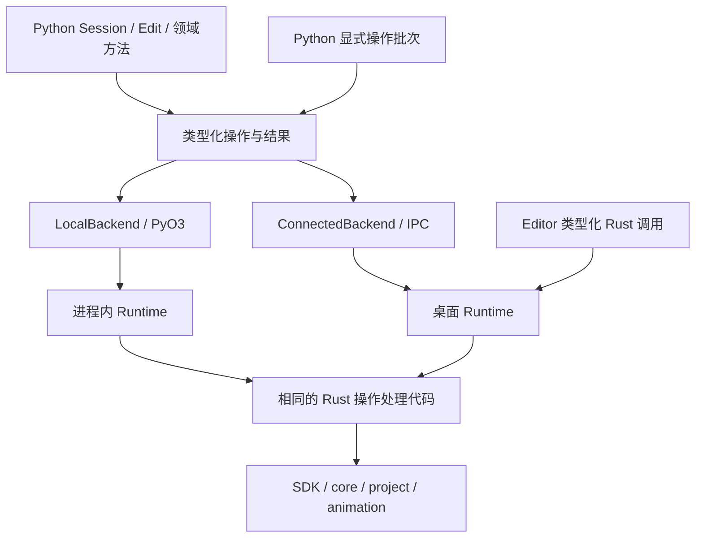

# zipzi-python2 Python SDK 建设计划

日期：2026-10-24。状态：**独立新包建设，P0/P1 实施中**。见[实施记录](python-sdk-rewrite/README.md)和[包说明](../../crates/zipzi-python2/README.md)。

本计划按用户决定，从一个全新的 `crates/zipzi-python2` 开始。把 `zipzi-python` 视为不存在：不读取或导入其实现，不复用其包装、stub、构建入口或测试 recipe，不以其接口数量、行数和性能作为交付基准，也不承担迁移、兼容或删除旧包的任务。先前放在旧 crate 内的 P1 试验代码已迁入新包；旧 crate 的接线改动已撤回。

本计划独立于 [SDK Runtime 设计](sdk-runtime-design.md)和[实施计划](sdk-runtime-implementation-plan.md)，不重写其 R0–R7 阶段。可复用的是共享 Rust SDK/core/project/animation、Runtime 和它们独立的领域测试。为新 Python 能力补强这些共享层，也必须计入本项目的实现与复杂度。

## 1. 决定与目标

**建立类型明确、执行路径统一的全新 Python 客户端。先用完整调用链验证设计，再生成机械包装。**

1. 包目录和 Cargo 包名为 `zipzi-python2`。纯 Python 分发名为 `zipzi-python2`，导入名为 `zipzi`；可选原生分发名为 `zipzi-python2-native`，导入名为 `zipzi_native._native`。
2. LocalBackend 与 ConnectedBackend 共用 Rust Runtime 类型化处理器。本地经 PyO3 进入显式拥有的进程内 Runtime，连接模式绑定已有宿主对象，不创建工程镜像或自动退回本地。
3. SDK/core 定义领域默认值、身份、不变量、算法、编辑、历史与求值；Runtime 管理会话、候选、来源、任务和预算；Python 只组织类型、生命周期、恢复和错误呈现。
4. 公共便利方法构造同一组类型化操作；显式批次按序执行，提交独立发生。不暴露任意字典/JSON 作为主要创作路径。
5. 只声明明确选出的操作。生成器负责值类型、机械转换、简单入口和分发接线，不生成领域规则、资源策略、事务状态机或行为预期。
6. 新包的 Python 源码、薄桥接、构建配置、P0/P1 工具和包级测试均放在 `crates/zipzi-python2`。共享 Rust 行为留在 SDK/Runtime；仓库级工具回归遵循根测试布局。

本项目不引入通用 RPC/IDL 平台、远程网络服务、Python 插件执行引擎或完整 asyncio API。同步调用和显式 Job 支撑首版；资源、动画、GPU 和格式 IO 是明确的后续能力，不阻塞第一条 CPU 调用链。

## 2. P0 基线与设计输入

P0 从本项目实际承诺的能力、共享 Rust 行为和新包自身的测量开始。能力清单见 [`CAPABILITIES.md`](../../crates/zipzi-python2/CAPABILITIES.md)：每项标明公共入口、共享处理器、交付阶段和独立验证证据，区分“Rust 已有”“Python 已接线”“已验证”和“尚待交付”。它不驱动生成，也不是另一份 API schema。

首批明确选出的输入/结果为：

| 范围 | 输入 | 结果与规则 |
| --- | --- | --- |
| 网格创建 | SDK `MeshCreateSpec`、明确几何和可选持久 ID | SDK 生成省略的 ID；不要求构造完整持久化 Mesh |
| 网格修改 | `MeshOperation::Rename/SetPositions` | 同一 Runtime 执行入口返回对象 ID 和确切候选来源 |
| 查询 | Session/Edit、持久 ID | 选定字段的不可变 Snapshot；读取属性不发请求；先准入再复制 |
| 编辑/历史 | 显式 Edit、提交/Undo/Redo | 普通失败不可提交；Busy 与执行失败分开；no-op/取消保留 redo |
| 工程 IO | 宿主可访问的绝对路径 | 接收后返回 Job，实际执行与持久化结果分开 |
| 恢复 | 原请求 ID、不可变请求内容、所属包装 | 同 ID 查询/恢复，禁止另起写请求掩盖未知结果 |

行为以固定顶点 ID、几何/像素、来源关系、历史及 SDK 独立测试为预期。两个 Python 后端相互一致只是必要条件，不能从同一声明同时生成实现与唯一预期。

性能基线只测新包。固定小查询、单项编辑、100 项批次、大数组/图片、Plan 和 CPU 采样的输入、样本数及环境；记录边界调用、JSON 编解码、实际复制、存活/峰值负载与耗时。未接线的工作负载和缺失指标明确列出，不用估算值冒充实测。阈值在噪声调查后冻结，不在回归失败后移动。LocalHost 管理成本必须实际测量。

## 3. 能力范围与共享边界

| 能力 | 实现责任 | 交付阶段 |
| --- | --- | --- |
| Runtime/Session/Edit/Job、结构化错误、恢复 | 共用少数手写生命周期原语；Rust Runtime 是实际状态来源 | P1 |
| 网格创建、位置、候选查询、批次 | 选定 SDK 类型和 Runtime 处理器，Python 提供明确签名 | P1 |
| PreparedImage、正式/候选 Plan、保存/重开 | 共享资源及 Plan 来源规则，Python 显式拥有 token/lease | P1，P3/P4 扩展 |
| 场景组织、参数/绑定/BlendShape、拓扑、Glue/Offscreen、Ref/Address | 先补共享 SDK/Runtime 类型化能力，再接 Python | P3 |
| 图片、附件、二进制负载、预算、原生工程和现有格式 IO | 共享资源所有权、先准入、显式 Job、取消与断连负例 | P4 |
| 动画、Expression/Physics/Pose、独立 Preview、CPU 采样、空间查询 | Rust 求值和来源，Python 不实现另一套算法 | P5 |
| GPU Observer、离线 inspection 工作流 | Rust 设备/观察能力与 Python 文件/报告组织分开 | P5 |
| 纯包/可选原生包、文档示例、CI、宿主发现 | 独立安装与构建验证；显式工作流和工具有可运行入口 | P6 |

未选定能力标为计划项，不发布只会报“不支持”的空壳。Proposal/Review 等未来新增 Runtime 能力单列，不能把它们算成已获得的 Python 能力。

## 4. 新架构与边界



图中的两套 Runtime 是不同进程中的不同实例，复用同一实现；不共享进程间指针。ConnectedBackend 只绑定宿主对象，不创建本地工程镜像。安装本地扩展也不改变一个已建立连接的执行位置。

| 层 | 保留的手写责任 | 禁止新增的责任 |
| --- | --- | --- |
| SDK/core | 领域默认值、对象身份、不变量、规划、编辑、历史和求值 | Python/wire 类型依赖 |
| Runtime 类型化处理器 | 所有权检查、来源、候选执行、资源/任务预算、事件 | 另一套 Mesh/Binding/Motion 算法 |
| 本机 transport | framing、握手、请求身份、去重/恢复、有界上传与下载 | 直接操作可变 SDK 会话 |
| PyO3 | Python 值与 Rust 类型转换、缓冲区所有权、等待时释放 GIL | 自有 Command 执行器、补 runtime ID、自建历史 |
| Python 核心 | 公共包装、上下文管理、已知/未知结果、资源释放与错误呈现 | 领域修复、隐式提交、后台镜像完整工程 |

LocalBackend 使用一个明确拥有 Runtime 的本地宿主和有界调用队列，串行进入 Runtime；耗时工作交给其执行器。宿主需要在 Python 没有下一次调用时也消费 Job 完成，不能靠 getter 顺便推进任务。同步等待释放 GIL；执行线程不反向调用 Python 用户回调，不在持有 Runtime 锁时等待依赖该线程的 Job。P1 先用最小任务验证关停和完成消费，再扩展功能。

本地 Runtime 的生命周期由显式上下文拥有，关闭会释放它的会话，不自动保存。关闭 Connected 客户端只释放该客户端资源，宿主正式会话继续驻留。两者生命周期有实际差异，不用模拟网络断线来强求形式一致。

## 5. 公共 API 的形状

模块按领域组织：`meshes`、`parameters`、`bindings`、`resources`、`scene`、`animation`、`project`。根模块只导出 Runtime 入口、Session/Edit、常用值和异常，不重新导出所有内部类。

以下是目标示意，尚不能执行；最终拼写在手写试点中确定：

```python
import zipzi
from zipzi import meshes, ops

# 两种入口由调用方显式选择；不会自动从连接模式退回本地工程。
runtime = zipzi.local()  # 可选本地扩展
# runtime = zipzi.connect(endpoint=endpoint)

with runtime:
    session = runtime.sessions.create("79000000-0000-4000-8000-000000000001")
    with session.edit("create face") as edit:
        face = edit.meshes.create(meshes.MeshSpec(...))
        snapshot = edit.meshes.get(face)
        edit.meshes.set_positions(
            face, vertex_ids=snapshot.geometry.vertex_ids, positions=new_positions,
        )
    session.project.save(destination).wait()

# 在另一项编辑中，下面两种写法是替代关系：
# edit.meshes.rename(face, "Face")
# edit.apply(ops.Rename(face, name="Face"))
# 多项已有引用上的修改可显式 edit.apply_many([...])。
```

具体约定：

- **CreateSpec、Patch/Intent、Snapshot 分开。** 创建表达必要输入，修改表达领域意图；不让调用者从查询结果补齐一整份内部持久化记录才能改名。完整替换仅在有明确语义的领域提供。
- **便利方法与操作对象只有一条执行路径。** `rename` 构造同一个 `Rename` 操作；适配层不维护第二份默认值或事务行为。操作对象用于组合和批量，不是额外的 Python Command 执行引擎。
- **读取是显式请求。** `get` / `list` / 批量查询返回带来源的快照；访问快照属性不发 RPC。列表支持有界分页和固定来源或过期检测，不能悄悄拼接不同 revision 的分页。
- **只为有价值的行为保留便捷包装。** 默认所有领域写入在 Edit 中完成，不再同时为每项操作生成 Session 自动开事务版、Edit 版和另一套字典版。高层工作流另行手写并说明历史边界。
- **显式批次按序执行，提交单独发生。** 批次不允许 commit/save/close 或嵌套批次；执行失败后整个候选不可提交，不发布部分正式结果。批次不提供独立 Undo，也不设置隐藏延迟队列。
- **批次内身份可预先表达。** 创建操作可显式带持久 ID，后续操作用该 ID 指向本批次新对象；省略 ID 时由 SDK 生成并返回。首版不实现跨结果的 Future 引用语言；需要服务器生成结果再计算下一步时使用顺序调用。
- **ID、Ref、Address 不混用。** 持久 ID 可用于显式重新查找；有效引用带所属 Runtime/Session 与 incarnation，地址额外带上下文 epoch。Undo 可恢复 ID，但不复活过期 Ref/Address；其检查由 SDK/Runtime 负责。
- **数值与大数组语义明确。** 标明浮点精度、索引范围、顺序、形状、endianness 和非有限值策略；Python 只做表达/编码检查，领域合法性由 Rust 判定。快照是不可变值或只读、由接收方持有的缓冲区。
- **公开能力只反映实际支持。** 区分契约可表达的操作、该后端实现的操作及设备能力。不因没有 GPU 而无法导入建模类型；未实现项不靠运行时空壳冒充覆盖。

## 6. 一份契约如何落地

“一份契约”不等于把所有 Rust public 字段自动发布给 Python。先人工选择操作和公共语义，再派生绑定。

### 6.1 唯一声明位置

以 Rust 中明确选出的领域输入/结果类型及 Runtime 操作注册为来源。复用已有 SDK 类型时引用其定义；需要不同公共形状时定义明确的 DTO，并手写映射到 SDK，不能把持久化 schema 原样当成 API。

每项操作登记：稳定操作名、输入/结果类型、目标对象、查询/编辑/规划/生命周期/任务类别、来源要求、处理器、能力、Python 便利入口和行为测试编号。所有权、失败后状态和预算策略引用手写实现，不把元数据扩张成业务规则语言。

一个字段结构只手写一处。生成器读取由 Rust 类型声明导出的有限 schema；该 schema 是生成中间产物，不再手写对应 JSON schema、Python dataclass 和 `.pyi` 三份规范。操作注册在 Rust 编译时绑定具体输入/结果和处理器，类型不匹配或缺处理器必须失败。P0 能力清单只记录本项目选定的承诺与交付证据，不从其他 Python 实现扫描出 API 规范。P1 先手写类型与适配，P2 再提取唯一声明及生成器。

第一版只支持试点需要的基础标量、显式可选值、记录、带标签联合、序列、受限映射及资源引用。Rust 宏/derive 或 schema 导出工具只实现这个子集；遇到新形状先评审公开语义，不建设能够理解任意 Rust 语法和泛型的编译器。具体依赖在试点后选择，本文不预先引入第三方 IDL 平台。

### 6.2 调用与执行

普通调用经过“生成的 Python 方法 → 类型化操作 → 后端适配 → Rust Runtime 处理器 → SDK”。本地桥接直接转换值与缓冲区，不经 JSON 字符串或完整 `serde_json::Value` 树；连接后端按同一声明编解码。

Runtime 将当前 `protocol::Operation` 中可复用的语义执行从 JSON 组装拆出，返回明确的 Rust 结果。wire 与 PyO3 分别适配这些结果。可以有一个内部 `invoke` 入口，但公开 Python 签名必须有具体类型；不能靠 `Any`、动态方法名反射或 `getattr` 生成看似完整的 API。

本地调用不需要 socket 的 RequestId 重放缓存；连接去重在进入同一语义处理器之前完成。去重恢复不得再次执行 SDK 操作或推进候选序号。领域输入转换不是领域验证，两后端遇到相同有效输入必须得到同样的领域结果。

### 6.3 生成边界

| 可以生成 | 必须手写 |
| --- | --- |
| Python 值类型、枚举、操作类型、明确的返回类型及公共导出 | Session/Edit/Plan/Job 等有生命周期的包装逻辑 |
| wire 编解码、Python/Rust 机械字段转换、结构形状检查 | SDK 默认值、不变量、身份处理、算法和领域错误 |
| 简单便利方法、Rust 注册/分发连接、能力目录的声明部分 | Runtime 预算、候选/资源/任务状态机与事务入口 |
| 签名文档、协议 schema、类型与 codec 一致性测试材料 | 上下文管理、连接恢复、清理策略与高层工作流 |
| 确定性生成和产物漂移检查所需元数据 | 行为 recipe、正确结果、故障注入和性能断言 |

生成产物放在明确的 generated 目录并提交仓库，禁止手改；手写文件不在覆盖范围内。生成器必须支持只检查不写入的模式，固定输入重复生成无差异。sdist 含生成所需来源与已生成产物，wheel 使用一致的产物；安装和运行时不执行生成器。

扩展常规操作的目标成本是：**一项声明、必要的 SDK/Runtime 处理器、独立行为测试**，其余机械连接生成。新增领域语义仍需正常设计和实现，不能宣称新增一行声明就自动具备功能。

## 7. 必须手写的执行与资源规则

### 7.1 Edit 与结果恢复

Runtime 是候选实际状态的来源。Python 维护已知状态以及连接结果是否待确认；不重新实现 SDK 的事务状态机。

| 事件 | 要求 |
| --- | --- |
| SDK 普通编辑失败 | 候选进入不可提交状态，捕获 Python 异常也不能继续提交 |
| Python 参数无法转换 | 当前 Edit 在公共层标为不可提交，并协调释放/abort；即使清理暂时失败也不得恢复为可提交 |
| 已确认未执行的 Busy/预算准入拒绝 | 保留候选；新请求可重试。若子操作已经开始，不能谎报整个批次未执行 |
| 写入响应丢失或超时 | 保存请求身份、摘要和所属对象，阻止后续写入；按原请求查询/恢复，不自动重放新请求 |
| `with` 退出 | 正常且可编辑才 commit；普通异常按明确状态清理；结果未知时保留恢复对象，不擅自 abort；清理错误不覆盖原异常 |
| 成功候选修改 | 普通单项、显式批次和导入均经相同入口推进候选序号；同请求恢复不重复推进 |

失败作用域必须明确：独立 `prepare_image` 或只读查询失败不污染 Edit；一个 Edit 写操作内部的图片准备/导入失败属于该写操作的失败路径。不能依赖 Python 追加 abort 请求掩盖服务器遗漏。

### 7.2 Plan、快照和对象引用

Plan 持有自己的来源和资源，报告返回纯值；应用必须匹配正式基准或确切候选身份/序号，不能只比较 revision。过期 Plan 的报告仍可读，但执行明确拒绝。释放 Plan 不破坏已经转移给候选的资源。

正式/候选查询、CPU 采样、Preview 和观察结果都带明确 SourceRef。独立 Preview 不写正式内容或另一客户端的预览。需要固定磁盘资源的快照必须固定实际不可变内容，不能只保存一个以后可能改变的文件路径。

### 7.3 图片、大数组与 IO

- `PreparedImage` 和可复用 `Buffer` 是拥有内容的资源对象。准备不等于加入文档；候选接纳、提交、历史和快照各自保留必要引用。准备 A/B 后提交 A，B 仍须可读；丢弃未使用资源可回收。
- 普通 Python 方法接受 bytes/明确的数组输入，后端负责有界传输；不公开一组平行的 `*_from_blob` 创作方法。确需重复使用同一大负载时显式准备 Buffer。
- 首个试点可以复用现有有界 JSON transport；这只是暂时实现。大数据阶段加入独立二进制负载通路及相同请求恢复规则，避免把图片或大型数组变成 JSON 数字列表。控制消息仍保持小而可诊断，不同时更换全部控制协议技术。
- 本地入参默认取得不可变所有权；可变 Python buffer 必须复制或执行明确的只读固定契约。未证明安全前不承诺零复制；GIL 释放后不得借用可能被 Python 修改的内存。
- 查询展开、编码、缓存复制、上传扩容、Vec→Arc 转换及下载前都要准入。计费区分实际负载、共享持有和保守估算，包含临时峰值；长结果采用有界分页/下载，不先完整展开再检查 frame。
- 文件路径表示所选执行宿主可访问的绝对路径；客户端 bytes 表示上传内容，二者不可混淆。IO 是明确的 Job，结果区分接收、执行完成和持久化成功；取消不冒充已经撤销写入。

这些规则复用共享 SDK/Runtime 的资源与预算能力。独立的 Rust 回归测试必须保留；Python2 还须逐项接线并验证候选准备失败、写入口来源推进及传输/转换峰值，不能把 Rust 已实现记为 Python 已交付。

## 8. 新包结构与分发

所有新包代码位于 `crates/zipzi-python2`：

```text
zipzi-python2/
  Cargo.toml                # Rust 包 zipzi-python2
  src/lib.rs                # 薄 PyO3 Runtime 适配
  pyproject.toml            # 原生分发 zipzi-python2-native，Maturin
  native/zipzi_native/       # 只包含原生 namespace
  client/pyproject.toml     # 纯 Python 分发 zipzi-python2
  client/python/zipzi/      # 公共类型、生命周期、领域模块和 backends
  tests/                    # 同 recipe 两后端、类型用例、安装验收
  tools/test.py             # 独立构建和 P1 验证
  tools/baseline.py         # 新包自身 P0 性能采集
  CAPABILITIES.md           # 本项目能力范围与交付证据
```

| 分发 | 内容 | 行为 |
| --- | --- | --- |
| `zipzi-python2` | 纯 Python 类型、异常、包装和 ConnectedBackend | 不依赖原生扩展；导入不创建 Runtime、不探测 GPU、不启动宿主 |
| `zipzi-python2-native` | `zipzi_native._native`，仅 LocalBackend | 依赖匹配的公共包；不安装或覆盖 `zipzi/`；检查契约/构建配对 |

两个分发分别构建，不靠同名 wheel 覆盖来选择后端。是否提供安装 extra，以实际元数据和安装验证决定。首版只声明经验证的 CPython 3.14；扩大平台/版本矩阵需要额外 CI 证据。源码可运行、wheel 可构建、安装后可用和完整发布验收分别记录。

逻辑上区分 generated、backends、lifecycle、领域模块和可选 inspection；P1 可以先使用少量手写文件，P2 后生成产物进入明确目录。用户类型不暴露 PyO3 pyclass，token 只藏在包装中；公共异常身份全在纯 Python 中定义。

## 9. 实施顺序与退出门槛

| 阶段 | 交付物 | 退出门槛 |
| --- | --- | --- |
| **P0 范围与基线** | 新包目录/构建边界、能力范围、首批输入/结果/失败契约、独立 Rust 证据、分层行数与新包性能基线 | 承诺能力及未交付项清楚；固定可重跑工作负载与噪声门槛；不扫描其他 Python 包来定义 API |
| **P1 手写完整链路** | 新公共包、薄 PyO3、本地宿主；网格创建/位置、PreparedImage、正式/候选 Plan、保存重开；Local/Connected 同 recipe | 固定内容、来源、像素与历史一致；候选读后写、单项/批次、失败/未知结果、无后续 Python 调用的 Job 完成及关停验证 |
| **P2 提取生成器** | Rust 操作/类型声明导出，有限生成与检查模式 | P1 独立行为测试不改预期仍通过；缺处理器、非法声明、漂移失败；本地无 JSON 适配 |
| **P3 Modeling 与身份** | 场景、参数/绑定/BlendShape、拓扑、Glue/Offscreen、Ref/Address、所有相关 Plan | 完成绑定/拓扑依赖 recipe；所有写入口推进来源；身份与上下文过期规则验证 |
| **P4 资源与工程** | 图片/附件、二进制负载、预算、完整工程与现有格式 IO、重定位、长任务 | 内存图片/未保存工程可建模导出重开；lease、查询放大、转换峰值、取消/断连释放负例通过 |
| **P5 动画与观察** | Motion/Expression/Physics/Pose、独立 Preview、空间、CPU/GPU 观察、离线 inspection | 两后端独立数值/诊断一致、Preview 隔离、候选图片可观察；GPU/授权素材按环境单列 |
| **P6 分发与使用** | 两分发的 sdist/wheel、版本配对、公开文档/示例、工具/CI、宿主发现 | 无原生连接安装、带原生本地安装、版本不匹配、真实 Editor 共享历史与刷新验证 |
| **P7 全量收尾** | 能力范围逐项验收、性能/内存对照、生成/手写责任报告 | 本项目所有承诺完成；未交付项不标完成；Runtime 未来能力及条件验收明确单列 |

P1 直接在新包实现，不再向其他 crate 放 Python 试验目录或特性开关。共享 Runtime/SDK 补强仍放共享 crate，独立 Rust 用户与 Editor 继续使用原有类型化边界。各阶段先跑聚焦测试；完整 SDK/Editor、GPU 和授权素材验收在受影响阶段收尾及 P7 安排。

## 10. 验证与复杂度门禁

### 10.1 独立行为验收

1. 无原生可导入类型/异常并连接宿主；安装扩展不改变公开类型身份。真实静态检查验证正反类型用例。
2. 便利方法和对应操作值只有一条路径；两后端内容、来源关系、回执、错误字段和历史一致。随机 ID 可归一化，关系与版本推进不可忽略。
3. 前序候选修改可见；批次中途失败无正式部分发布；捕获普通错误不能提交；Busy/预算准入与结果未知独立测试；no-op/取消保留 redo。
4. apply/批次/commit/上传/Job 启动及查询丢响应，均按原请求恢复；不重复创建、上传或推进序号。过期、客户端过期和宿主重启明确失败。
5. A/B 准备、候选/Plan/快照/Undo 持有及最后引用释放；至少 100 轮取消/淘汰直接断言底层条目/存活字节，不单靠 RSS。
6. 大记录/重复选择、分页变更、有界下载、无后续调用的 Job 完成、关闭/取消/worker 失败；临时复制与转换峰值提前准入。
7. 安装后的建模—动画—保存重开—导出 recipe；真实 Editor 共享历史/刷新；CPU 必跑，GPU/授权素材记录条件。

行为预期来自独立 SDK 结果、固定几何/像素和历史断言。生成器只能验证类型和 codec 一致性，不能生成唯一的行为预期。

### 10.2 责任与性能计数

每阶段分别报告：手写公共/生命周期、手写契约/转换、生成产物、共享 Runtime/SDK 新增代码；生成器、测试和工作流/工具另列。新包从零开始计数，不设从其他包减少某个百分比的指标；移入 Rust 的复杂度不能隐藏。

常规新增操作的目标成本为一项声明、必要的领域/Runtime 处理器和独立行为测试。领域语义始终正常设计实现；不为提高生成占比扩大 schema 或生成空壳。

持续检查：公共 API 不以任意字典/JSON 为主要入口；本地不绕过 Runtime；桥接不修补身份或持久化默认结构；生命周期共用少数原语；常规 metadata/no-op 不强迫全量模型/历史克隆；Editor/本地不被迫走 JSON；已接线、已生成、已验证分开计数。

### 10.3 测试入口

遵循根 [README 测试表](../../README.md#tests)和[工具测试说明](../../tools/README.md#test-coverage)。新包自身入口为：

```sh
./tools/test-sdk.sh python2
./tools/test-sdk.sh python2 PythonSdk.test_shared_recipe
./tools/test-sdk.sh python2 --release
uv run --locked python crates/zipzi-python2/tools/baseline.py --output target/python2/baseline-first
cargo test --locked -p zipzi-runtime --test authoring
cargo test --locked -p zipzi-sdk --test integration mesh_editing::
python3 tools/workspace/cargo_domain.py --check
```

新包行为测试及类型用例在 `crates/zipzi-python2/tests/`；生成器等仓库工具的回归仍在 `tools/tests/`；共享领域 fixture 在 `fixtures/`。不依赖其他 Python SDK 的环境、测试入口或安装产物。

## 11. 完成的定义

`zipzi-python2` 完成需要：本项目明确承诺的能力均接线且独立验证；两后端共用 Rust 领域路径；类型、错误、恢复、资源、任务和安装可用；生成只承担机械重复；常规操作不需跨多层手改同一结构；全部阶段门槛有实际证据。

当前新包已接通网格、候选查询、批次、历史、保存重开和主要响应恢复。P0 的完整性能指标及 P1 的 Python PreparedImage/Plan 等仍在进行中，不能标为阶段完成。详细结果见[实施记录](python-sdk-rewrite/README.md)。
