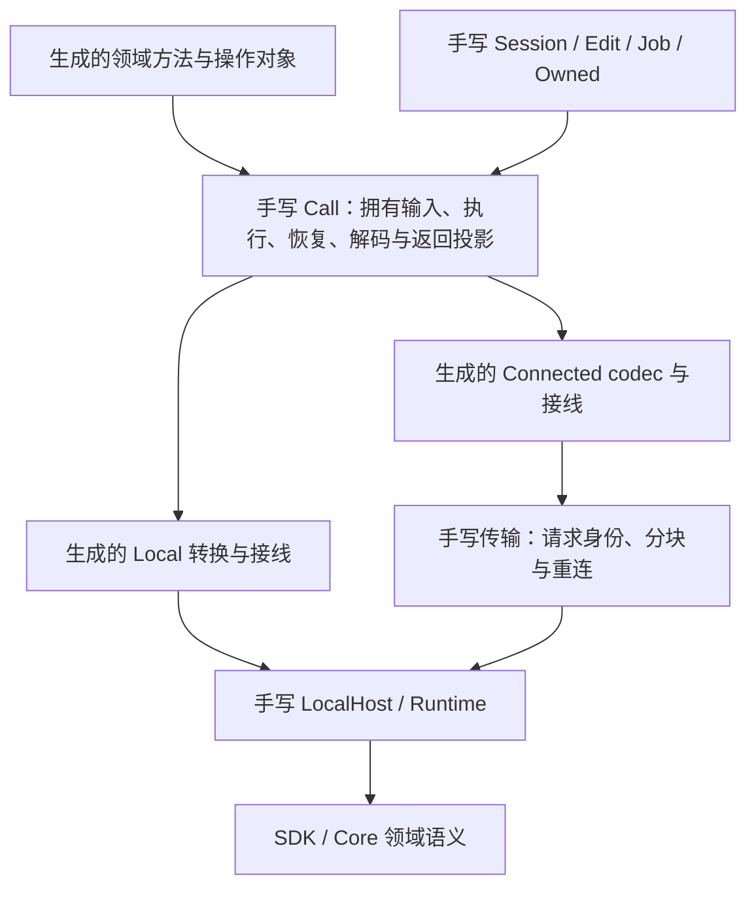

# zipzi-python2 P3A：统一 API 与 agent 契约重构

日期：2026-10-25。状态：**下一阶段，方案已制定，尚未实施/验收。** 本文从[Python SDK 建设总计划](../python-sdk-rewrite-plan.md)拆出，集中维护 P3A 的最终 API、生成/手写边界、执行规则、任务和验收；总计划保留整体阶段、历史证据与后续依赖。目标接口尚未交付，不可当作当前版本使用说明；当前用法见[包 README](../../../crates/zipzi-python2/README.md)，已有证据见[实施记录](README.md)。

## 1. 目标与范围

面向 agent 建立可发现、可预测、可恢复并能验证结果的 Python 公共契约。保留共享 Rust SDK/Core/Runtime 架构，集中修复公开返回与恢复不一致、未知结果被上下文吞掉、查询结构不统一、缺少完整分页与会话关闭，以及文档、自省和输出无界等问题。

当前 `zipzi-python2` 不需要旧 API 兼容：允许删除、重命名及改变返回类型，不保留旧别名、双入口、弃用期或迁移层。共享领域语义、资源正确性和独立行为预期继续保留；历史验收不自动证明新契约通过。

P3A 接管现有公开能力的契约、发现和生命周期，新增必要的分页、detach/close、自省与错误指引；不把完整动画、格式生态和 GPU 支持加入该阶段。当前 Buffer/图片扩展按进入 P3A 时冻结的源码/产物清单接入统一 Call 和生成接线；缺少实际验收的部分仍留在 P4 待验证栏。P3A 不新增兼容层，包版本及 native/IPC 配对一并升级，所有仓内调用者、正常 wheel recipe 和 Editor 接入改用新接口。

实施顺序为 P3A-0 → P3A-1 → P3A-2 → P3A-3/4 → P3A-5 → P3A-6，依赖与退出条件见第 5 节。P0 基线和 P6 分发验证贯穿各子任务；完整阶段依赖由[总计划](../python-sdk-rewrite-plan.md#91-阶段总表与依赖)维护。

## 2. 重构后的最终公开 API

本节是 P3A 的实现目标。冻结的是命名、结果形状、调用/恢复和生命周期契约；P3B–P5 新增领域继续使用这些规则。完整逐符号目录由 P3A-0 登记并在 P3A 退出时冻结，不能把下表未展开的已实现能力删掉来缩小验收范围。

### 2.1 模块、命名和类型

- 入口仍为 `zipzi.local()` / `zipzi.connect(...)`。不改变执行位置，不自动从 Connected 退回 Local；安装原生包不改变公共类型身份。
- 根模块导出 Runtime、Session、Edit、Job、Plan、PreparedImage、Buffer、通用结果容器、身份/来源/回执及异常。领域类型与操作只在 `meshes`、`parameters`、`bindings`、`resources`、`scene`、`sampling`、`events`、`references` 的公共模块导出。
- `ops.Operation` 只作为所有已实现领域操作的静态联合；操作构造器归所属领域：例如 `meshes.Create/Rename/SetPositions`、`parameters.Create/Patch`、`bindings.Create/SetKeyform`、`resources.CreateImage/ReplaceImage`。现有场景操作名称和字段保留在 `scene`，遵守下文统一调用规则。参数修改的字段值对象命名为 `ParameterPatch`，与操作 `parameters.Patch` 区分。
- 删除旧的 `ops.Create/Rename/CreateParameter/...` 平行导出、领域 `RenameIntent`、公开 `ApplyPlan` 操作及 `apply_plan` 别名。Plan 直接由 `edit.apply(plan)` 接纳；后端仍可使用内部 ApplyPlan DTO。
- 创建输入、修改输入与查询结果分开。领域查询数据使用 `meshes.Mesh`、`parameters.Parameter`、`bindings.MeshBinding`、`resources.Image`、`scene.Summary` 等不可变纯值；不继续发布各领域形状不同的 Snapshot/Batch 包装。
- 持久对象 ID 保持规范 UUID 字符串，运行期 `SessionId` 和 `Source` 保持结构化值。文档说明领域/会话归属；SDK/Runtime 检查有效身份，Python 不补造 ID 或伪装成可跨会话的句柄。创建时省略对象 ID 由 SDK 分配；批次内需要预先引用时允许显式 ID。
- 输入集合统一接受签名注明的 `Sequence`，在公共调用边界拥有化为不可变 tuple/bytes；参数值和操作对象构造后不得受原 list/buffer 修改影响。构造期检查类型/形状，写调用的转换检查和 Rust 领域检查遵守第 4 节失败作用域。`None` 表示保留还是清空必须逐字段明确；需要同时表达两者时使用独立的 `UNSET` 标记，禁止猜测。

### 2.2 统一结果形状

以下容器均为不可变纯 Python 值，字段访问、相等比较、repr 和摘要不发请求：

```text
Snapshot[T](source: Source, value: T)
Batch[T](source: Source, items: tuple[T, ...])
Page[T](source: Source, items: tuple[T, ...], next_cursor: PageCursor | None)
WriteResult(source: Source, ids: tuple[str, ...])
```

- 单项统一 `snapshot.value.name`；批量统一 `batch.items`，每项是同一领域的纯值，来源只放在外层。空 Batch/Page 仍有确切来源。删除旧 tuple 批量结果和混用的扁平快照。
- `get_many` 保留请求顺序和重复 ID；任一 ID 不存在、归属错误或整批超预算时整体失败，不返回部分列表。查询失败不使 Edit 不可提交。
- `WriteResult.ids` 按操作顺序拼接 SDK 返回的 ID，允许重复及一项操作返回多个 ID；它不冒充一操作一结果列表。创建便利方法必须使用已声明并测试的单 ID 投影，复杂复制映射留在专门结果或 Plan 报告中。
- 来源比较包含 Runtime、Session、正式 Version，候选还包含 Edit 身份和 sequence；不能只比较 revision。`Receipt` 区分 before/after、changed 和历史标签，`SaveReceipt` 说明保存路径、对应版本和持久化结果。
- CPU 采样统一返回 `Snapshot[sampling.Result]`，Result 持有参数、frames 和诊断；事件页使用独立的 Event Cursor，不强行伪装成模型集合 Page。注册表 `sessions.list()` 返回同一次读取的 `tuple[SessionInfo, ...]`，受宿主会话总量限制；它不属于文档对象集合。

### 2.3 对象发现、读取与分页

`session` 与 `edit` 都提供 `meshes/parameters/bindings/resources/scene` 查询；Edit 上读取的是该候选。每个领域使用相同形状：

| 入口 | 返回与语义 |
| --- | --- |
| `get(id, *, expected: Source \| None = None)` | `Snapshot[T]`；expected 不匹配时拒绝读取 |
| `get_many(ids, *, expected: Source \| None = None)` | `Batch[T]`；先对完整选择准入 |
| `list(*, name: str \| None = None, limit: int = 128, cursor: PageCursor \| None = None)` | `Page[Summary]`；首版 name 为区分大小写的精确匹配，SDK 存储顺序，重名返回所有匹配项 |

Summary 只包含适用的 ID、名称、类型、所属关系、尺寸/数量等有界元数据，不含完整几何、关键形或像素。`resources` 在 P3A 负责已实现的图片；P4 附件通过独立子集合增加，不暗中改变现有图片 get 的结果类型。

**分页采用来源变更即拒绝的契约。** 第一次读取捕获精确 Source；cursor 绑定 Runtime/Session/Edit、Source、领域、筛选、顺序和下一位置。后续页验证相同来源及筛选，任何文档/候选版本变化返回 `STALE_SOURCE`，调用方显式重新开始。首版不隐式固定整份模型、不自动合并新版本页面、不引入需要 close 的分页租约。cursor 不可变且不暴露内部 token；页恢复仍得到原请求捕获的旧页，不能变成重新查询后的新页。

分页记录数、结果字节和扫描工作量有独立准入；返回元数据不足以占满一页时可少于 limit。超预算时不得返回无进展的同一 cursor；明确报错并给出限制。测试至少覆盖 257 个对象、重复名称、空结果、页间改动、Undo/Redo、Edit sequence 变化及丢响应。分页先在 Runtime 有界读取和排序，然后才做 Python/PyO3 转换。

### 2.4 写入、Plan 与候选

| 入口 | 返回与规则 |
| --- | --- |
| `session.edit(label, *, expected: Source \| None = None)` | `Edit`；expected 只接受该会话正式来源，原子验证后创建候选；调用即开始，`__enter__` 不再创建一次 |
| `edit.meshes.create(spec)` 等创建便利方法 | `str`；返回 SDK 分配或确认的 ID |
| `edit.meshes.rename(...)`、`parameters.patch(...)`、`bindings.set_keyform(...)` 等 | `WriteResult`；只修改候选 |
| `edit.scene.create_part(spec)` 等已登记简单便利方法 | 与对应 `scene.CreatePart` 共用执行和单 ID 投影；其余场景操作仍可显式 apply |
| `edit.apply(operation: Operation)` / `edit.apply(plan: Plan)` | 两个明确 overload，均为 `WriteResult`，共用同一候选入口 |
| `edit.apply_many(operations: Sequence[Operation \| Plan])` | `WriteResult`；按序执行、整批一次 sequence 推进；最多一个 Plan 且只能位于首项 |
| `session.plan(operation)` / `edit.plan(operation)` | `Plan`；仅接纳契约列出的 `PlannableOperation` 子联合 |
| `edit.commit()` | `Job[Receipt]`；接受提交不等于已发布，显式 wait 才取得终态 |
| `edit.cancel()` | `None`；只取消未提交候选，已接受提交交给 Job |

- 便利方法仅存在于 Edit，不生成 Session 自动开事务版本。原有图片便利入口 `create_image/replace_image` 继续表达图片接纳；其输入通过 `resources.CreateImage/ReplaceImage` 构造，不另走资源事务。
- 同一领域操作同时用于直接 apply 和规划，不再维护 Rename 与 RenameIntent 两份相似字段。需要 expected label 等前置条件时放进该操作的明确字段，或由捕获地址提供；不要求所有写操作都支持 Plan。
- 网格改名使用 `meshes.Rename(id, name, *, expected_name: str | None = None)`，图片改名新增对应 `resources.RenameImage`；None 表示不增加字段值前置条件。规划时无论是否提供 expected_name，都绑定创建 Plan 时的确切 Source；显式前置条件在直接应用和规划时都由 SDK 验证。
- P3A 将现有网格/图片改名和场景规划能力接入统一 `plan`。可规划操作联合、静态签名与宿主能力由同一注册生成；新增操作先完成 Rust handler 和独立验证再加入。不要发布永远报不支持的空壳。
- `Plan.report` 是不可变缓存，含 Source、affected_ids、copied_ids、cost、losses、no_op；close 或来源过期后仍可读。正式 Plan 匹配对应正式基准的初始候选，候选 Plan 匹配原 Edit/sequence；应用失败遵守写入失败规则。
- `ObjectRef` 和 `LabelAddress` 继续是有生命周期的手写包装。`address.plan(name)` 保留为带 incarnation/context/field epoch 的规划入口，使用相同 Plan 执行原语；不能丢弃 epoch 后退化成 ID 改名。持久 ID、Ref、Address 分别说明移动、删除、Undo 后的有效性。

### 2.5 Session、Job 与资源生命周期

| 入口 | 最终契约 |
| --- | --- |
| `runtime.sessions.create(document_id: str \| None = None)` | `Session`；省略 document_id 时由共享 Rust 入口分配；不要求 agent 自己生成 UUID |
| `runtime.sessions.list()` / `.attach(id: SessionId)` | 注册表信息 / 已驻留会话；attach 不复制文档 |
| `runtime.sessions.open(path: Path)` | `Job[Session]`；已打开路径也通过缓存成功 Job 返回 |
| `session.info()` / `.show_window()` / `.subscribe()` | 显式查询或动作；窗口能力只在桌面宿主可用 |
| `session.detach()` | `None`；解除本客户端绑定，保留宿主会话和其他客户端；有未完成 Edit/Job 或待恢复请求时拒绝 |
| `session.close(*, discard_modified: bool = False)` | `SessionInfo` 终态；实际关闭宿主会话，未保存或其他客户端占用时明确拒绝；不自动保存/丢弃 |
| `session.undo()` / `.redo()` | `Job[Receipt]` |
| `session.project.save(path: Path)` | `Job[SaveReceipt]`；path 为执行宿主的绝对路径 |
| `job.wait(*, timeout: float \| None = None)` | `T`；终态成功/失败缓存并释放结果槽；超时不取消任务 |
| `job.state()` / `.cancel()` / `.close()` | 状态读取 / 请求取消 / 等待实际终态并释放；close 可抛出缓存失败 |
| `runtime.resources.prepare_image(...)` / `.prepare_buffer(...)` | PreparedImage / Buffer，明确拥有独立租约；接受 bytes/受支持的 buffer |
| `runtime.close(*, abandon_pending: bool = False)` | 关闭本地 Runtime 或释放 Connected 客户端；存在待恢复请求默认 Busy，显式 abandon 才放弃恢复并断连 |

同一 Runtime 对同一 SessionId 的多个包装共享绑定状态；detach/close 后全部失效。已确认 close 幂等并返回缓存终态；detach 幂等；重新 attach 创建有效绑定，不能复活旧 Ref/Address。关闭释放路径锁、Session 槽及其附属资源；独立 prepared image/buffer 按客户端生命周期处理。不得利用关闭一个包装偷偷关闭其他客户端正在使用的文档。至少 40 次创建/关闭和保存/关闭/重开必须在默认预算下通过。

`JobTimeout` 表示已知任务仍未结束，不伪装成未知写入，不制造 request_id=0 的 PendingRequest；网络响应丢失仍为 OutcomeUnknown。`timeout=None` 等到终态，底层单次传输仍受连接超时约束。cancel/status 的待恢复请求不能被 wait 消费；已进入 IO 的取消仍报告实际结果。显式放弃恢复后不能换身份重放原写入。

### 2.6 完整调用恢复与可观察状态

**一个公开调用只拥有一份完整的返回契约。** 内部手写 `Call[T]` 保存操作身份、已拥有输入、请求/传输阶段、解码器和公开返回投影。Local 执行和 Connected 正常/恢复都在同一边界完成解码与投影；它不成为公开 Command 或 Future 语言。

| 原调用 | 原调用与异常恢复的相同返回类型 |
| --- | --- |
| `edit.meshes.create(spec)` | `str`，包含单 ID 投影 |
| `session.scene.get(id)` | `Snapshot[scene.Summary]`，包含单项提取 |
| `edit.commit()` | `Job[Receipt]`，恢复不擅自 wait |
| `job.wait()` | `Receipt` 或对应 T |
| Buffer/图片准备、读取、close | 原公开方法的 Buffer/PreparedImage/bytes/None，包含多段传输的剩余阶段 |

`OutcomeUnknown.recover()` 恢复该异常所属完整调用，永远不重新调用用户函数。异常跨越不同方法，Python 静态检查无法从 except 分支推断原始 T；其运行时可解析注解使用 `object`，不维护不断遗漏类型的巨大 RecoveryResult 联合。需要保留静态类型时提供 `zipzi.recover_call(method: Callable[P, T], /, *args: P.args, **kwargs: P.kwargs) -> T`，其中 P 为 ParamSpec。仅接受目录中登记的公开请求方法，参数原样匹配该方法；任意 lambda、复合业务 callable 和未登记包装在执行前拒绝，避免把其外层返回转换丢失。原方法只调用一次，遇到 OutcomeUnknown 仅恢复原 Call 一次；Busy、预算、普通领域错误、JobTimeout 不自动重试，恢复仍未知则保留原异常/owner。公开示例不得依赖 Any、cast 或 type-ignore 获得表面类型通过。

删除阶段相关、返回多种生命周期结果的 `Edit.recover()` 公共入口。Edit/Job/Owned 暴露缓存的 `pending_request` 元数据；实际恢复由原异常或上述泛型辅助函数进入。旧异常在结果已解决后明确报 `NO_PENDING_REQUEST`，不能消费同一对象的后来请求。

Edit 提供纯值 `state: EditState` 和 `receipt: Receipt | None`；EditState 为 editing、committing、committed、cancelled、aborted、failed、unknown 的明确枚举，分别记录客户端已确认状态或待恢复状态；读取不查询宿主。正常退出 `with edit` 只允许已确认 committed 或显式 cancelled。普通错误被捕获后退出仍抛 EDIT_ABORTED；未知错误被捕获且没有异常传播时退出必须再次抛出可恢复的 OutcomeUnknown。已有异常传播时保留原异常并附清理说明。commit 接受但未 wait 时上下文负责 wait；显式 cancel 时 receipt 为 None，不能伪造成功回执。

### 2.7 能力、自省与紧凑输出

- `zipzi.describe(path: str) -> ApiDescription` 从发行包内的版本化目录查询一个公共类型/方法的签名、参数语义、返回、效果、生命周期、恢复、能力和示例链接。路径为明确公共路径，如 `Session.meshes.get_many`；它是静态文档查询，不执行用户字符串，不连接宿主。
- `runtime.capabilities() -> RuntimeCapabilities` 和 `runtime.limits() -> RuntimeLimits` 在 Local/Connected 都可用，明确实现、环境/设备条件及记录数/字节/会话/租约限制。瞬时对象状态通过引用能力查询获得；能力或预算查询不保证稍后一定准入。
- `runtime.connection` 仍为缓存握手信息，Local 为 None；不把它作为 Local 能力查询的替代。Secret、请求原始像素和完整模型不进入描述或日志。
- 大数组/bytes/帧的 repr 有界：默认单对象最多 1,024 字符，显示类型、来源、ID、数量/尺寸和截断提示，不展开完整负载。容器提供无 IO 的 `summary()`；完整字段仍可显式访问，摘要不触发线性扫描巨大几何或隐藏复制。
- 公开符号有明确 `__all__`；codec 的 read/wire/validate、Backend、token、生成内部类型放在内部模块。`help`、`inspect.signature/getdoc`、`typing.get_type_hints` 在纯 wheel 无原生包/无宿主时可用。长操作联合通过有名字的公开类型别名展示，避免签名展开几十个类型。

### 2.8 目标使用示例

以下使用 P3A 目标接口，必须在实施时变成独立可执行的 Local/Connected recipe：

```python
from pathlib import Path
from tempfile import TemporaryDirectory
import zipzi
from zipzi import meshes

with TemporaryDirectory() as folder, zipzi.local() as runtime:
    session = runtime.sessions.create()
    geometry = meshes.Geometry(
        vertex_ids=(42, 7, 99),
        positions=((0., 0.), (1., 0.), (0., 1.)),
        uvs=((0., 0.), (1., 0.), (0., 1.)),
        triangles=((42, 7, 99),),
    )
    with session.edit("create face") as edit:
        face = zipzi.recover_call(
            edit.meshes.create, meshes.MeshSpec("Face", geometry))
        snapshot = edit.meshes.get(face)
        edit.meshes.set_positions(
            face, vertex_ids=snapshot.value.geometry.vertex_ids,
            positions=((2., 3.), (3., 3.), (2., 4.)))
        edit.apply(meshes.Rename(face, "Final"))
    assert edit.receipt is not None
    assert edit.receipt.changed
    result = session.meshes.get(face)
    assert result.value.name == "Final"
    saved = session.project.save(Path(folder).resolve() / "project").wait()
    assert saved.durable
    session.close()
```

Connected 版本由 fixture 提供宿主可访问目录，不能用客户端 `Path.exists()` 证明宿主文件已持久化。例中只演示创建调用的恢复；提交/Job 等阶段的未知结果由专门恢复 recipe 覆盖。复合 with、控制流和业务计算不由 `recover_call` 自动重新执行。

## 3. 一份契约与生成/手写边界

### 3.1 声明来源与公开契约

Rust 中明确选出的 SDK 输入/结果和 Runtime DTO 是字段、数值类型、默认值及字段语义的唯一来源。需要不同公开形状时定义明确 DTO 和 SDK 映射，不直接发布持久化结构。扩展 ApiShape 导出类型/字段文档，保留单位、坐标空间、身份、顺序、默认值和 None/UNSET 语义；不要丢弃 `#[doc]` 后再在 Python 重写一份字段说明。

每项 Runtime 注册静态配对输入、结果、handler、能力及来源类别。在新包唯一的绑定声明处补充公共模块/方法名、参数投影、公开返回类型/投影、调用的手写原语、文档/示例/验收编号。生命周期和错误恢复只引用有限、已实现的策略名称，不把声明扩张成执行状态机的 DSL。跨字段语义和领域验证留在 Rust。

`schema/mesh.json` 改为覆盖已选契约的 `schema/authoring.json`，仍为生成中间产物，禁止人工维护第二份字段 schema。公开 API 目录、类型签名、docstring 和参考文档从同一契约输出；动态宿主能力是 Runtime 的事实，不能从静态目录推定。公开名只登记一次，根模块和领域模块的重导出也由该登记派生。

### 3.2 完整调用路径



生成的方法把返回投影传给 Call，不能在其返回后再写 `.ids[0]`、取第一项或包装 Snapshot。投影只允许契约中有限的字段选择/记录构造；复杂解码通过显式、单一手写 adapter hook 注册。Local 不走 JSON/serde_json::Value；Connected 保留不可变请求字节及原 ID。输入拥有化、传输恢复与公开返回契约共用原语，不把客户端与宿主各做一份领域逻辑。

### 3.3 责任矩阵

| 内容 | 唯一负责人 | 生成层的职责与限制 |
| --- | --- | --- |
| SDK 默认值、对象身份、算法、不变量、领域 Plan | 手写 SDK/Core | 读取声明和调用已实现 handler，不修复模型、不分配持久 ID |
| Session/候选/任务/事件/资源及预算 | 手写 Runtime | 生成选定注册/分发适配，不生成状态机 |
| 字段、领域值、枚举、操作、Source/Version/Receipt 等纯 DTO | Rust 声明；生成 Python/PyO3/wire | 三端结构从同一来源产生，领域约束与字段含义也必须有来源 |
| Snapshot/Batch/Page 等通用容器 | 手写公共值原语 | 为各领域生成具体返回类型和投影，不复制各领域包装类 |
| 领域 get/get_many/list、创建和简单修改方法 | 绑定契约；生成 facade | 统一签名、调用原语、返回投影和 docstring，不自行实现恢复 |
| Session/Edit/Job/Plan/PreparedImage/Buffer/Ref/Address 包装 | 手写公共生命周期层 | 可生成其引用的 DTO 和机械接口；生命周期方法由手写实现并登记文档 |
| 请求、解码、公开返回投影的续接 | 手写 Call 与恢复原语 | 生成器传入适配器；正常与恢复共用完整返回链 |
| socket/握手/分块传输/GIL/释放等待 | 手写 transport/host | 生成 codec/参数转换，不以覆盖同名生成方法改变传输策略 |
| 错误类别、失败作用域、恢复动作 | 共享 Runtime 事实 + 手写异常/策略映射 | 生成描述和字段，禁止生成通用盲目重试 |
| agent 工作流与独立验收预期 | 手写 examples/tests | 生成可遍历的覆盖清单，不能自己生成唯一正确答案 |

生成方法不允许被手写子类同名覆盖，也不允许 monkey patch。图片/Buffer 大负载通过明确 transport adapter hook 进入分块实现；同一操作只有一个注册，生成及手写路由能在清单中直接追踪。薄公共领域模块只重导出受管符号，不再散放第二套 codec、便捷方法或结果包装。

### 3.4 P3A 的生成范围与代码组织

P3A 覆盖所有已经公开的网格、资源/Plan、参数、网格绑定、采样、场景、事件、引用能力等领域纯值及机械转换，保留有生命周期的包装。不能只修网格后继续让其他领域使用不同返回模板。现有 20 个产物和生成代码约三分之一的统计仅为重构前观察，不作为提高比例的 KPI。

目录按职责组织：`_generated/` 保存值、操作、codec、领域 facade、公开目录/文档元数据；手写 `_calls.py`、`_lifecycle.py`、`_owned.py`、`_errors.py`、`backends/` 保存公共原语与传输。具体文件拆分可因体积调整，责任矩阵不能改变。对需要手写的特殊方法登记理由、单一 hook 和测试编号；每个例外可审计。

未实现的动画、完整 IO 或 GPU 操作不生成 public stub。P3B–P5 每增加一项能力，都补声明、必要 Rust handler 和独立测试，并由现有模板产生包装。遇到新类型形状先明确语义再扩展有限 emitter；不建设任意 Rust 语法解析器或通用 RPC/IDL 平台。

### 3.5 生成与分发门禁

生成产物提交仓库、带所有权标记，禁止手改；固定输入生成确定，`--check` 不写文件，手写目录受保护。删除旧产物和旧导出，不保留双轨模板。编译注册必须拒绝缺 handler 或输入/结果不匹配；绑定目录拒绝重复公共名、缺投影、引用未知策略和缺文档。

wheel 包含版本匹配的类型、目录、docstring、短指南和例子；安装与导入不生成代码。纯包 sdist 含文档/生成 Python；原生 sdist 含共享源码闭包、声明和生成器，并可从解包目录重新检查生成、构建和安装。契约变化升级 native/IPC 配对标识，旧 host 明确拒绝，不回退或尝试兼容。

## 4. 必须手写的执行与资源规则

### 4.1 Edit 与结果恢复

Runtime 是候选实际状态的来源。Python 维护已知状态以及连接结果是否待确认；不重新实现 SDK 的事务状态机。公开行为以第 2.6 节完整调用契约为准。

| 事件 | 要求 |
| --- | --- |
| SDK 普通编辑失败 | 候选进入不可提交状态，捕获 Python 异常也不能继续提交 |
| 写调用内 Python 参数无法转换 | 当前 Edit 在公共层标为不可提交，并协调释放/abort；即使清理暂时失败也不得恢复为可提交；在调用前独立构造值失败不改变任何 Edit |
| 已确认未执行的 Busy/预算准入拒绝 | 保留候选；新请求可重试。若子操作已经开始，不能谎报整个批次未执行 |
| 写入响应丢失或超时 | 保存请求身份、摘要和所属对象，阻止后续写入；按原请求查询/恢复，不自动重放新请求 |
| `with` 退出 | 正常且可编辑才 commit 并 wait；正常返回只表示 confirmed committed 或显式 cancelled；捕获未知异常后正常退出必须再次抛出可恢复异常；已有异常传播时保留原异常，结果未知不擅自 abort |
| 成功候选修改 | 普通单项、显式批次和导入均经相同入口推进候选序号；同请求恢复不重复推进 |

失败作用域必须明确：独立 `prepare_image` 或只读查询失败不污染 Edit；一个 Edit 写操作内部的图片准备/导入失败属于该写操作的失败路径。不能依赖 Python 追加 abort 请求掩盖服务器遗漏。

### 4.2 Plan、快照和对象引用

Plan 持有自己的来源和资源，报告返回纯值；应用必须匹配正式基准或确切候选身份/序号，不能只比较 revision。过期 Plan 的报告仍可读，但执行明确拒绝。释放 Plan 不破坏已经转移给候选的资源。

正式/候选查询、CPU 采样、Preview 和观察结果都带明确 SourceRef。独立 Preview 不写正式内容或另一客户端的预览。需要固定磁盘资源的快照必须固定实际不可变内容，不能只保存一个以后可能改变的文件路径。

### 4.3 图片、大数组与 IO

- `PreparedImage` 和可复用 `Buffer` 是拥有内容的资源对象。准备不等于加入文档；候选接纳、提交、历史和快照各自保留必要引用。准备 A/B 后提交 A，B 仍须可读；丢弃未使用资源可回收。
- 普通 Python 方法接受 bytes/明确的数组输入，后端负责有界传输；不公开一组平行的 `*_from_blob` 创作方法。确需重复使用同一大负载时显式准备 Buffer。
- 首个试点可以复用现有有界 JSON transport；这只是暂时实现。大数据阶段加入独立二进制负载通路及相同请求恢复规则，避免把图片或大型数组变成 JSON 数字列表。控制消息仍保持小而可诊断，不同时更换全部控制协议技术。
- 本地入参默认取得不可变所有权；可变 Python buffer 必须复制或执行明确的只读固定契约。未证明安全前不承诺零复制；GIL 释放后不得借用可能被 Python 修改的内存。
- 查询展开、编码、缓存复制、上传扩容、Vec→Arc 转换及下载前都要准入。计费区分实际负载、共享持有和保守估算，包含临时峰值；长结果采用有界分页/下载，不先完整展开再检查 frame。
- 文件路径表示所选执行宿主可访问的绝对路径；客户端 bytes 表示上传内容，二者不可混淆。IO 是明确的 Job，结果区分接收、执行完成和持久化成功；取消不冒充已经撤销写入。

这些规则复用共享 SDK/Runtime 的资源与预算能力。独立的 Rust 回归测试必须保留；Python2 还须逐项接线并验证候选准备失败、写入口来源推进及传输/转换峰值，不能把 Rust 已实现记为 Python 已交付。

### 4.4 结构化错误与下一步动作

SdkFailure 保留稳定的 code、operation、object_ids、field_path、expected/actual_version、referrers、edit_state；补充 `recovery_action` 和可选的 requested/allowed/limit_name。数值限制来自实际拒绝点，不把客户端猜测当成宿主事实。策略由错误代码、是否准入、实际候选状态和操作类别共同决定，不只设一个 retryable 布尔值。

| 事实 | recovery_action | 调用方行为 |
| --- | --- | --- |
| 确认未进入执行的 Busy | `retry` | 等待原因消除后重新提交；禁止无界忙循环 |
| 请求数/负载超限且候选未改变 | `reduce_request` | 缩小批次或负载；不能在需要原子性的批次上偷偷拆分 |
| 结果槽/租约占用 | `release_resources` | wait/close 已有资源后再提交 |
| 写入结果未知 | `recover_original` | 保留 owner 和原请求，恢复；不得重新执行用户 callable |
| 写失败且候选不可提交 | `restart_edit` | 修正输入并创建新候选，不继续使用失败 Edit |
| 只读来源/Plan 创建来源过期 | `refresh_source` | 重新读取或规划；若是 Plan 应用已使 Edit 失败，则动作是 restart_edit |
| 事件缺口 | `resync` | 显式重新同步该订阅 |
| Job 正常等待超时 | `wait_job` | 保留 Job，再次等待；不声称取消或执行失败 |
| 原请求已过期、宿主重启、会话故障等无法安全续接 | `stop` | 报告可确认状态，由调用方检查正式来源；不自动用新身份重放 |

这些动作是结构化指引，库不自动执行领域重试/拆批/重建 Edit。清理失败保留可恢复的所属异常；SdkFailure 可持有结构化 cleanup，普通 Python 异常通过异常链/notes 保留，不覆盖原失败或写入任意不存在的 BaseException 属性。

### 4.5 并发与会话关闭

同一 Connected Runtime 串行化 wire 请求；一项结果未知会阻止该连接的新请求，不能被另一个 Session/资源操作抢占。跨客户端并行采用各自连接，共享 Session 的发布由 Runtime 验证；开始候选的 expected 校验不保证之后不会有冲突。冲突的版本信息和候选状态必须结构化返回，禁止隐式覆盖正式内容。

Session detach/close 复用并补齐 Runtime 的会话成员、路径锁和清理规则；Python 只维护已确认绑定状态。close 的 modified/其他客户端占用等拒绝不得改变会话和资源；成功关闭释放 Session 表与路径锁。未知关闭保留原 owner，不能先把包装标记为 closed。运行期包装不承诺可跨线程并发修改，文档明确推荐一个拥有者顺序操作 Edit；只读快照可自由传递。

## 5. 实施任务与交付物

P3A 保留共享 Rust 架构，重新组织 Python 公开契约及机械接线。各任务顺序验收；任务完成不能只填“接口已实现”，必须关联独立测试、安装产物与结果记录。

| 任务 | 工作与交付物 | 前置及完成条件 |
| --- | --- | --- |
| **P3A-0 冻结契约与失败基线** | 记录 Git SHA/dirty、客户端/原生产物/宿主哈希及实际能力；逐项登记所有现有公共符号到第 2 节目标名、类型、行为或删除理由；保留已有数值测试；给本轮发现的问题添加定向失败用例 | 必须覆盖创建/get/commit 恢复返回、吞掉未知异常、类型自省、257 项分页、40 次会话关闭；登记新目标方法的完整签名和结果类型，不能只有方法数量 |
| **P3A-1 完整调用与恢复原语** | 实现 Call[T]、公开返回投影、recover_call、错误动作、Edit state/receipt、JobTimeout 与上下文规则；先用少量手写/生成适配验证 | P3A-0；正常/故障恢复返回类型一致，原请求方法一次执行，任何失败不产生重复写入或静默成功 |
| **P3A-2 统一值、操作和规划** | Snapshot/Batch/Page 及纯值分离；领域操作归位；参数/绑定/采样/事件/引用 DTO 纳入单一声明；统一 plan/apply；删除旧别名和重复意图 | P3A-1；全部现有领域保持内容/来源/历史/像素/数值断言，纯包及静态正反类型可验证 |
| **P3A-3 生成边界与公共包装** | 扩展有限 schema 文档字段、绑定注册、facade/返回投影/目录输出；移除生成方法同名覆盖与手写重复 codec；为二进制传输登记唯一 hook | P3A-2；所有现有领域都走统一调用边界，例外清单为空或有具体必要性/唯一 hook/独立测试；漂移、编译配对和所有权检查通过 |
| **P3A-4 发现、分页与生命周期闭环** | Runtime 有界元数据分页/来源失效、名字过滤；公开 capabilities/limits；Session detach/close 和成员/路径释放；紧凑 repr/summary | P3A-1/2；Local/Connected 的集合、关闭、其他客户端保护、预算及故障验收通过；不克隆完整模型后再切页 |
| **P3A-5 agent 文档与安装任务** | 文档元数据贯通 Rust→导出→docstring；随 wheel 打包版本目录、短指南和可执行 recipes；纯包自省；构建 agent 任务 fixture/记录器 | P3A-3/4；第 6 节全通过，任务只依赖正常安装包及其文档；旧实验文档不能成为默认指南 |
| **P3A-6 综合验收和阶段交接** | 正常双 wheel/配对 sdist、独立故障宿主、当前生产 Editor、P0 对比及 agent 任务；更新能力/实施记录，删除旧公开入口 | P3A-0…5；[总计划独立行为验收](../python-sdk-rewrite-plan.md#101-独立行为验收)中的已实现能力及本文第 6/7 节全部达到门槛；未满足项列 blocked/pending 原因，不标完成 |

退出报告须逐项列出最终公共目录、生成/手写责任、所用文档和包哈希、同 API 两后端对照、故障结果、agent 每次运行及性能。文档/agent 测试工具放 `tools/`，其回归放 `tools/tests/`；SDK 行为/类型/安装例子放本 crate `tests/`；可复用 fixture 放 `fixtures/`。首次实现命令入口时同步 README 和 `--help`，本计划不把未来命令记为当前可运行。

## 6. 公共契约、文档与自省验收

下列 D 门禁属于 P3A 必须完成的工作，不推迟到 P6 最后收尾。生命周期规则人工维护，领域字段说明随声明导出；英文为公共 API 参考的基准语言，中文 agent 指南可以补充，但不能维护不同的语义。

| 门禁 | 可检查的通过标准 |
| --- | --- |
| **D01 公共符号全集** | 所有 `__all__` 符号、公开对象上的方法/属性与公开路径登记在同一目录；无失效导出、旧别名、Backend/token/codec 泄漏；手写特殊方法逐项登记实现及文档来源 |
| **D02 语义 docstring** | 每个公开 callable 都有用途/前提、参数语义、返回、效果与 IO/阻塞、限制、异常/候选状态、恢复动作、资源责任和最小例子或适用项说明；所有公开值字段说明单位/坐标/ID/顺序/None/默认值；不能把自动构造签名计作文档 |
| **D03 文档来源** | Rust 字段说明经 ApiShape/exporter 到生成文档；Python 方法语义来自唯一绑定或手写原语文档；变更字段/投影后生成目录、签名、docstring/参考同步变化，故意漏改有负控制 |
| **D04 离线自省** | 纯 wheel 无 native/宿主/GPU、从 `/tmp` 使用 `-I` 可导入；对全部公开 callable/types 检查 signature/getdoc/get_type_hints，无 NameError/未解析前向引用；describe 不发请求，不实例化资源 |
| **D05 精确类型** | 创建/get/get_many/plan/commit/wait/recover_call 正例的类型与目标一致；错误参数/错误领域类型被严格检查；没有公开 Any、type-ignore 或为通过测试添加 cast；异常直接恢复的 object 限制有准确说明 |
| **D06 可执行示例** | 最小创建、发现重名、候选读取、混合批次、Plan、资源、提交/保存、关闭/重开及错误恢复例子在适用的两后端执行，使用固定独立断言；响应丢失例子不以再次调用原写入伪装恢复 |
| **D07 有界呈现** | 1,000 顶点、百万级元素摘要、图片字节、采样帧/Batch 的默认 repr 各不超过 1,024 字符；不发 RPC、不展开负载、不做整份复制；日志不含凭据/像素负载；明确访问完整字段仍准确 |
| **D08 包与文档配对** | 正常 pure/native wheel、配对 sdist 含同版本目录、参考、短指南和 recipes；目录记录包/契约版本与构建摘要；历史计划/旧 API 不进入默认帮助；文档链接在安装环境有效 |

Docstring 模板的重点是行为，不能重复类型后留空：例如 Geometry 必须说明 triangles 引用 vertex_ids 而非位置索引，坐标空间与 UV 约定从 Rust 语义核对；save 必须说明宿主绝对路径和 durable；close 必须说明等待/释放/取消的区别；get_many 必须说明来源、顺序、重复与全选失败；Plan 必须说明精确来源和失效。

短指南作为包资源提供，`zipzi.describe("zipzi")` 指向它；按“发现能力 → 明确选择会话/对象 → 读取 → 编辑/必要时规划 → 等待提交 → 验证 → 保存/释放”组织。一个最小工作流控制在约 1,500 个中英文词以内，深入字段/错误规则按公共路径查询，避免一次向 agent 倾倒全部 API。公开方法签名尽量使用可读的有名类型别名。

## 7. 行为与 agent 任务退出矩阵

先运行确定性的公共契约回归，再运行独立 agent 任务。所有普通调用都通过已安装包；下列 C 编号只用于本计划，不复用 Runtime 的 A 系列验收编号。故障控制只在外部 test-support fixture 提供，agent 不能调用私有注入接口。两类门禁分别记录，agent 能完成任务不能掩盖生命周期 bug。

| 门禁 | 必须验证的结果 |
| --- | --- |
| **C01 返回与恢复闭合** | 对所有公开请求入口登记正常/丢响应结果类型；重点逐个覆盖所有创建便利方法、scene 单项/get_many、commit、wait、prepare/read/close、分页多步传输。公开投影执行一次，内容/来源/ID/阻塞职责一致 |
| **C02 异常与上下文** | 捕获普通失败仍不可提交；捕获 OutcomeUnknown 后 with 退出再次可恢复；Busy/预算保留可编辑候选；构造值失败与写调用内失败区分；清理异常不覆盖原异常；显式 cancel 的正常退出不冒充 commit |
| **C03 身份与幂等** | 原 RequestId/不可变输入恢复，不重复创建或推进历史/sequence；旧异常不能消费新请求；host/client/request 过期明确失败；recover_call 的已登记方法严格一次执行，任意业务 callable 被拒绝，最多一次自动恢复且未知状态仍可继续恢复 |
| **C04 集合与来源** | 空结果仍有来源，批量保序保重复、缺项全选失败；超过 256 个对象完整分页；重名不随意选中；页间正式/候选变更与 Undo/Redo 拒绝旧 cursor；恢复保留原页；查询失败不毒化候选 |
| **C05 会话生命周期** | 默认预算下至少 40 次创建/关闭、路径保存/关闭/重开；modified 默认拒绝且状态不变；其他客户端占用受保护；detach 与 close 区别明确；别名包装失效、丢关闭响应、资源/路径/槽释放均有证据 |
| **C06 规划与资源** | 同一操作直接/规划应用结果一致；正式/候选来源、失效、跨 owner、关闭/Undo 的规则不退化；现有固定像素、BlendShape/绑定/拓扑数值测试继续通过；独立资源及历史持有/100 轮回收保持原门槛 |
| **C07 Job 与传输** | JobTimeout 不等于 OutcomeUnknown/CANCELLED；commit 恢复只返回 Job；排队/已进入 IO 的 cancel 语义、缓存失败、结果槽释放、关闭时等待/GIL、二进制阶段与清理恢复分别通过 |
| **C08 生成边界与发行** | 公共目录与签名配对、缺 handler/投影/文档的负控制、无同名覆盖、重复生成与只检查不写；纯包连接/原生 Local/sdist 重建及当前 Editor 使用新接口；禁止 Local JSON 往返的原断言继续通过 |

agent 任务只给正常安装包、随包文档、任务说明、fixture 可访问路径和明确资源预算；不提供仓库源码、测试答案、私有方法或本次对话。同一目标由独立验收器检查模型/像素/版本/历史/文件，不以 agent 声称成功作为通过。

| 任务 | 环境 | 独立成功判据 |
| --- | --- | --- |
| **G01 发现并选择** | Local/Connected | 多 Session 和重名对象中按所属关系选对目标；能力不足时准确报告，无猜测 ID/方法、无误改对象 |
| **G02 建模与验证** | Local/Connected | 创建非连续 vertex_ids 的网格、参数与绑定，读取候选并核对固定 CPU pose，提交只有预期历史；从文档得知三角形 ID 语义 |
| **G03 分页与更新** | Local/Connected | 发现至少 257 个对象；fixture 在页间修改来源后，明确重读且不拼接不同版本；最终对象集合完整 |
| **G04 规划与失败处理** | Local/Connected | 读取 Plan 成本/损失；来源失效后重新规划；普通写失败后重建 Edit；没有在失败候选上继续提交或盲目重试 |
| **G05 图片/工程闭环** | Local/Connected | 准备/接纳/替换图片、正确释放、Undo/Redo、保存并重开核对像素；使用宿主路径和真实保存回执 |
| **G06 有界长期使用** | Local/Connected | 40 次会话生命周期在默认槽预算内完成；未保存关闭拒绝后按任务要求保存或显式丢弃；输出使用摘要而非倾倒全部数组 |
| **G07 写入丢响应** | Connected | fixture 丢创建/应用响应后恢复原调用，得到正确返回类型，最终无重复对象或历史；不靠新写请求试探结果 |
| **G08 提交与 Job 丢响应** | Connected | fixture 丢 commit/终态响应后区分 Job 与 Receipt，等待并验证实际结果；上下文未确认时不报告成功 |

P3A-0 固定 agent 模型/版本、提示、工具、每次调用/时间/token/输出预算和 fixture 种子；G01–G06 两后端、G07–G08 Connected，共 14 个任务环境，各运行 3 次，共 42 次。**至少 38/42 成功，且每个任务环境至少 2/3 成功；任何重复写入、误改其他对象、静默部分发布或把未知结果报告为成功都直接阻断退出。** 所有运行（含失败）保留；不挑最好的一次，不在看到失败后放宽门槛。agent 服务不可用时标未验证，不以手写 recipe 替代。

报告每次成功/失败、调用次数、首次正确调用前的探索次数、虚构 API 次数、恢复动作、输入/输出 token 与日志大小。D/C 确定性门禁必须全部通过；agent 比率用于评估可用性，不能抵消 D/C 失败。性能按[总计划 P0 基线](../python-sdk-rewrite-plan.md#22-p0-试点测量与统计范围)独立采样，文档/摘要改善不掩盖额外 RPC、完整克隆或资源泄漏。

## 8. 阶段退出与后续交接

P3A 完成必须同时满足第 5 节全部任务、第 6 节 D01–D08、第 7 节 C01–C08 和 G01–G08 门槛，以及[总计划独立行为验收](../python-sdk-rewrite-plan.md#101-独立行为验收)中适用于已实现能力的要求。接口已接线、源码验证、安装验证和 agent 验收分别记录；任何未满足项保留 pending/blocked 及原因，不以已有旧接口的通过记录代替。

测试遵循[根 README 测试表](../../../README.md#tests)和[总计划测试入口](../python-sdk-rewrite-plan.md#103-测试入口)，先运行受影响模块的定向测试，再在 P3A-6 汇总完整阶段证据。未来测试入口实现时同步 README 和 `--help`，不能把规划中的命令记为已可运行。

退出时更新[能力清单](../../../crates/zipzi-python2/CAPABILITIES.md)和[实施记录](README.md)，登记源码/工作区与安装产物身份、公共目录、生成责任、两后端及 Editor 结果、全部 agent 运行和 P0 对比。保留重构前证据及原始基线，新契约另建结果记录。

通过后按[总计划后续任务调整](../python-sdk-rewrite-plan.md#97-p3a-之后的任务调整)推进 P3B/P4 剩余领域、P5 和 P7；新领域沿用本文契约。Runtime R0–R7 编号与已交付事实保持，P3A 不宣称完成 Runtime R4，也不把尚未实现的动画、完整格式生态或 GPU 能力计作本阶段交付。
