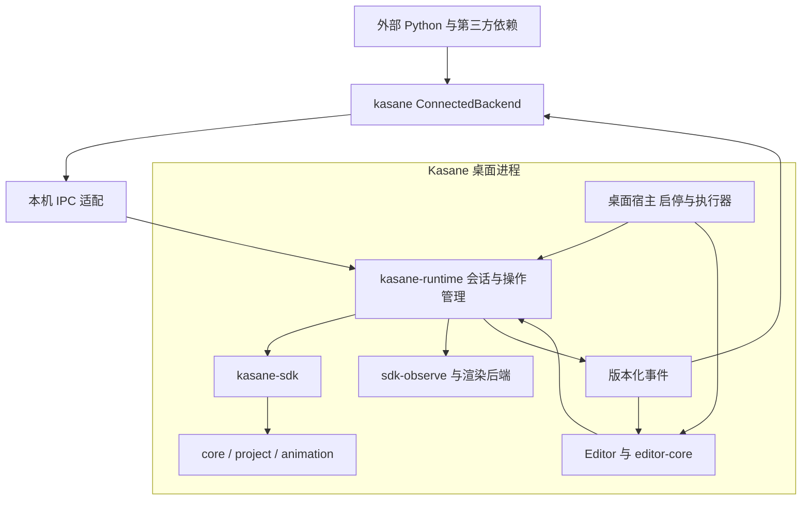

# SDK Runtime 与 Editor 同进程详细设计

合仓导航：SDK 与 Editor 现位于同一仓库的根 `crates/`，Editor 资产位于 `crates/kasane-editor/assets/`；下文两仓名称表示原模块职责，旧 R0 记录保留原路径与 SHA。新采集使用同一仓库 SHA、dirty 状态和根锁文件。
日期：2026 年 10 月 23 日。状态：**配对工作树中已交付 R0 准备；Runtime/连接能力尚未实现**。

实际进展与证据见 [R0 实施记录](sdk-runtime/r0-preparation.md)，不以本文的目标能力代替实施结果。

实施顺序、跨仓交付物和验收编号见[分阶段实施计划](sdk-runtime-implementation-plan.md)。两份文档以本文件定义行为契约，以实施计划定义交付门槛；实施结果另行记录，不能把本文中的目标能力表述为现有能力。

## 1. 产品目标与已确定决策

Agent 通过 Python SDK 独立完成全过程 modeling / animation，包括观察、诊断、修改和导出。Editor 是创作者 inspect、review 和精细调整的窗口。人的修改进入同一原生创作状态，供 agent 继续制作。

确定采用以下架构：

1. 保留 `kasane-sdk`，继续拥有领域编辑契约、候选、版本、历史和工程操作。
2. 在 `kasane-2d` 新增薄的 `kasane-runtime` crate，管理会话托管、操作对象、调度、事件和客户端生命周期，不依赖 GPUI。
3. Editor 与 Runtime 位于同一个桌面进程。Editor 通过类型化 Rust 接口调用 Runtime，无 IPC 编解码开销。
4. Python 在独立进程和自己的环境中运行，通过连接后端调用 Runtime 中的 SDK。保留现有独立执行的 NativeBackend。
5. 每个托管会话只有一个正式 `AuthoringSession` 和一套历史。Python 按需读取数据，不为连接建立第二份完整工程。
6. 桌面宿主生命周期独立于窗口和脚本。关闭窗口不释放会话，Python 退出不终止宿主。
7. 原生工程仍用于保存、恢复和分发，不承担每次人机交接的同步协议。

原设计阶段只交付本文与实施计划，未创建 crate、改 API、调整包结构或修改现有行为。后续实施按分阶段计划另行记录。项目未发布，允许破坏式重构，不要求旧实验协议或旧包布局迁移。

首期范围为本机 IPC、单个桌面宿主中的多文档、多客户端。网络服务、多人协同、自动语义合并、跨重启恢复完整 Undo 栈、任意脚本在宿主内执行均不属于本计划。Review 保留候选和只读快照；完整分支历史与选择性合并另行设计。

## 2. 现状与证据

调查基线为 editor `24601bc`、kasane-2d `b86b13b` 及当时工作区；editor 存在进行中的 UI 改动。该基线用于说明现状，实施 R0 必须重新记录两个仓库的确切 revision 和工作区差异。

| 现有位置 | 已有能力 | 本次需要改变的边界 |
| --- | --- | --- |
| [SDK session](../../crates/kasane-sdk/src/session.rs) | `AuthoringSession`、历史、快照、事件、`begin_owned_edit` | 保持领域所有权，由 Runtime 托管实例；补齐候选观察等公共契约 |
| [SDK edit](../../crates/kasane-sdk/src/edit.rs) | `commit_to` 校验完整 Version，原子发布并生成回执 | 提交不应被重复实现；昂贵准备与发布需要明确调度边界 |
| [SDK project IO](../../crates/kasane-sdk/src/project_io.rs) | 保存协调历史资源路径及已保存基线 | 统一保存入口，明确忙碌和失败后的会话归还 |
| [Editor Document](../../crates/editor-core/src/document.rs) | 同时持有 SDK 会话、候选、选择和投影缓存 | 拆开正式会话所有权与 Editor 视图适配 |
| [工作区 entry](../../crates/editor-core/src/workspace/entry.rs)、[IO](../../crates/editor-core/src/workspace/io.rs) | 多文档、运行期身份；保存将整个文档会话交给后台 | Runtime 管理文档生命周期，Editor 保留视图和交互状态 |
| [发布适配](../../crates/editor-core/src/authoring/publication.rs) | 回执驱动投影更新，当前会消费 SDK 事件 | 统一事件消费，保留现有增量更新策略 |
| [应用入口](../../crates/kasane-editor/src/lib.rs) | 最后一个窗口关闭时退出应用 | 宿主常驻与窗口开关分离 |
| [Python NativeSession](../../crates/kasane-python/src/session.rs) | 独立 `Arc<Mutex<AuthoringSession>>` | 增加连接后端，不向连接模式复制这个会话 |
| [Python 公共包](../../crates/kasane-python/python/kasane/__init__.py)、[Session](../../crates/kasane-python/python/kasane/_session.py) | 公共 API 直接依赖 `_native`；Plan、Handle 等为 PyO3 对象 | 分离公共值类型、后端引用和可选原生扩展 |
| [Observer](../../crates/kasane-sdk-observe/src/lib.rs) | 不可变观察输入、空间检查和离屏渲染 | 接受明确的正式/候选快照来源，按需执行 |

旧[第一阶段架构](../archive/editor-foundation.md)把 Python 连接排除在当时范围之外。本设计更新该范围，保留其中的单一历史、文档身份、SDK 领域所有权和后台结果版本检查原则。对象身份与编辑规则继续遵循[对象创作核心方案](unified-object-authoring-core.md)。

## 3. 分层、依赖和 Runtime 厚度



`kasane-runtime` 的“薄”指不拥有第二套领域规则，不代表省略会话和连接管理。新增建模能力应主要修改 core/SDK 与绑定；Runtime 只增加路由或类型适配。禁止在 Runtime 重新定义 Mesh/Binding/Motion 的合法性、复制闭包、默认结构或 Undo。

| 层 | 负责 | 不应承担 |
| --- | --- | --- |
| core / project / animation | 原生数据、不变量、持久化、求值与播放规则 | 客户端、窗口或连接生命周期 |
| SDK | 查询、编辑、规划、版本、句柄、原子提交、唯一历史、候选观察 | socket、窗口、线程池实现 |
| Runtime | 会话注册、操作对象、执行协调、预算、事件分发、客户端生命周期 | 建模算法、通用第二文档树、第二历史栈 |
| IPC 适配 | 握手、DTO/二进制传输、请求关联、错误映射 | 领域算法、直接访问可变文档 |
| editor-core | 选择、工具、交互协调、投影与缓存更新 | 持有另一份可写正式工程 |
| Editor / 宿主 | GPUI、原生窗口、执行器、进程启停、连接监听装配 | Python 解释器或 agent 执行环境 |
| Python facade | 类型、上下文管理器、Python 工作流、后端适配 | 复制领域规则或隐式同步完整工程 |

Runtime 放在 kasane-2d，以便独立测试和未来无界面宿主复用。基础 crate 不强制依赖 GPU、GPUI 或 PyO3；观察能力通过可选适配接入。首期协议与本机 transport 可作为该 crate 中边界清楚的模块/feature，只有独立依赖图或复用需要时再拆 crate。

SDK 不反向依赖 Runtime；standalone Rust/Python 可继续直接调用 SDK。桌面托管会话的可变引用只在 Runtime 内部使用，不向 UI 或 IPC 暴露可绕过发布流程的 `&mut AuthoringSession`。

## 4. 状态、身份与资源所有权

### 4.1 会话与视图

Runtime 管理 `SessionEntry`，其正式内容由一个 `AuthoringSession` 持有。Editor 管理 `DocumentView`，引用会话并保留选区、工具、面板、视口和投影缓存。具体 Rust 类型名可以调整，所有权不可回退。

| 状态 | 所有者 | 释放条件 |
| --- | --- | --- |
| 正式模型、动画资源、历史、modified | SDK，实例由 Runtime 托管 | 显式关闭 Session 或退出宿主 |
| SDK Edit、Plan、地址、对象句柄 | SDK 定义语义；Runtime 注册与托管 | 完成、取消、显式释放、失效或客户端清理 |
| 客户端连接、请求记录、Job、订阅 | Runtime/transport | 完成、过期或断连策略 |
| 选择、焦点、布局、鼠标捕获 | Editor | 视图关闭或上下文转换 |
| 参数采样值、播放钟、Physics 状态 | 每个 Preview 实例 | 观察结束或显式释放 |
| GPU 资源、解码图像、只读快照 | 渲染/资源服务，按引用和预算 | 最后引用释放及缓存淘汰 |

宿主内允许保留只读快照、候选和渲染缓存；不宣称所有数据均零复制。对象查询不应每次深拷贝整个工程。同进程读取优先复用已有借用、共享负载及增量索引，复制和缓存必须计入预算。

### 4.2 身份

- `RuntimeInstanceId`：每次宿主启动生成，隔离重启前后的 token 和请求结果。
- `SessionId`：Runtime 中的运行期会话身份；不使用工程 UUID 或路径代替。
- `Version`：保留 SDK 的 session/generation/revision，用于内容与提交校验。
- `ClientId`：客户端实例；传输连接断开和客户端身份消失分开处理。
- `EditId / PlanId / PreviewId / SnapshotId / JobId / ProposalId`：带所属会话、拥有者和生命周期的远端引用。
- `ViewId + context_revision`：Editor 上下文身份，和内容 Version 分开。

对象存活判断沿用 SDK incarnation、地址 epoch 和 generation。Runtime token 仅负责路由和存活容器，不能让删除后 Undo 恢复的对象继续接受旧句柄。正式内容与候选还需区分 `SourceRef`，不能仅因 revision 相同而互用 Plan。

同一规范化工程路径重复打开，返回已存在的会话；另存为不得覆盖另一托管会话的位置。未保存文档正常具有 SessionId。Session 级原有 import/replace 语义须保留并明确推进 generation；工作区导入新模型则创建新 Session，不把“替换”和“新建”合成一个隐式行为。

Runtime 注册表同时管理已打开路径和在途 Open/Save As 的预留，按工程身份统一目录、manifest 等等价入口。派发 IO 前在宿主调度点原子检查并预留，覆盖其他会话尚未完成的加载与保存；每会话 Busy 不能代替跨会话路径保护。在途打开的重复请求等待/复用原操作或明确返回 Busy，不能再创建一次加载。Save As 期间继续占有旧路径，成功后切换身份，失败保留原身份；临时目标预留只在任务完成或确认停止后释放，取消请求本身不构成释放条件。此保护适用于同一 Runtime 的所有 UI/IPC 入口，不宣称协调外部独立进程的文件写入。

### 4.3 文档状态

会话采用 `Ready → Busy(JobId) → Ready` 及 `Closing → Closed` 状态；持有正式会话的 worker panic 且一致性无法确认时，从 Busy 进入 `Faulted`，而不是自动恢复 Ready 或永久等待。Faulted 拒绝正式写入/保存，仅提供明确标注的可用冻结来源与故障结果，显式关闭后才能按正常打开流程重建会话，不承诺恢复未保存内容或历史。候选列表、交互占用和只读 Preview 是会话下的独立状态，不等价于整个文档忙碌。

只有明确的 session close/shutdown 能释放正式会话。关闭标签页或窗口解除视图；释放文档是独立动作，须检查脏状态、任务和其他使用者。启动/恢复 UI 应列出仍驻留的会话，不能让关闭标签页的工程成为不可发现的后台状态。

## 5. 调用接口与 Python 后端

### 5.1 调用入口

以下是接口类别，非新的领域实现层：

| 接口类别 | 输入/结果契约 |
| --- | --- |
| Session | create/open/list/save/close、路径身份、状态和当前 Version |
| Query | 明确 Session/SourceRef，返回对象、集合、属性、几何、诊断和对应版本 |
| Edit | begin/apply/query/commit/cancel、固定基准、事务内读后写 |
| Plan | SDK 意图、影响/成本/损失报告、版本与来源约束、执行和释放 |
| Preview/Observe | 固定来源、显式参数/时间/表达式计划、独立状态、图像与诊断结果 |
| Job | JobId、进度、取消、状态和结构化结果 |
| Subscribe | 原子建立快照与游标、增量事件、缺口重同步 |

Editor 的类型化入口可直接返回 Rust 类型和共享引用，不经过 wire DTO。IPC 使用同一组 SDK 操作与错误语义。现有 Python 私有 `Command` 可作为覆盖调查来源，但不能直接把含内部补偿逻辑的私有枚举当作公共协议。规则归 SDK，绑定只适配值和调用。

R0 建立接口清单：每项登记领域、SDK 入口、Python 入口、读取来源、写入/历史效果、批量能力、错误、是否长操作及验收。纯值计算 helper 可以本地执行；使用工程语义的操作必须在连接模式的宿主 SDK 上执行。未支持能力须显式报告，禁止静默转成本地独立工程。

### 5.2 Python 包

公共 `Session / Edit / Preview / Observer` 面向后端契约；NativeBackend 调用现有 PyO3，ConnectedBackend 调用 Runtime。公共值类型与异常不应要求在 import 时加载 `_native`。原生扩展作为可选分发组件；连接包的支持 Python 版本独立定义并测试，不能继续因原生 wheel 绑定而无条件限制到 CPython 3.14，也不能未经测试宣称支持所有版本。

示意代码尚不存在：

```python
runtime = kasane.connect(endpoint)
session = runtime.session(session_id)

with session.edit("制作头部转向", expected_version=version) as edit:
    mesh = edit.mesh(mesh_id)
    positions = calculate_in_python(mesh.positions)
    edit.update_positions(mesh_id, mesh.vertex_ids, positions)
    candidate_frame = edit.evaluate(parameter_values)
```

Python 可使用任意与其环境兼容的依赖。读取/写入顶点按数组批量传输；读取整份工程只能是显式导出或检查请求，不能是连接的前提。Plan、Handle、Preview 变成后端中立包装，不能把远端 token 传给要求 `NativeSession` 的 PyO3 方法。

公共能力查询分为客户端可用能力和所连 Runtime 的执行能力。GPU 可用性由实际宿主设备和构建决定。旧方法中默认 preview、drain_events 等单调用方语义须逐项记录新映射，不能让一个客户端清掉其他客户端的事件。

### 5.3 Python Edit 的结果与生命周期

公共 facade 不得沿用“任意异常都 abort、commit 返回就关闭”的 NativeEdit 假设。连接端区分以下结果；`OutcomeUnknown` 是客户端对在途操作的认识，不是 SDK 候选新增的领域状态。

- 已确认的普通编辑失败仍使整个候选失败；Python 参数转换失败等本地错误也必须禁止该 Edit 后续提交，即使远端清理暂时失败。NativeBackend 保留原有领域语义。
- 明确未执行的 Busy 不消费 Edit，也不设置已关闭；调用方可在条件解除后使用新的 RequestId 重试。SDK 已消费候选的提交失败则遵循 Aborted/Stale 等实际终态，不能一律恢复为可编辑状态。
- 超时、断线或响应不完整不能推导出操作失败。客户端进入 `OutcomeUnknown`，保存原 RequestId 与参数摘要，通过第 10.2 节的查询或同 ID 重送确认结果；此前不得发送后续 apply、commit、seal 或自动 abort/cancel。已取得 JobId 的操作等待/查询其终态，同样不能把接收成功误认为提交完成。
- 恢复后按实际结果转换状态：apply 成功可继续编辑，commit 成功进入 Committed，明确未执行的 Busy 回到可重试状态。结果过期、宿主重启等无法确认的情况明确报错，不能通过新 ID 重放或把未知结果冒充取消成功。
- `with` 正常退出只对可编辑状态提交；已提交/已取消不再提交。普通业务异常离开且 Edit 状态确定时按约定取消；存在待确认操作时保留可恢复信息并传播错误，不盲目清理。abort/cancel 自身失败不得替换原异常，且不能将尚未确认的远端释放标为成功。上述状态必须通过公共 Edit 和上下文管理器验收，不能只测底层 transport。

## 6. 事务、冲突与历史

### 6.1 事务生命周期

`begin_edit` 在指定正式 Version 上创建 SDK owned candidate。Runtime 为每个候选串行执行其操作。`session.query` 默认读正式状态；`edit.query` 读包含之前成功操作的候选。多项一致读取使用明确快照或批量 query，独立调用之间不隐含一致快照。

状态为 `Editing → Committing → Committed`，也可进入 `Aborted / Cancelled / Stale`。规则如下：

1. 普通编辑方法失败使整个候选失败；保留现有 Python 即使捕获异常也不能提交的语义。
2. 交互用的可恢复 preview 更新沿用 SDK 明确支持的专用契约，不把普通失败自动降级为可恢复。
3. 一个成功且有变化的 commit 产生一个历史步骤；无变化、取消、失败保留 redo。
4. 脚本可以分多次提交；脚本最终异常不撤销之前已经成功提交的事务。
5. commit 最终调用 SDK 校验；Runtime 的预检查不授予跳过 SDK 校验的权限。
6. 提交前发现 Busy 不消费候选。基准变化返回 `STALE_VERSION`，不自动重放、不覆盖；原候选可保留明确捕获的只读结果用于诊断，不能继续被当成可提交候选。
7. `commit_to` 当前会消费 owned edit。若需要在失败后保留展示结果，必须在移交前捕获只读来源或补 SDK 接口，不能假定失败会返回原 Edit。

每客户端每会话默认最多一个可写候选，多个客户端可持有不同候选；数量和总内存另有 Runtime 上限。正式发布按会话串行化。SDK 仍是唯一模型历史，Runtime 不建立第二个 undo 栈。

### 6.2 人工交互占用

一次顶点/属性/Timeline 手势获得短期交互占用。外部读取和候选计算可继续，其他来源的正式提交返回可重试的交互忙碌原因，不静默结束人的手势。Editor 的 Esc、失焦、切换上下文继续负责结束自己的交互；Runtime 占用释放与候选状态必须一致。

Agent 长任务不持有跨整个脚本的写锁。人工结束手势后，外部候选仍须检查版本。来自所有客户端的 Undo/Redo 沿统一提交顺序执行；不实现“跳过他人修改只撤销自己的操作”。Editor 文本 Undo 的焦点规则仍由 Editor 处理。独立外部候选可被一次正式 Undo/Redo 变成过期候选。

### 6.3 保存与替换

保存、Save As、工程替换和 Session close 是会话级独占操作。首期存在未决可写候选或 Proposal 时返回 Busy，由操作发起者先完成/取消自己的操作或明确处理 Proposal；不跨客户端自动提交/丢弃。该保守限制避免保存迁移资源路径后旧候选继续使用旧资源上下文。

保存通过原 SDK 入口执行，保留历史和历史资源重定位。保存过程中不可接受新的写入；SDK 错误仍将同一会话归还。冻结读视图必须标明版本及 busy，不能冒充实时读。保存成功发布独立事件，即使内容 revision 未改变，也要更新路径和 modified 基线。

未来如需保存与候选并发，先补齐候选资源固定、重定位及保存基线契约，再放宽本限制；不作为首期实现捷径。

## 7. 执行模型与长操作

Runtime 核心是单一会话所有者的状态机，不依赖 GPUI executor。桌面首期在应用线程调度短调用，保持 Editor 现有同步快速路径；IPC 解码线程不直接修改会话，也不从后台调用 GPUI。

- SDK 快照/owned candidate 可移交后台计算；后台结果带 RuntimeInstanceId、SessionId、OperationId、基准 Version 和候选序号。
- 仍要求完整可变会话的昂贵操作，将该 SessionEntry 变为 Busy 并移交所有权；不是长期持有一个阻塞 UI 的全局 Mutex。
- 其他会话可以继续工作。当前会话显示有版本的冻结投影；要求当前强一致结果的 query 明确等待或返回 Busy。
- 完成消息只能消费一次，必须匹配当前任务和会话。取消、关闭后的结果不能重新激活文档。
- 会话任务的持有者与完成接收者属于应用级宿主，不能依赖发起窗口、EditorView 或其弱引用。完成时先由 Runtime 归还会话、更新状态并登记结果，再通知仍存活的视图；最后一个窗口关闭仅 detach，不中断完成投递，也不使已归还会话再次弹窗。无窗口期间的成功/错误可在重开窗口或客户端查询时取得。
- 现有 commit 包含结构校验、变化总结和历史预算，不能一律当作轻量操作。R0 测量，后续按 prepare/publish 边界逐步拆分；在拆分前使用 Busy 所有权移交。
- 预览和视口请求可按来源合并最新值；正式命令不可丢弃或合并。控制消息、取消和 UI 任务不能被批量观察永久饿死。
- 取消是协作式的。提交线性化点之前可返回 Cancelled；之后返回已提交结果。不得把超时等同于已经回滚。

Job 状态至少包含 Queued/Running/Cancelling/Succeeded/Failed/Cancelled。普通 SDK 返回错误后归还同一会话并恢复 Ready；执行器适配必须将可捕获的 worker panic 投递为 Job 的失败终态，持有正式会话且无法确认一致性时将 Session 置为 Faulted，不能声称数据已安全恢复。保留可用只读快照供检查，重复或晚到结果不得将故障会话恢复为 Ready。此路径与正常取消分别验收；进程 abort/宿主崩溃仍遵循第 11 节的内存状态边界。

## 8. 统一发布、事件与 Editor 投影

Runtime 独占托管会话的 SDK event drain，将 EditReceipt 与宿主管理事件放入有序事件流。`event_seq` 在每个 Session 内单调递增，游标包含 RuntimeInstanceId、SessionId 和序号；会话注册表的创建/关闭事件使用独立游标，不承诺跨 Session 的全局顺序。事件携带来源客户端、操作 ID 及 SDK ChangeSet/管理结果；内容变化附带前后 Version，不适用于管理事件的字段明确为空。

发布顺序：SDK commit 成功 → Runtime 登记结果与事件 → 更新会话可读状态 → 通知订阅者。此后 UI 刷新错误不能把成功 commit 回报为未提交。请求结果和 UI 是否显示最新帧分别可查询。

Editor 复用现有 receipt-driven projection 策略，集中处理对象索引、选择/地址校正、纹理、动画来源与画布更新。UI 本地修改与 Python 修改走同一流程，避免 UI 本地路径重复消费回执。更新完成后再处理依赖新投影的 UI 输入；不能在持有可变会话借用时重入订阅回调。

订阅原子地返回初始视图/版本与游标，后续事件从该游标继续。事件缓冲有界；慢客户端发生缺口时收到 `RESYNC_REQUIRED`，重新获取快照，不静默丢事件。没有窗口时事件仍正确产生；UI 重开从最新快照建立投影，不要求回放进程启动后的全部历史事件。

## 9. Preview、Observer 与 Review

### 9.1 独立观察

`SourceRef` 明确区分正式会话、固定 Snapshot、候选 Edit 和 sealed Proposal。正式会话观察在开始时捕获具体 Version；整个观察批次固定来源。候选还带候选序号，结果中保存来源与参数/时间，避免仅比较正式 revision 接受过期候选帧。

无状态 CPU 求值是建模闭环的基础能力，在 R4 交付正式/候选来源的显式参数批量采样和几何诊断，用于绑定、关键形和 BlendShape 验收。求值不推进播放钟、不改变任何 Preview 或正式历史，结果记录来源、Version、候选序号及参数；无需创建独立播放实例或依赖 GPU。R5 在此基础上增加有状态动画 Preview 与图像观察，不能让 R4 验收依赖后续阶段的实现。

每个 Preview 独立拥有参数值、motion schedule、expression schedule、播放时间和 physics 状态。连接模式不能共享 `AuthoringSession` 的默认可变 preview。独立 Python 的旧便利 API 可映射到该客户端的默认 Preview，语义变化须在 API 清单中记录。

SDK 提供正确的快照、候选求值和动画行为；sdk-observe 负责图像与诊断；Runtime 管理对象和调度。Editor 的实时 Metal 输出继续使用同进程设备与缓存。资源解码与共享负载可逐步复用，但不把“Observer 与 Editor 已经共享所有 GPU 纹理”作为现有事实或首期内存保证。

资源快照需保留可解析的内容及正确来源，特别是未保存内存图像、替换后的旧纹理、Undo 后的资源和候选新增图像。长批次不能在运行中读到被其他修改替换的资源字节。

### 9.2 候选评审

普通 Edit 默认提交或取消。显式 seal 可将一个成功候选移交为 `Proposal`，记录基准、候选、标签、修改报告和必要资源。seal 消耗客户端的可写 Edit，Proposal 由 Runtime 明确保留，不因创建脚本正常结束而丢失；这是独立功能，不能仅依赖普通断连清理例外。

首期在 seal 时固定基准，而不是为每个普通 Edit 预先保留完整基准快照。Runtime 检查正式 Version 仍等于 edit 基准，捕获该版本的只读快照并固定基准/候选资源，完成预算检查后才消费 Edit、登记 Proposal；这一过程与正式发布协调，不能穿插一次提交后仍登记旧检查结果。若资源准备需要后台执行，先捕获明确来源，登记前再次校验版本。seal 前或准备期间基准已变化则返回 `STALE_VERSION`，不创建 Proposal，也不从当前正式内容或 Undo 栈猜测旧基准；候选可按事务契约保留只读诊断来源。Busy、资源固定或预算准备失败不消费 Edit，不留下半个 Proposal。seal 成功后的快照和资源随 Proposal 生命周期保持，后续正式变化只使其过期，不改写对比内容。

Editor 可查看基准与候选、采样和播放。接受时仍经过 SDK 原子提交，形成一个历史步骤；拒绝不改变正式状态或历史。正式基准变化后标记 Stale，继续只读查看，接受被拒绝。首期人工精修发生在接受后的正式文档；直接编辑 Proposal、局部接受、自动合并和 Proposal 自有历史不在范围内。

Agent 无窗口完成全部制作不依赖 Proposal。Review 是可选交接方式，不是所有 SDK 写入的强制人工审批。

## 10. IPC 与远端对象契约

### 10.1 连接与消息

本机 Unix domain socket 位于当前用户私有目录。桌面宿主负责监听启停与发现；协议/transport 模块不访问 UI。首期不开放网络监听。

控制消息采用长度前缀 JSON，批量数组/图像采用独立二进制 blob 帧。blob 描述包含类型、shape、长度、所有者和引用；Rust/PyO3 内存布局或地址不能作为 wire 格式。浮点往返、空数组、溢出/非法长度、UTF-8、非有限值和大消息限制都须契约测试。

请求包含协议版本、ClientId、RequestId、SessionId（若适用）、操作、目标 token、expected Version 与参数。响应是成功值、JobId 或结构化错误。领域错误保留 `SdkError` 的 code、operation、object_ids、field_path、expected/actual version 和 referrers；Runtime/transport 错误使用可区分的类别。

握手校验协议契约标识并返回 RuntimeInstanceId、SDK build、能力与预算。首期协议严格匹配；脚本可额外要求某个 SDK build。不兼容应在任何写入前失败，不能自动另开一个空白宿主让用户误以为连接了原工程。

### 10.2 请求重试

同一 RuntimeInstanceId 内，以 ClientId + RequestId 去重所有有副作用请求，包括 edit.apply，而不仅是 commit。请求记录含输入摘要、执行状态和结果；相同 ID 不同参数拒绝。

断线后通过恢复的客户端身份查询原请求或重送同一请求；已完成则返回原结果。明确收到 Busy 后再次尝试应使用新 RequestId，避免重放已完成的 Busy 响应。窗口内去重能力不等于跨重启 exactly-once。

去重记录必须有有界窗口和已过期 ID 的拒绝机制，例如单调序号与已确认水位；不能把淘汰的旧请求误当成新请求执行。结果未知或宿主重启后返回明确错误，客户端读取会话状态重新决策，不盲目重试写入。

### 10.3 远端引用与断连

Plan/Edit/Preview/Address token 在 Runtime 表中解析并检查所属会话、创建者、generation 与状态。普通只读数据按值返回，SDK 对象句柄的 incarnation 校验仍由 SDK 完成。释放幂等，失效 token 不重新分配给新对象。

连接断开后先允许有界重连窗口，普通未提交 Edit 在窗口到期后取消，客户端临时 Plan/Preview/blob 随后回收；已提交内容不回滚，Proposal 按其显式生命周期保留。已进入提交点的请求即使断连也登记最终结果。实际宽限时间由 R0 的默认预算表冻结。

数量、字节、待执行消息、事件、请求结果、预览缓存与临时资产均有上限。预算错误在破坏已有状态前返回，已有 SDK history/authoring 限制继续生效；不能只限制每个候选而不限制多个候选的总占用。

## 11. 桌面宿主、Editor 上下文与退出

桌面可执行程序始终包含显示 Editor 的能力，支持无窗口启动，随后打开同一进程的窗口。现有 `KASANE_DEV_BACKGROUND` 仍会创建窗口，不能直接当成已完成的无窗口宿主实现。未来真正无 GUI 的宿主可以复用 Runtime，但不承诺一个未链接 UI 的二进制稍后在原进程显示 Editor。

首个客户端可请求启动宿主；启动过程按用户/endpoint 协调，避免两个客户端同时启动两个正式会话宿主。由 Python 发起启动不意味着进程跟随脚本退出。

R3 交付 endpoint 发现、按需启动和仲裁，桌面启动/重开与 Python 使用同一规则。启动者协调冷启动，最终宿主在整个驻留期持有该 endpoint 的唯一所有权；窗口关闭和启动客户端退出不释放它。就绪以监听后的成功握手为准，PID 文件或 socket 存在不等于就绪。启动等待有界，超时只报告未就绪，不据此清理仍有所有者的 endpoint 或再启动一个宿主；协议不兼容也不触发替代启动。只有取得唯一所有权并确认无活跃宿主后，才能清理残留 socket/发现记录。监听前失败须解除本次启动占用，使后续请求可重试；已经存活但尚未就绪的宿主继续沿原尝试被发现。R0 记录宿主可执行文件定位、endpoint 规则与等待上限，R7 用发行包验证，不将开发脚本当作发布启动器。

| 动作 | 目标行为 |
| --- | --- |
| 关闭标签页/窗口 | 结束该视图的手势和播放并 detach，正式会话保持；保存/加载/导入任务仍向应用级宿主投递终态 |
| Python 正常结束/崩溃 | 客户端临时对象按策略释放，已提交内容和历史保持 |
| 再打开 Editor | 发现并附着现有会话，构建正确投影 |
| 显式释放 Session | 检查所有使用者、候选、任务和脏状态，明确完成/拒绝 |
| 明确退出应用 | 统一协调保存、取消/等待任务与所有连接；不能静默遗失未保存文档 |
| 宿主崩溃或重启 | 内存状态保证结束，旧 token 失效；只承诺已成功保存的数据 |

第一版不增加跨重启 Undo 日志。若之后加入恢复日志，必须单独定义 durable acknowledgment、资源内容与历史恢复范围，不能把驻留内存当成持久化。

EditorContextProvider 由 editor-core/宿主适配提供，返回 ViewId、SessionId、内容 Version、context_revision、选区、编辑模式、预览时间/参数等明确信息。无窗口时返回无上下文，模型 API 仍可用。读取上下文不赋予持续控制当前活动文档的隐式目标；脚本后续使用固定 SessionId。

## 12. 两仓改动地图

下表为计划改动，不代表已经创建对应模块。

| 仓库/位置 | 计划改动 | 保持的边界 |
| --- | --- | --- |
| kasane-2d：`crates/kasane-runtime`（新增） | 会话/操作表、调度状态机、事件、预算、协议及可选本机 transport | 无 GPUI；无第二模型/历史；可独立 CPU 测试 |
| kasane-2d：`crates/kasane-sdk` | 通用候选读取/快照、发布契约、后台准备接口、必要的批量查询 | 领域行为唯一实现，standalone 继续可用 |
| kasane-2d：core/project/animation | 仅在候选/资源/后台契约需要时补底层原语 | 不引入连接、窗口和 Runtime 依赖 |
| kasane-2d：`crates/kasane-sdk-observe` | 明确来源、候选及内存资源观察、异步宿主适配 | 渲染/诊断结果可无窗口获得 |
| kasane-2d：`crates/kasane-python` | facade/backend 分离、连接客户端、远端引用、可选原生扩展分发、API 清单与一致性测试 | 同一创作语义；连接 import 不要求 `_native` |
| kasane-2d：workspace、工具与文档 | 加 crate/锁文件，新增聚焦 Runtime/连接测试入口，更新构建与包文档 | 保留现有 focused test 策略 |
| editor：`crates/editor-core` | Document/Session/Workspace 所有权重构、Runtime 引用、事件驱动投影、每视图 Preview、上下文 provider | UI 交互策略留在此处；可测试且不依赖 GPUI |
| editor：`crates/editor` | 应用级 Host、IPC 装配、窗口 attach/detach、任务反馈与 Review、输入边界适配 | UI 不直接取得托管 SDK 的可变引用 |
| editor：`crates/editor-render` | 接收版本化来源，按需适配资源共享与结果失效 | 保留原生 Metal 输出；不承担编辑或网络 |
| editor：测试、脚本、依赖文档 | 双客户端真实闭环、生命周期、性能、配对版本记录 | 不修改测试断言来掩盖架构回归 |

## 13. 已冻结行为与实施时需要测量的参数

已冻结：同进程、薄 Runtime 独立 crate、单份正式模型/历史、Python 外部执行、正式提交串行、独立 Preview、显式候选 Review、无自动合并、本机协议、严格握手、窗口关闭保留会话。

R0 必须给出可复现默认配置：并发候选/任务数量与总字节预算，blob 分块和消息上限，断连宽限期，请求/事件缓存窗口，客户端支持 Python 版本，以及昂贵操作的后台执行清单。参数依据现有 fixture 和 baseline 确定，属于实施调优，不要求用户再次决定架构。

若测量证明需要改变所有权、事务语义、历史、预览隔离或本机范围，先修改本文及对应验收项并说明依据；不能以“实现细节”为名绕过。所有阶段和整体完成标准见[实施计划](sdk-runtime-implementation-plan.md)。
