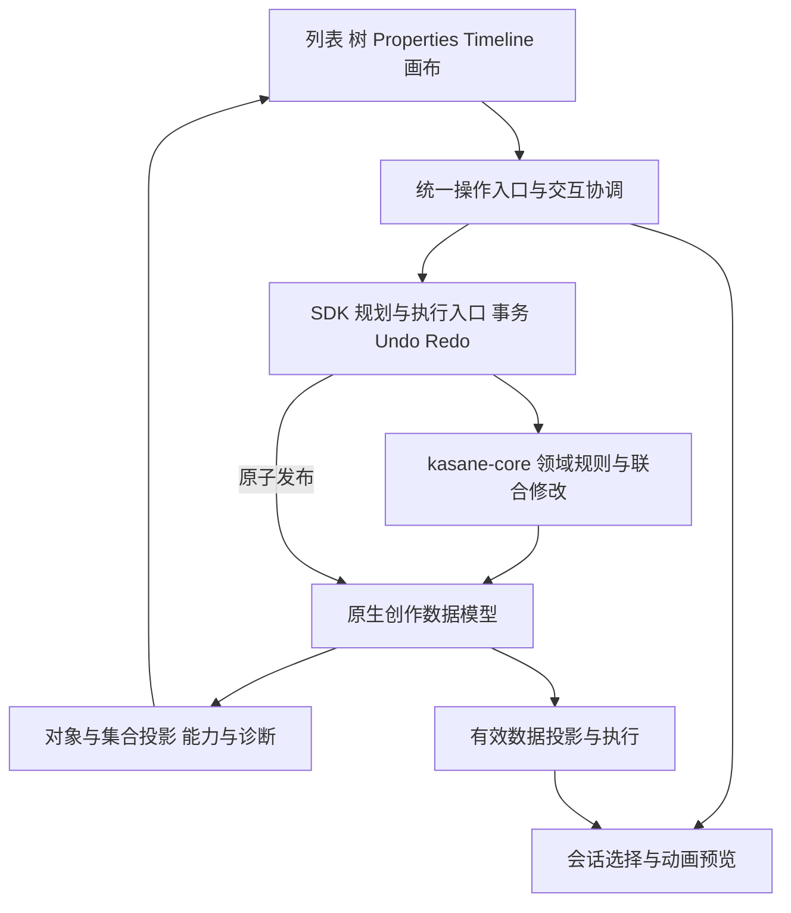

# 对象创作核心架构改造方案

日期：2026 年 10 月 21 日，进度更新于 10 月 23 日。状态：**C1–C6 已完成，核心已交付；UI 统一正在按 U1–U6 实施**。C5 的资源操作与完整覆盖核对已收尾，覆盖表 7 项均已落地；接口、领域限制和回归依据见 [C5 覆盖矩阵](unified-object-authoring-c5-coverage.md)与[实施记录](unified-object-authoring-core-implementation.md)。C4 的改父级支持矩阵、容量、协作取消及真实模型 Release 验收继续沿用已记录结果。

第 4、5 节定义完整核心范围；已实现接口及边界以实施记录和覆盖矩阵为准。C6 已完成核心验收、性能复核和公共契约定稿；验收映射、结果及边界见 [C6 交付记录](unified-object-authoring-c6-acceptance.md)，随后进入 UI 统一实施。

先完成原生创作模型、SDK 与 editor-core 的统一对象能力，使创建、属性修改、集合移动、复制、删除和引用修复具有稳定身份、明确的领域规则和单一事务历史。随后按 [Editor UI 交互统一方案](unified-object-authoring-ui.md)接入新的界面操作。

本文是数据模型、领域能力、操作契约和核心验收的权威定义。完整对象清单在第 4 节，模型改动在第 5 节；菜单、焦点、键盘、拖拽命中和表单事件规则由 UI 方案维护。

## 1 范围与阶段边界

已确认的产品约束作为核心改造输入：New 直接创建并在 Properties 编辑；Motion、Expression 单击维持现有预览逻辑；Sort 覆盖同级排序、跨组移动和改父级；支持 Group 的对象可创建空组。

项目尚未正式发布，允许破坏式模型重构，不设计旧版原生项目迁移。现有外部格式导入导出仍须有明确映射。下文具体模型组织和默认策略是设计建议；影响模型的待定选择集中在第 12 节。

| 本阶段负责 | 后续 UI 阶段负责 |
| --- | --- |
| kasane-core 原生模型、有效数据投影 | 面板、树和列表的具体展示 |
| SDK 类型化编辑、校验、单一历史 | 工具栏、右键、主菜单和快捷键接入 |
| editor-core 身份/集合投影、会话能力与命令适配 | 创建后的选择、定位、展开和控件焦点 |
| 字段地址、上下文 token、候选生命周期接口 | 输入法、Enter、失焦、Esc、颜色与数值控件事件 |
| 保存、资产内容、导入导出、诊断 | 错误、待配置提示、影响说明和修复入口 |
| 保持现有 UI 可编译和行为兼容的必要适配 | 新交互的批量接入与重复 UI 逻辑清理 |

核心阶段允许修改 editor 适配代码，以承接新 ID、模型和 API，并确保已有功能继续运行；不借此提前统一全部菜单、布局或拖拽交互。核心验收不能依赖尚未实现的 UI 按钮，应能直接调用 SDK/editor-core 验证所有能力。

本阶段不新增第二套 Undo 栈、通用数据库或复制所有领域关系的通用对象树。原生数据模型改动、领域命令与格式适配必须一起完成，不能只交付接口空壳。

## 2 对象集合与身份

### 2.1 身份与位置分离

可独立选择、引用、编辑或移动的实体使用稳定 ID。改名、同级重排、跨容器移动不改变 ID；复制生成新 ID；Undo 恢复原 ID。

对象引用携带文档身份、实体类型和实体 ID。拥有者、组名、数组下标、文件路径不构成可移动实体的身份。拥有者是可查询、可校验的关系。对于不能脱离父对象的结构元素，可以使用“父实体 ID 加元素 ID”，但元素一旦支持跨父对象移动，就使用独立稳定 ID。

不为每个数值和控制柄创建 UUID。已有 Mesh VertexId 和 MotionKey ID 保留；Bezier 控制柄通过端点关键帧 ID 与柄角色定位；三角形和网格控制点通过专用拓扑地址定位。拓扑变化使旧地址失效，旧编辑必须取消，不能继续按旧数组下标写入。

持久化引用与操作句柄分开。持久化引用回答“文档中的哪个实体”，操作句柄还携带 SDK session、generation 和实体 incarnation，回答“是否仍是开始操作时的那次存活”。复用现有 SDK ObjectHandle/incarnation 机制，并覆盖新增的组、注册、条目、轴和采样点；不能另建一套仅在 editor-core 生效的存活判断。

改名、重排和合法跨拥有者移动保持 ID 与 incarnation，但依赖旧拥有者或结构的编辑仍需重新校验。删除使原句柄永久失效；Undo/Redo 恢复原 ID 时分配新的 incarnation，不复活删除前的句柄。项目重载或替换推进 generation。incarnation、会话版本和失效 epoch 不写入原生文件，也不随历史 checkpoint 回滚；只读查询、失败和 no-op 不推进它们。

### 2.2 五类集合

| 类别 | 示例 | 主要规则 |
| --- | --- | --- |
| 组织容器 | Part 组织树、ParameterGroup | 管理归属和展示顺序，允许的层级由类型声明 |
| 引用集合 | Motion 注册条目、模型行为参数组 | 成员引用对象，不独占对象；移除成员不自动删除被引用对象 |
| 业务组 | PhysicsGroup、PoseGroup、DrawOrderGroup | 分组影响执行或绘制，不能当普通文件夹任意嵌套 |
| 拥有的内容集合 | ExpressionEntry、MotionTrack、PhysicsInput | 生命周期由拥有者管理，跨拥有者移动必须重新验证 |
| 时间或拓扑集合 | MotionKey、Binding 关键值网格、Physics 节点、Mesh 拓扑 | 顺序具有领域含义，使用专用操作 |

一个对象可以出现在多个投影中。Mesh 在组织树与变形树中的位置属于不同关系；MotionClip 与引用该 Clip 的注册条目属于不同实体。

### 2.3 关系与顺序只有一份权威数据

每个集合明确拥有者、成员类型、成员关系和顺序来源。已有合适的领域存储继续使用；不建立一棵复制所有业务关系的通用对象树。

参数归属继续由原生参数显示元数据管理；Part 与 Deformer 的父级继续使用各自领域字段；Physics 的组顺序继续决定执行顺序。统一层通过适配器查询和操作它们。

有展示顺序且没有执行语义的集合使用稳定 ID 顺序。具有语义的集合保留其业务顺序。名称排序等临时视图排序不修改文档；“应用为手动顺序”才是可撤销操作。

是否在 UI 中混排文件夹和普通成员由 UI 方案规定；本模型默认不为 Parameter 等额外增加交错顺序结构。Part 组织树保留已有混合成员关系。若交互要求改变，应先调整此处的顺序存储契约。

## 3 架构分层与操作契约



### 3.1 原生模型与 SDK

`kasane-core` 负责创作模型及领域不变量。`kasane-sdk` 负责事务、验证、发布和唯一的 Undo/Redo 历史。原生项目保存完整创作状态；运行时与外部格式使用显式转换。

新增组和条目身份、未配置引用、集合编辑应在这一层具备类型化接口。任何 UI 都不能通过自行拼装整个资源来定义业务规则。

领域规划和执行的权威在 core/SDK：集合归属、创建默认结构、复制闭包与内部引用重映射、最后一个 Motion 注册的处理、依赖删除、网格转换、改父级保证和运行投影均不能只存在于 editor-core。SDK 对外提供同源的能力查询、只读规划和执行接口，Python 等非 Editor 调用方获得相同规则。core 实现领域不变量和联合修改原语，SDK 在其上负责版本、句柄、容量、资产内容与原子发布；规划结果不授予跳过提交校验的权限。

按关系类型声明复制与删除的闭包：拥有的内容随拥有者处理，组织归属按所选子树策略处理，外部共享引用默认保留。Part 组织树与 Deformer 关系不能用同一个通用“递归子节点”函数推导复制范围。SDK 规划列出闭包及需重映射的边，执行使用同一规则。

### 3.2 editor-core

增加对象操作模块，按场景、参数、动画、物理、Pose、绑定和资源拆分。模块名可以是 `authoring`，不要求新建 crate。

该模块将编辑上下文转换为 SDK 意图，并协调检查、预览和建议定位；不重新实现领域规划。领域能力与 Editor 会话可用性分层合成：类型、引用、归属和持久化锁定规则由 core/SDK 校验；工作区、焦点、播放策略由 editor-core 管理；SDK 保存占用与版本条件由 SDK 提供。合成结果保留原因来源，执行时各责任层再次校验。持久化锁定不能被其他 SDK 入口绕过，Editor 特有焦点也不应成为无界面 SDK 写入的前提。

统一入口接收类型化意图，示意如下，具体 Rust API 在实施时确定：

```text
Create(document, kind, owner, placement, captured_context)
Patch(document, entity, field_address, expected_values, changes)
Move(document, sources, collection, destination)
Duplicate(document, sources, destination, copy_policy)
Delete(document, sources, delete_policy)
RepairReference(document, slot, replacement)
```

`CreatePayload` 等使用按领域区分的 Rust enum。不要用任意 JSON 填充统一对象，也不要做所有类型共享的巨型结构体。

SDK 提供以下领域只读查询，editor-core 在返回值上附加会话条件：

- `capabilities(context, entity_or_collection)`：操作是否支持、是否当前可用、不可用原因。
- `plan_move / plan_delete / plan_create`：校验后得到目标实体、受影响关系、操作效果和诊断。

复制、修复及网格转换同样提供类型化规划。计划绑定相关实体句柄、集合与字段基线、所选策略和影响范围；失效后重新规划。若新计划扩大删除范围或改变转换损失，必须返回新计划供调用方接受，不能把对旧计划的接受当作对新影响的授权。

能力描述至少包括创建、检查、属性编辑、内容编辑、复制、删除、移动、重排、创建子组、修复引用及预览。返回值区分“此类型不支持”和“当前条件不满足”：前者不显示无意义入口，后者禁用并说明原因。版本、锁定、拥有者、播放和保存占用都属于动态条件，不能只靠 ObjectKind 的静态布尔值。

拖动时通过只读规划得到可落点，提交时基于当前版本重新验证。UI 的判断只负责命中位置和呈现，不复制循环引用、父级、执行语义等领域规则。

### 3.3 共享的操作结果

一次成功操作返回领域结果和提交回执；editor-core 在其上添加建议选择目标和需定位的集合位置，组成面向 UI 的 OperationResult。领域结果包括稳定引用、诊断、转换保证和执行失效范围；选择与焦点建议不成为持久化事实或运行缓存失效依据。

领域层不操作 GPUI、不聚焦控件、不决定停靠布局。创建与归属、初始顺序在同一 SDK 事务完成，操作后的滚动和焦点不进入模型历史。

SDK 发布统一 ChangeSet，覆盖普通编辑、候选提交、Undo、Redo、导入和项目替换。至少包含提交前后版本、创建/删除/修改的实体、受影响引用与集合、资源内容变化，以及可组合的标签、展示顺序、拓扑、求值输入等变化类别。多个类别不能折叠为一个优先级最高的枚举，导致其他消费者漏掉失效。

Undo/Redo 按实际恢复方向产生 ChangeSet，不重放创建后的选中或动画激活建议；不能继续用固定 `Structure` 加空对象列表冒充精确变化。可保存正反向变化摘要或按受影响存储计算差异，无须每次序列化全模型。项目整体替换可显式标记全量失效，普通重命名或排序不可采用该退路。no-op 返回 changed=false，不发布模型变化事件。

对象索引、运行投影和渲染/动画缓存消费同一提交事件。直接 SDK 调用与 editor-core 调用得到相同领域变化；OperationResult 只引用同一回执，不产生第二次失效。播放暂停、重建等会话策略由 editor-core 根据变化类别及领域转换结果决定，SDK 不操作播放器。

### 3.4 属性地址与集合描述

保留 editor-core 中的 PropertySpec、PropertyPatch 和预览 token 基础。字段地址分开表达实体身份和字段身份；重复字段使用子实体 ID，提交时解析为当前存储位置。PropertyKey.at(index) 只用于绑定结构版本的短期投影，版本失效时拒绝旧地址。

集合描述提供成员类型、允许的创建与结构动作、字段数据和领域效果。返回结构化诊断与变化范围，不包含 GPUI 控件、焦点句柄或视图坐标。

现有 editor 中的 PropertyProvider、PropertyForm 和专用编辑器继续作为 UI 适配层。具体复用与事件协调在 UI 方案第 2、5 节定义；core 不接收控件原始输入事件。

## 4 完整领域能力清单

以下清单定义领域支持范围，UI 表现由后续方案实现。Create 成功即产生持久化创作对象。必须有拥有者的子对象要求命令携带拥有者；普通可配置引用可以暂未指定，见第 5 节。当前条件不满足时返回不可用原因，不通过 UI 自行绕过约束。

### 4.1 场景与参数

| 类型 | 创建与编辑 | 分组和移动 | 排序含义 |
| --- | --- | --- | --- |
| Document | 新文档；模型设置与导出属性进入 Properties | 不移入模型文件夹 | 文档标签顺序是工作区状态 |
| Part | 默认名与 ID 创建；组织和绘制属性 | 组织树嵌套，移动子树 | 展示顺序；绘制顺序另行操作 |
| Mesh | 空几何和可选纹理创建；纹理、外观、引用与几何 | Part 归属和 Deformer 父级是两种关系 | 两棵树各自展示顺序 |
| Warp Deformer | 默认中性网格；网格范围及属性 | Part 归属、变形父级 | 展示顺序与变形关系分开 |
| Rotation Deformer | 默认中性变换；原点、角度等 | 同上 | 同上 |
| Offscreen | 默认合成配置；内容关联、遮罩、Keyform | 使用其领域允许的 Part 归属 | 展示顺序与合成效果分开 |
| Glue | 根据选择填两端；不足时保留未配置端点 | 作为连接关系，不能任意移入 Deformer | 管理列表顺序不应暗改粘合计算 |
| Parameter | 合法范围和默认值；ID、精度、类型 | ParameterGroup 归属 | 手动展示顺序 |
| ParameterGroup | 空文件夹；名称、runtime ID | 支持嵌套和子树移动 | 同级组顺序 |
| DrawOrderGroup | 从已有 Part 创建或设置；根组由系统保证 | 成员归属由绘制规则验证 | 实际绘制组织及平局顺序 |

### 4.2 动画与运行配置

| 类型 | 创建与编辑 | 分组和移动 | 排序含义 |
| --- | --- | --- | --- |
| MotionClip | 默认空动作；基础属性与 Timeline | 通过注册条目出现在 Motion 库 | Clip 资源顺序不代替注册顺序 |
| MotionGroup | 空的一级文件夹；组名 | 第一版不嵌套；条目可跨组或移到根列表 | 组顺序和组内注册顺序 |
| Motion 注册条目 | 新建 Motion 同时产生；也可显式添加已有 Clip 引用 | 同一 Clip 可有多次注册 | 移动条目保持 Clip 和覆盖属性 |
| MotionTrack | 当前 Clip 内创建；目标引用、曲线 | 可以通过类型化移动或复制到另一 Clip | 行顺序属于作者组织；保持执行语义 |
| MotionKey | 当前轨道和时间创建；时间、值和插值 | 时间拖动；跨轨道通过专用剪切粘贴 | 时间顺序，禁止任意行重排 |
| MotionEvent | 当前时间创建；时间与内容 | Clip 内时间移动；跨 Clip 专用操作 | 时间顺序，相同时间保留稳定次序 |
| Expression | 空参数表；名称、fade 和参数条目 | 暂不新增纯整理文件夹 | 资源列表顺序 |
| ExpressionEntry | 所属 Expression 内直接创建；参数、值、blend | 跨 Expression 移动需验证目标和重复规则 | 采用领域条目顺序，不自动按参数名重排 |
| Physics | 文档单例；全局配置 | 不提供第二套根资源 | 不适用 |
| PhysicsGroup | 创建合法默认节点链和空输入输出 | 平级物理计算单元，不是嵌套文件夹 | 实际执行顺序 |
| PhysicsInput / Output | 当前组内直接创建；目标、权重等 | 跨组移动要验证参数和输出节点 | 执行顺序，允许的变化通过领域命令 |
| PhysicsNode | 当前链内新增合法节点；节点属性 | 专用链条编辑，禁止普通跨组拖拽 | 拓扑顺序及输出采样引用 |
| Pose | 文档单例；fade 等 | 不提供第二套根资源 | 不适用 |
| PoseGroup | 创建空成员组；可编辑名称 | 平级业务组，不嵌套 | 保留领域组顺序 |
| PoseEntry | 组内创建；主 Part 和 links | 可跨组移动，检查重复与关系 | 保留运行时成员顺序 |
| PoseLink | 成员内添加关联 Part | 引用集合，不拥有 Part | 只在领域允许时重排 |
| ModelParameterGroup | 空行为参数组；名称和成员 | EyeBlink、LipSync 等行为，不与 ParameterGroup 合并 | 运行配置集合顺序 |
| ModelHitArea | 默认名创建；选择 Mesh | 引用 Mesh，不归属 Mesh | 配置列表顺序 |
| CdiCombinedSet | 空组合参数集合；成员配置 | 与 ParameterGroup 独立 | 成员顺序按格式和领域规则保留 |

### 4.3 绑定与 BlendShape

| 类型 | 创建与编辑 | 所有权与结构操作 |
| --- | --- | --- |
| MeshBinding | 从 Mesh 创建；轴、关键值和形态 | 必须有目标 Mesh；受已有绑定数量约束 |
| SceneBinding | 从 Warp、Rotation、Part 创建；参数网格和形态 | 使用目标对应的 SceneTrack 类型；改变目标是显式重新绑定 |
| GlueBinding | 在 Glue 中启用和编辑参数网格 | 由 Glue 独占，引用用 Glue ID 加固定 binding 角色即可，不必另加 UUID |
| BindingAxis | 从已拥有的绑定内添加；参数和关键值 | 轴重排同步重排整个 Keyform 网格 |
| Binding 关键值 | 轴内添加、修改、删除 | 数值有序，增删时同步构造或删除相关形态 |
| Keyform | 由网格位置选择；Properties 与画布共同编辑 | 不作为普通列表任意排序；轴和采样点变化需保持对应关系 |
| BlendBinding | 从目标创建；共享表、约束、增量形态 | 更换目标或表需验证或转换形态 |
| BlendKeyTable | 直接创建；参数、关键值和基准点 | 共享资源，修改须检查所有使用者 |
| BlendConstraint | 直接创建；参数、关键值和权重 | 共享资源，成员引用与删除有依赖检查 |
| DeltaKeyform | 在 BlendBinding 的关键值位置生成或编辑 | Mesh、Warp、Rotation、Part、Glue、Offscreen 分别保留领域数据 |

Mesh 顶点、UV、三角形、Warp 控制点、Bezier 控制柄、GlueVertexPair、Offscreen Keyform 及索引映射也在范围内；通过所属对象的专用内容编辑操作管理，不新增普通文件夹。

### 4.4 资源与特殊数据

| 类型 | 管理方式 |
| --- | --- |
| Texture / ImageAsset | New 创建无内容资源条目，Properties 中导入或替换图像；另外保留直接 Import 快捷入口 |
| Attachment | New 创建无内容附件条目，Properties 中选择文件、编辑路径；直接 Import 是另一个动作 |
| Layout / ExportSettings / SourceCanvas | 文档属性；来源信息与可写导出设置明确区分，不提供无意义的 New 或 Sort |
| UserData 引用 | 在文档属性关联 Attachment，不复制附件内容 |
| 遮罩、约束引用、组成员等引用列表 | 创建引用条目或直接添加选择；移除引用不删除目标 |
| Unresolved / MissingReference | 可选中、定位、修复、重新绑定或显式移除；不提供 New Unresolved |
| 编辑器状态 | 展开、滚动、搜索、选择、预览不混入对象内容历史；锁定与可见性遵循现有明确的编辑器状态存储策略 |
| 不透明扩展和来源信息 | 保留并按现有格式规则验证，不自动生成任意 JSON 编辑器 |

## 5 数据模型改动

### 5.1 待配置状态与数据有效性

“直接创建”要求原生文档能保存合法但尚未配置完整的对象。区分三类状态：

- **Ready**：结构合法且当前用途所需引用齐全。
- **NeedsConfiguration**：用户尚未填写的可配置引用或资源内容为空。
- **BrokenReference**：保存的引用目标不存在，或导入引用尚未解析。

状态由数据和诊断推导，不保存容易过期的 `ready: bool`。引用使用类型化的未指定、已解析、导入未解析状态；禁止用随机 ID 或伪造 runtime ID 代替未配置。

原生保存要求结构合法，允许 NeedsConfiguration。运行时有效数据投影跳过不能执行的条目，Properties 显示具体缺项。外部导出对不可表达的状态给出精确诊断，默认不静默丢弃；显式“仅导出可用内容”须列出省略项。NaN、循环归属、重复稳定 ID 等始终是非法数据，不能因支持待配置状态而放宽。

跳过以最小安全单位进行：未指定参数的 ExpressionEntry 或 PhysicsInput 不执行；没有有效主 Part 的 PoseEntry 整项不执行；缺少端点的 Glue、缺少关键值表的 BlendBinding 整体不执行。Binding 的待配置轴不替换其已有有效轴网格。某项缺失若使整个业务单元不满足运行约束，则禁用该单元并保留创作数据。执行顺序中被跳过条目的相对位置仍在原生模型中保存。

#### 5.1.1 投影输出与依赖传播

运行投影是从已验证创作快照生成的派生数据，不能另存一份可编辑的有效模型。按用途区分几何可求值、可绘制、动画通道可执行和格式可导出；一个 Mesh 没有纹理不代表其几何不可编辑。Ready 等状态按用途聚合诊断，不以一个对象级布尔值替代各消费者的条件。

每个领域投影提供运行数据、原生实体/子条目到运行槽位的映射及反向来源、被禁用项、原因链和依赖版本。省略条目后不得以压缩后的数组下标回写创作数据。所有运行消费者使用这些投影及其映射，不能有的路径读取待配置原生数组、有的路径读取过滤数组。

依赖处理按下表执行；“禁用”只影响派生执行结果，不删除原生对象或引用。未配置和导入未解析的原因必须区别保留。

| 关系或缺项 | 执行策略 | 传播范围 |
| --- | --- | --- |
| Mesh 未绑定纹理，或所引用 ImageAsset 没有内容 | 保留可用几何供画布内容编辑，不生成可绘制项 | 以该 Mesh 为遮罩的使用者按遮罩规则处理；几何用途的 Glue、HitArea 另验几何条件 |
| 遮罩引用条目未配置，或目标不能生成有效遮罩 | 禁用依赖它的 Mesh 绘制项或 Offscreen 合成单元，不静默解除遮罩 | 沿遮罩依赖继续传播；禁用 Offscreen 时其内容不能回落为未遮罩的直接绘制 |
| 普通 Binding 的待配置新轴 | 从有效轴集合排除该轴，保持既有有效网格 | 无额外传播；已激活轴的引用损坏时禁用整个 Binding，不能自动降维 |
| Binding/BlendBinding 所需目标、表或约束不可用 | 禁用该绑定，目标按其余有效驱动与基础数据求值 | 缺失约束不能按无约束权重执行；共享资源的每个使用者独立报告 |
| Glue 端点不可用或几何条件不成立 | 禁用整条 Glue；仅配对条目待配置时跳过该配对 | 不禁用端点 Mesh；剩余配对仍需满足 Glue 领域约束 |
| MotionTrack、ExpressionEntry 的写入目标不可用 | 跳过该通道或条目，保留其他通道执行顺序 | Clip/Expression 可以产生空效果；注册本身缺少有效 Clip 时不可激活 |
| PhysicsInput/Output 的参数未指定或未解析 | 跳过对应通道，不重归一化其余权重 | 合法节点链可继续运行；运行槽位映射保持原条目身份 |
| PhysicsOutput 的采样节点不可用，或节点链违反结构不变量 | 拒绝非法创作修改或投影构建 | 不通过临时换节点或跳过坏拓扑来掩盖结构错误 |
| PoseEntry 主 Part 不可用 / PoseLink 目标不可用 | 前者跳过整项；后者只跳过对应 link 并诊断 | 其余成员保持顺序；运行实现须处理过滤后空组 |
| ModelParameterGroup、CdiCombinedSet 成员或 HitArea 目标待配置 | 省略该成员或 HitArea 的执行贡献，保留业务组身份和诊断 | 不改变其余成员的语义顺序；导出仍按目标格式严格校验 |
| Motion sound / UserData 的 Attachment 内容不可用 | 声音或附加数据不可用，不阻止独立的视觉动画预览 | 报告相应功能缺项；外部导出不可静默丢弃 |
| 必需拥有者、父级、绘制分组或拓扑关系非法 | 拒绝修改或投影构建 | 不把循环、错误 ID、非法映射转换为待配置状态 |

已有引用类型新增待配置能力时，必须先补齐其用途和传播策略；没有策略的关系不能默认删除引用或默认为可用。导入未解析内容只能进入领域明确支持的保留状态；已解析引用无目标若违反结构不变量，加载需报告并走显式修复路径，不能放宽成任意悬空 ID。

投影先检查结构，再按用途计算局部可用性及依赖闭包，达到稳定结果后建立紧凑运行映射。合法依赖环由领域规则处理或按强连通单元传播，不无限递归；原本禁止的环仍拒绝。几何、遮罩和绑定是不同依赖用途，不能用一个“目标不可绘制”标记禁用所有引用。

预览与“仅导出可用内容”共用领域可用性和依赖策略；格式转换另检查格式可表达性。部分导出计划必须列出直接省略项和传播导致的省略项，接受后才执行；导出不能悄悄输出解除遮罩或约束后的模型。非法结构导致构建失败时，不发布半成品运行快照。

### 5.2 必须调整的结构

下表保留改造前的问题与结构设计；当前实现状态见 C5 覆盖矩阵。

| 模型 | 当前问题 | 建议改动 |
| --- | --- | --- |
| Mesh | `texture_asset_id` 必须指向现有资源 | 允许未绑定纹理；空几何已合法，无须增加几何草稿对象 |
| MotionGroup | 只有 name 与 entries | 增加稳定 ID；空组持久存在；第一版无 parent_id |
| MotionRegistration | 无独立 ID，选择依赖组名和下标 | 增加稳定 ID；组归属可改变；根列表也能承载完整条目 |
| MotionTrackTarget | 当前轨道必须有确定目标或导入未解析目标 | 增加未指定目标状态；New Track 可以立即保存，选择目标后才参与采样 |
| Motion 轨道展示顺序 | 直接重排 tracks 可能改变同目标写入次序 | 增加按 TrackId 保存的展示顺序，Timeline 重排不修改轨道执行次序 |
| PoseGroup | 当前为 `Vec<PoseEntry>` | 显式 `PoseGroup { id, name, entries }` |
| PoseEntry | 无 ID，Part 必须已指定 | 增加稳定 ID；允许未指定主 Part |
| PoseLink | 无独立引用条目身份 | 独立新增编辑时使用带 ID 的引用条目；不需要用户可编辑名称 |
| ExpressionEntry | 以数组位置定位，目标必须指定 | 增加稳定 ID；允许未指定参数；保留 blend 与 value |
| PhysicsInput / Output | 数组位置是字段地址，引用需立即有效 | 创作层增加条目 ID、未指定参数状态；Output 用稳定节点引用 |
| PhysicsNode | Output 使用 vertex_index | 创作节点增加稳定 ID；运行时编译为索引，删除与调整链条同步验证 |
| ModelHitArea | 无 ID，Mesh 引用需立即填写 | 增加 ID 与未指定 Mesh 状态 |
| ModelParameterGroup | 名称承担定位用途 | 增加组 ID；新增的未完成成员使用稳定引用条目 |
| ImageAsset | 资源记录要求实际图像信息 | 显式 `content: Option<ImageContent>`；尺寸和哈希在有内容时才存在；导入不可用来源另存 `unresolved_source` |
| PackageAttachment | path 同时承担身份和文件定位，bytes 必须存在 | 增加 ID；path 与内容可独立编辑；内容为空与零字节文件明确区分 |
| Attachment 引用 | Motion sound、UserData 等使用路径 | 原生层改为 Attachment ID；导出再解析为路径，保留导入未解析状态 |
| Glue | 两个 Mesh 端点立即必填 | 允许端点未配置；完整且有效时才参与计算；已有配对在换端点时验证或显式清空 |
| BlendKeyTable / BlendConstraint | 必须立即指定参数 | 参数可未配置；关键值、权重的结构关系仍严格校验 |
| BlendBinding | 必须立即引用完整 KeyTable | 从目标创建，允许暂未关联关键值表；无表时不产生形变 |
| BindingAxis | 参数立即必填且位置寻址 | 增加轴 ID；未指定参数的轴作为创作配置，完成时原子构建有效网格 |
| Binding 采样点和 BlendKeyTable 关键值 | 数值数组及基准下标承担对应关系 | 采样点增加稳定 ID；Keyform 和基准点通过 ID 关联，执行时生成数组索引 |
| BlendConstraint 关键值与权重 | 两个平行数组依赖下标配对 | 原生层使用带 ID 的关键值权重条目，转换时生成所需数组 |
| GlueVertexPair | 无条目 ID，依靠数组位置定位 | 采用 PairId；新增时允许未指定顶点，完整后参与粘合 |
| 可逐行编辑的引用集合 | masks、constraint_ids、行为组成员、CombinedSet 成员等直接存引用 | 需要保留逐行草稿时使用 `ReferenceEntry { id, target }`；批量选择型字段仍可整组原子替换 |

“创作层”是 Kasane 原生持久化模型，不是 UI 中另一份临时资源。Physics 当前与 physics3 字段形状接近；应将新增原生身份和可空引用放入类型化创作结构，再通过转换器产生 physics3。不得依赖 serde flatten 让内部 UUID 意外写入第三方格式。

PhysicsGroup 名称目前来自 dictionary。创作模型可把名称与组身份一起提供访问接口，但名称只能有一个权威来源；导出 dictionary 由该来源生成。导入的外部组 ID 与内部稳定身份若分离，必须分别保存并做明确映射，不能在加载时任意替换外部标识。

ModelParameterGroup 的 name 是运行行为名称，不只是显示标题。名称编辑应提示其行为含义；EyeBlink、LipSync 可以提供直接创建对应类型的菜单项。自定义组依然直接创建，不能靠自动改成另一行为名来解决冲突。

### 5.3 Motion 库中的本体和注册

建议保留 Clip 资源表，组和注册条目独立组织，概念结构如下：

```text
MotionLibrary
  groups: [MotionGroup { id, name, entry_order }]
  root_entry_order: [RegistrationId]
  registrations: { RegistrationId -> { id, clip_id, fade_in, fade_out, sound } }
```

每个注册条目恰好位于一个组或根列表，不再额外保存容易不一致的 group_id；位置由集合关系索引查询。每个 Clip 至少有一个可见条目。导入没有 model3 注册的 Clip 时生成根条目。旧的“有注册显示注册、无注册临时投影一行”改为统一显式条目模型。

新建 Motion 同时创建 Clip 和当前容器中的注册条目。跨组、移到根列表、解散组只移动注册条目，不改变其覆盖属性或复制 Clip。组名变化只更新导出组键；当前预览通过 RegistrationId 跟踪。

根条目没有 model3 组键。其注册级 fade、sound 覆盖保存在原生项目，预览照常使用；外部格式无法表达时要求分配到导出组或报告不可表达，不能悄悄写回共享 Clip。重复引用同一 Clip 的条目必须保留各自身份和覆盖配置。

### 5.4 绑定内部身份与网格

普通 Binding 从目标上下文创建，目标在创建时固定；因此 MeshBinding 和 SceneBinding 不必支持没有拥有者的悬空对象。New Binding 建立中性或当前基础形态的无驱动绑定，随后添加轴。

轴关键值用稳定采样点 ID 加数值表达；基准关键值引用采样点 ID，避免索引漂移。Keyform 通过轴采样点组合定位，运行时可编译成紧凑数组。BlendKeyTable 与 DeltaKeyform 使用同一关键值身份规则。

新增未指定参数的轴先保存为待配置轴，不进入有效参数网格。配置完成后，按下表在同一事务里激活轴并构建完整网格；已有绑定扩轴不得用单一当前预览形态覆盖旧网格。待配置轴和有效轴的区分由类型化配置及网格成员关系表达，不另存容易失效的 ready 标志。

不为 Motion 曲线控制柄、Mesh UV、三角形下标再加通用对象 ID。MotionKey、Track、Event 已有稳定身份，应复用。Glue 配对采用 PairId，配对端点继续使用 Mesh VertexId。

#### 5.4.1 零轴与网格转换

零轴 Binding 是合法创作状态，不保存独立 Keyform 副本，也不额外驱动目标。目标本身的基础字段是唯一权威；在此状态编辑基础形态写入目标。激活第一条轴时读取同一事务基线中的最新基础形态，复制到初始采样点，不读取叠加 Motion、Physics 或其他 BlendBinding 后的预览结果。

删除最后一条有效轴时，将显式选择的切片或采样结果原子写回目标基础字段并清空网格；不能表达为基础字段的内容使该策略不可用，不静默丢弃。待配置轴可继续存在。原生校验、运行投影、外部格式转换须一起支持零轴；外部格式不能表达空绑定时严格报告，部分导出可列为无执行贡献的省略项。

| 操作 | 转换契约 | 保持与损失 |
| --- | --- | --- |
| 激活第一条轴 | 从目标基础字段生成各采样点形态 | 在新轴有效域内初始形态一致；越界启用规则仍遵循领域语义 |
| 向已有绑定增加有效轴 | 沿新轴每个采样点复制整个旧网格，旧采样身份和形态不变 | 对旧参数组合、在新轴有效域内保持原有效果，不把旧网格压平 |
| 轴重排 | 按 AxisId 和采样点 ID 组合重排存储，同时更新 Offscreen 等映射 | 保持采样对应与求值行为 |
| 插入关键值 | 在旧网格上按该新数值求值，对其他轴每个组合生成新形态 | 不修改原采样；保证是否保持插值行为由领域转换器声明，不默认覆盖离散属性 |
| 移动关键值数值 | 保持 SampleId 与关联形态，更新排序及映射 | 改变形态在参数域的位置；不得宣称保持原动画 |
| 删除关键值 | 移除其关联切片并验证剩余网格；基准点被删除时必须指定替代点 | 计划列出被删除形态及插值影响；最后一个点走删轴策略 |
| 删除有效轴 / 清空其参数 | 必须指定保留某采样切片或在明确参数值处重采样，再降维；清空后保留同一轴 ID 为待配置项 | 计划列出失去的维度和形态，不能隐式平均或任选一个切片 |
| 更换轴参数或改变参数范围 | 保持数值、显式数值映射等策略由调用方选择，连同全部依赖网格联合验证 | 越界、重复轴及数值合并拒绝；不得自动裁剪或丢弃采样 |
| 修改共享 BlendKeyTable / 约束条目 | 对所有使用者规划新映射；增量形态按各目标类型转换，基准变更必须重基准化或拒绝 | 不能只改共享表留下旧 DeltaKeyform 或权重配对 |

每种转换返回保留、生成、删除和重映射的稳定地址，以及适用参数域、行为保证和损失诊断。颜色、可见性、draw order、旋转反射等非位置字段采用其领域插值/离散规则；不支持的转换明确拒绝，不套用位置数组插值。基础 Binding、GlueBinding、SceneBinding 和 BlendShape 分别提供转换器，共用规划和事务框架。

#### 5.4.2 容量与失败边界

规划时使用检查溢出的乘法计算新网格大小、各形态载荷、共享表全部使用者及临时转换空间，包含历史快照保留成本。SDK 提供统一且有限的 AuthoringLimits（最大采样组合数、转换临时字节数和历史预算）；具体默认值由 C4 的实际模型基准确定并记录，不能默认为无限制，也不能由面板各设一套限制。

C4 已固定默认值为 **65,536 采样组合、64 MiB 转换临时估算、256 MiB 历史估算**。
Mao、Shirousagi 的 Release 转换、取消与堆分配峰值检查通过，测量边界和结果见
[Binding 转换容量记录](../benchmarks/2026-10-22-binding-authoring.md)。估算覆盖转换报告、候选与历史成本，不等同于进程 RSS 上限。

预算校验必须发生在分配完整笛卡尔积之前。超过限制、取消、转换不可表达或基线失效均不发布模型、历史和运行投影；释放候选内容。支持的组合必须有成功案例，不能以全部拒绝来满足转换契约。

### 5.5 保留结构或仅调整引用接口

Part、Transform、Parameter、ParameterGroup、MotionClip、Physics 根资源、PhysicsGroup 的基本身份和主要字段保留。MotionClip 增加轨道展示顺序元数据，轨道本体继续使用已有 ID。CdiCombinedSet 已有 ID，继续复用。DrawOrderGroup 用所属 Part 或根角色标识，无须为了统一而增加冗余 UUID。

Offscreen 继续保留领域 Keyform 与 Part 映射，不将其数组当普通对象排序。Properties 中的选择地址必须具有所属对象与结构版本保护。若未来允许跨对象移动某类 Keyform，再为该操作补明确身份和转换。

ParameterGroup 已支持 parent_id 和空组，本次主要补齐任意合法父级移动。不额外建立 ParameterFolder 复制同一关系。Motion 以 MotionGroup 为文件夹；Expression、Texture、PhysicsGroup 暂不新增纯整理文件夹。

### 5.6 跨层连带修改

模型调整必须同步更新原生序列化版本、SDK 编辑方法、对象与反向引用索引、候选事务、Undo/Redo、有效数据投影、导入导出、资产加载及诊断。只改结构体与 UI 会留下不可保存或不可预览的中间状态。

原生 UUID 在首次导入时生成，保存后持久化；外部格式没有的名称和 ID 不强塞进其标准字段。重新导入外部文件是新对象导入过程，不保证重建上一次项目中的内部 ID。

Properties 的 `ObjectRef`、MotionSelection、Physics 重复字段地址与 Pose 引用需要同步去掉数组下标身份。不可移动的结构地址仍须绑定结构版本。

## 6 创建默认值与原子性

Create 接收已捕获的拥有者、插入位置和领域上下文，分配稳定 ID、合法默认名称与适用的 runtime ID。名称在目标容器中按可读数字后缀避重；runtime ID 按领域命名空间保证唯一。可见默认名称由本地化适配层提供或通过统一默认值服务解析，不能把翻译规则散落在各面板。

创建对象、归属和初始顺序作为一个 SDK 事务提交。若需要同时创建 Physics/Pose 根资源或 Motion 注册条目，也包含在同一事务中。操作返回新实体、集合位置和诊断，不直接展开列表或触发动画点击。

| 对象 | 默认内容 |
| --- | --- |
| Parameter | 合法范围、范围内默认值、有效精度；沿用项目现有默认值 |
| Motion | 沿用现有 2 秒、30 FPS、空轨道和事件等创建默认配置 |
| MotionTrack | 当前 Clip 内创建；有明确通道上下文则绑定，否则目标未指定；初始关键帧使用合法时间和值 |
| MotionKey / Event | 使用当前编辑时间；Key 使用该轨道采样值，Event 使用空文本；时间冲突按 Timeline 领域规则处理 |
| Expression | 空条目表，合法 fade 默认值 |
| PhysicsGroup | 合法默认根节点与至少一个子节点，空输入和输出；复用现有默认 rig 行为 |
| PoseGroup / 各文件夹 | 空成员列表 |
| Mesh | 空几何；有明确纹理上下文则绑定，否则未绑定 |
| Warp / Rotation | 中性形态；选中对象范围用于建议尺寸或原点，但不自动把所有选中对象改为子级 |
| Glue | 恰好两个适用 Mesh 时填入端点，否则端点可留空 |
| Binding / BlendBinding | 已有目标对象，合法中性内容，待配置驱动项 |
| Texture / Attachment | 无内容资源记录；在 Properties 选择文件，取消选择不删除对象 |

无名称的子条目不增加虚构 name 字段；操作结果可指出首个待配置字段供 UI 定位。新增轴关键值、形态、节点和几何元素使用领域可接受的默认位置；无法确定合法新增位置时禁用具体创建动作并说明条件。

新增 PhysicsGroup 或 PoseGroup 时若根资源不存在，在同一事务里创建根资源。文档已有根资源时，“新建 Physics/Pose”转为定位现有根资源，或只提供新建组，不能生成第二个单例。

### 6.1 UI U2 发现的后续创建位置契约

2026 年 10 月 23 日组织树接入时确认：当时 SDK `SceneEdit::Create` 的 `part_id` 与 `parent_id` 可分别指定组织和变形归属，但 `before` 只指向组织集合，变形集合中的初始顺序为追加。因此 C6 已交付的创建能力尚不能原子表达 UI 所需的“在所选变形同级之后创建”。

该缺口要求扩展类型化创建位置，明确投影、拥有者与稳定插入锚点；原生 planner 在一次创建事务内验证两个集合的归属、锁与锚点，并一次发布两个顺序。回归应覆盖变形容器内指定位置、组织/变形拥有者不同、隐藏同级锚点、过期或错误集合锚点的整体拒绝，以及单条 Undo/Redo 与保存往返。不能由 UI 拼接层级数据，或先创建再用另一条历史重排。

第九轮 UI 接入已补齐该契约：`SceneEdit::Create.deformation_before` 独立指定实际变形集合的稳定插入锚点；`before` 保留组织集合位置语义。原生 planner 一次校验两个拥有者、锁与锚点，并在一份创建 delta 内发布两份顺序。Mesh、Warp、Rotation 支持变形锚点，Offscreen/Glue 明确拒绝。SDK 计划继续使用原生版本保护，Undo/Redo 与保存回读保留两个投影及原 ID。

Editor core 的创建计划携带明确投影。组织树创建继续独立于实际变形父级；变形树单容器内追加、普通项之后插入、同父级多选按完整集合定位，跨父级选择回到根集合。组织拥有者独立从创建上下文确定，不能从变形父级硬推；组织/变形拥有者不同的路径已有 SDK、core 和 UI 回归。创建默认名称仍按组织拥有者避重。

这是 UI 接入后补充的契约与验证，不追溯改写此前 C1–C6 的交付范围。详细门禁和当前提交状态见[UI 第九轮实施记录](unified-object-authoring-ui-implementation.md)。

## 7 事务生命周期与过期输入

### 7.1 联合修改与原子发布

核心提供明确的 Begin/Update/Finish/Cancel 生命周期。连续候选编辑最终一次提交；取消、无变化和非法操作不消费历史、不清空 redo。组合字段、批量移动和依赖修复整体成功或整体失败，不发布非法中间状态。

一次 SDK edit 包含多个现有 setter，不等于具备联合修改能力。参数范围与绑定采样、轴与整个形态网格、节点链与输出引用、注册与 Clip、改父级与形态转换等相互依赖的修改，必须提供类型化领域批量原语。

联合原语先读取同一基线并规划完整写入集和依赖读集，在私有工作区构造所有替换片段，再以“替换片段加未修改原文档”的最终视图验证整体不变量。成功后一次装入 SDK 候选并发布；临时片段不能被读取为合法 Document 或用于运行预览。普通 setter 继续维持其校验，不增加公开的跳过校验开关，不通过临时解绑、扩大参数范围等过渡操作规避约束。

例如参数由 `[-1, 1]` 改为 `[10, 20]` 并重映射关键值，应通过专用组合操作一次验证新参数与所有新网格。即使“先改参数”及“先改网格”都会被普通 setter 拒绝，合法的最终组合也必须成功；任一使用者无法转换则整体失败。重映射策略和受影响范围属于计划，不由 UI 临时补算。

SDK 最终提交仍检查候选基线版本和结构。字段编辑可先对最新文档检查字段及依赖基线，再建立短生命周期事务；不能把旧完整候选直接覆盖新文档以实现字段级合并。长转换遇相关变化重新规划；遇无关版本变化也须在最新快照重建/验证候选，不移除现有 SDK 的提交版本保护。

发布后的历史、ChangeSet、引用索引和运行投影必须指向同一提交版本。允许运行缓存延后构建，但消费者不能混用旧槽位和新数据；失败保留上一份完整可用快照并报告原因。

### 7.2 编辑句柄、上下文与异步任务

每次编辑绑定 DocumentId、SDK 操作句柄、上下文 token、实体身份和字段基线；结构元素还绑定必要的集合版本。核心不根据提交时的当前全局选择重新猜测写入对象。Undo 恢复原数据和稳定 ID，不恢复旧句柄、不重放预览选择事件。

UI 的失焦、Esc、Save 等由 UI 方案协调为具体生命周期调用；核心即使被无界面调用，也执行相同的身份、基线与领域校验。

属性补丁校验相关字段及其依赖组，避免无关字段变化导致全表冲突。结构操作校验相关集合版本；版本变化后重新规划，不直接重用旧插入下标。跨文档、目标删除、结构地址失效立即拒绝旧操作并刷新控件。

异步文件加载捕获文档会话与 generation、资源句柄及 incarnation、单调内容 epoch 和请求 ID。资源删除后即使 Undo 恢复相同 ID，原任务仍丢弃；内容替换后即使 Undo 恢复相同字节，也不能使旧请求重新有效。请求取消或被后续请求替代同样失效。返回时重新验证全部条件并通过 SDK 提交，不能导入到当前恰好激活的另一文档。

持久化内容可以由历史恢复，操作有效期不可回退。资源内容 epoch 在该内容实际改变及 Undo/Redo 改变内容时推进，无关改名不必使加载失败。拓扑与集合版本同样不能复用已失效的旧值；新增子条目必须同时纳入 SDK 对象存在性、incarnation 管理、反向引用和变更事件。选择可用稳定引用重新定位恢复后的对象，但必须获取新句柄后才能开始新的编辑。

运行会话将“检查对象”“内容编辑目标”“预览选择”作为不同状态保存。现有 UI 的 Motion/Expression 激活仍组合调用这些能力。改名、重排、移组使用稳定引用协调会话状态，不伪造再次点击；删除当前预览目标清理失效选择与触发。SDK 返回领域失效范围，editor-core 的统一会话策略将其解释为暂停或重建要求，面板不自行决定。

## 8 移动复制删除与修复规则

### 8.1 移动与改父级

| 操作 | 必须满足的规则 |
| --- | --- |
| Part 组织移动 | 无循环；保留组织子树；不修改 Deformer 关系；维护独立绘制分组使绘制行为保持 |
| 组织树排序 | 不改实际 draw order；不能把用户想排序误解为修改数值绘制顺序 |
| Deformer 同级排序 | 仅展示顺序 |
| 改变变形父级 | 按显式策略保留局部数据或原子转换基础形态和相关绑定；循环与所选策略无法转换的关系被拒绝 |
| Parameter / ParameterGroup | 组存在、无循环、runtime ID 和参数值不变；跨组后保存新归属 |
| Motion 注册移动 | 注册 ID、Clip 引用及覆盖配置不变；不触发新的预览选择 |
| Motion 轨道行排序 | 只改展示顺序；重复目标轨道的执行结果不得因整理列表改变 |
| PhysicsGroup 排序 | 标明“调整执行顺序”；提交后按新顺序重建物理预览 |
| Physics 输入输出移动 | 保留条目身份；输出节点在新组不可用时拒绝，使用专用转移操作选择新节点 |
| Physics 节点修改 | 根节点不能任意移走；输出节点引用不因下标变化指向其他节点 |
| Pose 成员移动 | 检查目标组重复成员与 link 有效性，整体事务 |
| Expression 条目移动 | 保留值、blend 和目标；违反目标集合约束时拒绝 |
| Binding 轴或关键值变化 | 同步重建映射，保留所有形态对应关系，不只改数组顺序 |
| DrawOrderGroup 调整 | 明确是绘制组织，校验完整覆盖、组关系和顺序范围 |

#### 8.1.1 改父级的保证范围

改父级必须携带明确策略，不能使用含义不明的 preserve 布尔值。普通拖放默认请求 PreserveEditState；不支持时拒绝，不自动降级为保留局部数据。以下名称表示契约，具体 Rust 命名可在实施时确定。

| 策略 | 输入与保证 | 不保证的内容 |
| --- | --- | --- |
| KeepLocalData | 保留局部基础数据和绑定内容，仅改变父级关系，仍验证循环、类型和引用 | 不保证模型空间位置或后续动画效果相同；计划报告预期影响 |
| PreserveEditState | 捕获明确参数值、编辑时间、目标形态与求值配置，对受影响子树在该状态的模型空间几何保持到容差内 | 不保证其他参数组合或其他时间的动画，也不默认保持继承外观 |
| PreserveParameterDomain | 捕获有限、明确的参数区间及其他固定输入，转换器证明该域内受影响子树的几何和声明的其他通道保持到容差内 | 不包含域外状态、未声明的通道和未建模的有状态模拟 |

保证对象包括移动目标的受影响子树，不能只比较父级原点。PreserveEditState 的输入是显式求值快照，不读取提交时的当前全局预览；Physics 等有状态输入必须被冻结为明确输入，无法重现时拒绝。转换计划列出要修改的基础字段、全部受影响绑定及映射；转换结果无法由原生类型表示时拒绝，不隐式加入新驱动轴或烘焙整个动画。

几何误差在模型坐标中计算，不使用缩放后的屏幕像素。初始默认容差为 `absolute = 1e-5` 模型单位、`relative = 1e-6`；参考尺度 `S = max(1, 操作前受影响子树包围盒对角线长度)`，每个对应几何点的欧氏误差须不大于 `absolute + relative * S`。容差与参考尺度写入计划和结果，不能因转换失败自动放宽。拓扑、引用和离散状态要求精确满足声明，不能用位置误差代替。

新父级可能引入新的参数依赖。例如原来的子对象只依赖 A，新父级旋转依赖 B；保持一个 B 值处的画面不能证明保持整个 B 区间。PreserveParameterDomain 必须检查新旧祖先及绑定的依赖闭包。有限点抽样只能作为回归测试，不能当作连续参数域的保证；必须有解析转换或覆盖该域的保守误差界，否则返回不支持原因。

UI 第十轮接入补充了稳定目标位置与后台计划契约。`ReparentEdit.placement: Option<ReparentPlacement>` 在原生计划内表达 `before` 锚点；未提供时沿用既有顺序，显式 `before: None` 表示目标实际变形集合末尾。原生先归并选择、验证锁/循环/目标锚点，再同时规划几何替换与变形顺序；执行一次装入，不能由 Editor 在转换后另行重排。顺序数据计入转换容量，保存回读及单条 Undo/Redo 保留结果。

SDK `AuthoringSnapshot::plan_scene_edit_with_control` 允许从一次只读捕获在后台规划；结果携带原会话版本、完整报告、容量与共享取消控制。确认时复用原计划并重新验证版本/取消/容量，不在 UI 线程重新进行保持形态计算。Editor 另行冻结并验证预览参数 revision；默认 `PreserveEditState`，参数域保持和容差调整均需显式选择。详细交互与门禁见[UI 第十轮实施记录](unified-object-authoring-ui-implementation.md)。

#### 8.1.2 首批支持边界与验收

| 关系与转换条件 | 必须交付的行为 |
| --- | --- |
| 无绑定 Mesh 在根与可逆静态 Rotation 父级间移动，结果可由局部顶点表示 | KeepLocalData 与 PreserveEditState 成功；有静态仿射等价证明时支持 PreserveParameterDomain |
| 带普通 MeshBinding 的 Mesh，从旧局部坐标到新局部坐标的转换在整个声明参数域内为同一个可逆仿射映射，且无额外非线性或有状态作用 | 转换基础位置及每个 Keyform，支持域保持；验证所有采样与域内插值行为 |
| 移动 Rotation/Warp 子树 | KeepLocalData 在结构合法时可用；保持策略需证明目标类型、全部后代和绑定均可表达，否则明确拒绝 |
| 奇异变换、非线性 Warp 逆变换无唯一解或无误差界、缺少必要驱动维度 | 拒绝相应保持策略，不修改模型、历史及运行状态 |

参数化父级可在一个指定状态形成可逆仿射映射，但只有转换器验证全部受影响几何可表达时才支持 PreserveEditState。首次交付不要求对任意非线性 Warp 自动转换；Warp、Rotation、所有绑定类型仍在完整操作范围内，其支持矩阵和拒绝原因必须齐全，不以删去这些对象缩小范围。

改父级引起的透明度、颜色、启用状态、Glue 后处理等额外效果必须逐项声明是否保持。不在保证内且会变化的效果进入计划；无法可靠判断时标记未知，调用方不得将其呈现为“全部外观不变”。PreserveParameterDomain 如声明保持某通道，则该通道也必须证明，不能只验证位置。

#### 8.1.3 共用移动规则

多选移动保持源集合内顺序，排除已被选中祖先包含的后代。跨源集合按明确的集合投影顺序执行；任何成员不可移动则整体失败。检查源对象、受影响子树与目标容器的锁定，不允许换一个投影绕过限制。第一版只接受同文档移动。

非法落点返回结构化原因，UI hover 和最终提交共享同一领域规则。实际执行前重新验证集合版本和转换基线。

### 8.2 复制

普通复制生成新的实体与所拥有子条目 ID，并重映射内部引用；外部资源引用默认共享。文件夹复制复制拥有的子树。Motion 组是引用集合，复制组复制注册条目、共享 Clip；需要复制实际内容时明确使用“复制动作内容”。

Motion 复制契约区分复制 Clip 内容及一个目标容器注册条目，以及只新增共享 Clip 的注册条目。复制 Texture 或 Attachment 记录可共享不可变内容 blob，后续替换一方不影响另一方。

复制禁止复用独占子条目的 ID。复制操作保留合法待配置状态，不凭空修复未知引用。

### 8.3 删除与解散

文件夹删除契约区分解散与删除所拥有内容。解散将成员移到父容器，放在原文件夹位置附近并保持顺序，父容器不支持该类型时不可用。空文件夹可直接删除。

MotionGroup 删除内容默认删除组内注册条目，不删除共享 Clip。最后一个条目被移除而 Clip 仍存在时，在根列表生成或迁移一个可见条目，避免资源无入口；明确“删除动作资源”才移除 Clip 与其全部注册，并处理相关依赖。

MotionGroup 的删除计划明确区分移除注册与删除 Clip，并列出迁移到根列表的动作。最后一个注册需要迁移到根时保留原注册 ID 和覆盖配置；准确的菜单措辞由 UI 方案维护。

Part、PhysicsGroup、PoseGroup 是具有业务关系的组。Part 解散要同步迁移归属并保持绘制规则；PhysicsGroup 删除拥有的输入输出与节点；PoseGroup 没有等价的根成员容器，解散必须指定接收成员的目标组，或明确删除组及成员。集合能力查询必须反映这些差异。

引用目标存在外部使用者时，默认拒绝普通删除并返回使用者。提供显式替换引用或删除依赖操作；不默认静默级联。删除 Mesh 顶点、Physics 节点、关键值等，由领域规划同时处理依赖映射，不能留下错误索引。

SDK 删除计划返回受影响对象和可执行策略；editor-core 据此附加建议检查目标，供 UI 决定反馈。删除后会话协调不得自动触发另一个 Motion/Expression；确认界面和焦点定位由 UI 方案负责。

### 8.4 引用修复

未配置和导入未解析引用都能从 Properties 修复，但状态和提示不同。重新绑定验证类型与命名空间，按稳定对象 ID 保存。修复路径、runtime ID 或组名不会变成实体改身份操作。

禁止用强制转换整段 JSON 绕过引用检查。无法识别的扩展数据保留，并按已有导出限制报告风险。

## 9 实施步骤与对 UI 的交付接口

### 9.1 按领域纵向交付

不再按“先改全部 schema，再补执行、操作和 Editor 适配”推进。每个切片同时交付其原生模型、稳定身份/句柄、SDK 规划与命令、运行投影、保存与格式、ChangeSet、必要的现有 UI 适配及回归；通过后进入下一切片。共享基础设施只随实际切片需求扩展，完整协议在不同语义验证后定型。

| 步骤 | 工作 | 完成条件 |
| --- | --- | --- |
| C1 ExpressionEntry 端到端切片（已实现） | 建立最小身份、句柄、规划、字段地址与 ChangeSet 协议；完成条目创建、待配置、配置、移动、复制、删除、修复和预览投影 | 从空条目到有效执行，重排后仍编辑同一条目；跨拥有者移动、保存重开、格式诊断及 Undo/Redo 可独立验收；协议仍可演进 |
| C2 Motion 库与注册（已实现） | 完成 Clip/注册分离、空组、根条目、覆盖、轨道展示顺序及轨道/关键帧/事件操作；随 sound 需求贯通 Attachment 身份与引用链路 | 重复注册、最后注册迁移、复制与删除闭包正确；现有单击预览保持，结构整理不重启播放，非 Editor SDK 行为一致 |
| C3 Physics 条目与节点（已实现） | 完成类型化原生物理结构、节点身份、输入输出、执行顺序、运行槽位映射和 physics3 转换 | 待配置通道可保存；节点与输出引用联合修改正确；压缩运行槽位不误定位；测试预览及现有字段编辑不回退 |
| C4 Binding 网格与变形父级（已完成） | 完成轴/采样点身份、零轴、网格与共享 BlendShape 转换、参数范围联合修改，以及第 8.1 节改父级支持矩阵；所需场景操作一并贯通 | 成功与拒绝案例均覆盖；基础形态无双重来源，容量预检有效，转换误差与保证可验收；不得以全拒绝代替要求支持的操作 |
| C5 全领域扩展与覆盖核对（已完成） | 按下表完成 Parameter/Part 组织、场景对象、Pose、行为集合、绘制组织、资源附件及专用内容操作；补齐跨领域依赖传播 | 第 4、5 节每项均有实现、测试和必要适配；SDK 规划规则无 Editor 副本，未完成项不能归入“类型不支持” |
| C6 核心验收与交付（已完成） | 汇总第 10、11 节检查，核对所有入口和 Undo/Redo 的变更记录，固定公共契约、支持矩阵、预算默认值及诊断说明 | 全领域目标完成、现有 Editor 可运行、性能回归通过，随后进入 UI 统一实施 |

先以 ExpressionEntry 验证待配置和子条目语义，再以 Motion、Physics、Binding 验证共享引用、语义顺序与复杂转换；Part/Parameter 不能作为唯一协议验证样本。C4 等步骤需要的前置对象能力应作为该切片的一部分提前贯通，不等待 C5 才修复依赖。必要的 Editor 适配贯穿每步，不再设一个末期集中修复编译和行为的阶段。

### 9.2 完整范围追踪

以下是交付归属，不替代第 4 节能力清单；跨领域测试在首次涉及依赖时补齐。

| 完整目标范围 | 主要交付步骤 |
| --- | --- |
| Expression 与 ExpressionEntry | C1 |
| MotionClip、MotionGroup、注册、Track、Key、Event 和 Bezier 控制柄 | C2 |
| Physics 根资源、Group、Input、Output、Node | C3 |
| Mesh/Scene/Glue Binding、轴、采样点、Keyform；BlendBinding、KeyTable、Constraint、DeltaKeyform；变形父级转换 | C4 |
| Parameter、ParameterGroup、Part 组织与同级顺序 | C5 第二批已落地：嵌套移动、复制、删除闭包、解散和统一 SDK／Editor／Python 适配；Part 解散按绘制保持证明执行，见实施记录 |
| DrawOrderGroup；Mesh、Warp、Rotation、Offscreen、Glue 完整生命周期 | C5 第三批已落地：创建、字段补丁、移动、复制、删除、显式 Offscreen 归属转换及绘制组角色；见实施记录 |
| Mesh 顶点/UV/三角形、Warp 控制点、GlueVertexPair、Offscreen Keyform 及映射 | C5 第四批已落地：拓扑联合转换、形态内容编辑、稳定 PairId、Keyform 及 Part 槽位映射操作；见实施记录 |
| Pose 根资源、Group、Entry、Link | C5 首批已落地，见实施记录 |
| ModelParameterGroup、ModelHitArea、CdiCombinedSet 和其他可编辑引用集合 | C5 第五批已落地：根／成员稳定身份、待配置目标、生命周期和集合操作、原生运行映射及 masks／constraint_ids 批量选择；见实施记录 |
| Texture/ImageAsset、Attachment、sound/UserData 引用及异步内容加载 | C5 第六批已落地：空内容、生命周期与集合操作、依赖替换、可取消加载、不可变内容交接及快照保留；见覆盖矩阵 |
| Document、Layout、ExportSettings、SourceCanvas、未解析内容修复、编辑器状态边界、不透明扩展和来源信息 | C5 第七批核对完成：类型化文档字段与修复入口、精确发布、只读来源边界及跨领域回归；见覆盖矩阵 |

每项按适用能力记录创建、属性/内容编辑、移动/重排、复制、删除、修复、持久化和格式验收位置；业务上不支持的操作记录明确原因。第 8.1 节允许拒绝无法保证的转换，不等于取消对应对象的其他能力。全量 UI 统一仍以 C6 完成为前提。

### 9.3 对 UI 的交付接口

| 核心交付 | UI 可依赖的保证 |
| --- | --- |
| 稳定实体引用、操作句柄与集合位置 | 改名、排序、移组不改身份；删除恢复不复活旧句柄；结构失效可检测 |
| capabilities 与集合描述 | SDK 领域能力及 editor-core 会话条件来源明确，面板无重复判断 |
| Create/Patch/Move/Duplicate/Delete/RepairReference | 类型化意图，领域规则和原子事务已实现 |
| 只读操作规划 | 可落点、依赖、影响范围和拒绝原因可用于预览 |
| 编辑 token 与候选生命周期 | 旧控件不能写入新目标，取消和 no-op 保留历史 |
| ChangeSet 与 OperationResult | 所有 SDK 写入及 Undo/Redo 均发布权威变化；UI 选择与定位建议独立，缓存不依赖 UI 入口 |
| 运行投影与转换计划 | 原生/运行映射、依赖原因链、形态保证和损失范围可检查，不把局部成功呈现为整体保持 |
| 原生保存与外部转换 | 空组、待配置对象、稳定 ID 和覆盖属性可持久化 |

后续交互入口和验收见 [Editor UI 交互统一方案](unified-object-authoring-ui.md)。核心交付不意味着新 UI 已上线；UI 方案也不能反过来用面板逻辑补核心缺失规则。

### 9.4 实施进度

C1–C5 已完成。C5 的完整操作、修复路径、来源边界和领域限制见 [C5 覆盖矩阵](unified-object-authoring-c5-coverage.md)；落地接口与验证结果见[核心架构改造实施记录](unified-object-authoring-core-implementation.md)。C6 已完成 30 项场景验收映射、SDK 公共契约、完整 Editor 门禁和真实模型 Release 性能复核；参见 [C6 交付记录](unified-object-authoring-c6-acceptance.md)。UI 统一尚未开始。

## 10 核心验收

| 场景 | 验收结果 |
| --- | --- |
| 空项目新建 Mesh、Glue、Texture、Attachment | Create 返回对象，投影可查询且可保存，待配置诊断准确，无伪造引用 |
| 新建 ParameterGroup、MotionGroup、PoseGroup | 集合投影包含空组，保存重开存在，改名和排序身份稳定 |
| 新建 PhysicsGroup 且无 Physics | 根资源与组一次 Undo；默认 rig 合法 |
| MotionGroup 改名、跨组移动、移到根列表 | 同一注册与 Clip 保持；覆盖属性不丢；预览不被误切换 |
| 删除有共享 Clip 的注册或组 | 不误删 Clip；共享影响清晰；最后引用处理符合规则 |
| Pose/Physics/Expression 条目重排后继续编辑 | 稳定字段地址仍解析为同一实体，旧 index 或版本被拒绝 |
| ParameterGroup 嵌套移动与 Part 移动 | 无循环，整体 Undo；Part 移动不意外改变绘制或变形 |
| 非线性变形父级转换失败 | 原模型和历史不变，显示原因，不声称保持形状 |
| Binding 轴重排或关键值增删 | 所有 Keyform 映射与基准引用正确；共享表使用者全部验证 |
| Physics 节点插入或删除 | 输出始终引用同一逻辑节点，非法删除被拒绝 |
| 引用目标删除、跨文档切换、异步加载返回 | 旧 token 或任务无法写入新目标 |
| 无效属性、原地移动、取消手势 | 不产生历史，不清除 redo |
| 一次候选编辑、多对象移动、文件夹移动 | 每个用户动作一条 SDK 历史；整体成功或整体失败 |
| 原生保存和重开 | ID、空组、待配置状态、覆盖字段、内容和顺序保持 |
| 外部格式往返 | 合法内容行为保持；内部 ID 不泄露；不支持内容明确诊断 |
| 不透明扩展或未解析导入内容 | 未触及的内容保留；修复与导出遵守既有保护规则 |
| 无内容纹理 → Mesh A → 遮罩使用者 B → Offscreen | 不产生悬空运行引用或解除遮罩的意外绘制；几何编辑仍按其用途可用，诊断包含完整传播链 |
| Physics/Pose/Motion 条目过滤与随后修复 | 运行槽位可压缩，观察结果经映射定位原条目；修复后恢复原语义顺序 |
| “仅导出可用内容”与预览 | 使用同源可用性规则，计划列出间接省略项；额外格式限制独立报告 |
| 零轴 Binding 后编辑目标，再激活首轴 | 使用最新目标基础字段，无隐藏旧采样复活；删掉末轴时按显式策略写回基础数据 |
| 三个不同形态的单轴 Binding 新增一轴 | 沿新轴复制完整旧网格，在声明有效域内旧轴行为保持 |
| 插点、删轴、清空参数及共享表重基准 | 按指定转换策略处理所有使用者；离散属性与 Offscreen 映射无遗漏，损失已列入计划 |
| 网格组合数溢出、超预算、转换取消 | 完整分配前拒绝或在取消后释放候选，模型与历史保持不变 |
| 参数范围与所有依赖关键值从 `[-1, 1]` 联合映射到 `[10, 20]` | 两种普通 setter 顺序均不能完成的合法最终组合可一次成功；任一依赖失败则整体回滚 |
| 静态可逆父级下无绑定/有绑定 Mesh 改父级 | 第 8.1.2 节必需成功组合通过，结果给出策略、作用域、容差及实际误差 |
| 新父级引入另一驱动参数、奇异或非线性不可表达转换 | 当前状态保持不冒充参数域保持；无证明的域保证被拒绝，模型和历史不变 |
| 资源开始异步加载 → 删除 → Undo → 旧结果返回 | 原 ID 恢复但 incarnation 不同，旧结果丢弃；必须重新取得句柄才能编辑 |
| 内容替换 → Undo 恢复相同字节；子条目删除 → Undo | 内容 epoch 与句柄有效期不回退，旧请求/字段手势不可复活 |
| 直接 SDK 写入与 editor-core 写入、Undo/Redo | 相同领域结果和正确方向 ChangeSet；无重复通知，普通标签变化不全量重建 |
| 规划后依赖或集合变化 | 重验或重新规划；影响范围扩大的删除/转换不能沿用旧计划的接受结果 |

这些场景通过 SDK/editor-core 领域测试、保存往返和执行对比验证。每个切片对必要适配补跑已有 UI 回归，重点保留 Motion/Expression 激活逻辑；新控件的截图和完整交互验收属于后续 UI 阶段。转换测试必须包含成功、失败、边界和 Undo 恢复；域内抽样是回归证据，不替代第 8.1 节的保证依据。

## 11 性能边界

能力查询与 hover 规划不能每帧构建完整对象索引、克隆整个 PhysicsAsset、遍历所有 Keyform 或重建运行时。缓存按相关集合结构版本和依赖变化失效。

拖动先用轻量索引判断，重型形态转换在需要时计算，并在提交时验证基线。普通属性编辑继续采用已有字段补丁与共享存储；统一入口不能退化为每次替换完整资源。

SDK ChangeSet 携带可组合变化类别：标签和列表展示变化只刷新相应投影；引用和结构变化刷新关系索引；实际计算输入变化才使对应动画或渲染缓存失效。直接 SDK 写入、Undo/Redo 采用相同路径。不能因为所有操作走同一入口，就统一执行全模型重建。

运行投影按用途与依赖版本增量失效，不每帧重新过滤整份原生文档。网格转换的容量预检纳入计划阶段测量，记录组合数、载荷估算、临时内存峰值及历史成本；C4 必须固定有限默认预算和超限诊断。架构统一不预设性能提升，验收同时检查延迟、内存和工作量没有不可接受的回退。

数据身份调整可能增加持久化体积，优先将稳定 ID 放在可独立管理的条目上；渲染和计算数据保持紧凑布局。性能验收沿用当前属性编辑链和 Timeline 基准，对新增结构操作补针对性测量，不以完整对象序列化充当通用实现。

## 12 已采用的模型策略

C1–C5 按下表策略落地。未来产品策略若调整，必须同步更新相应契约和验收。纯输入交互选择归 UI 方案；C6 固定公共契约，继续保持已写明的语义保证。

| 选择 | 已采用策略 | 改用其他方案的影响 |
| --- | --- | --- |
| Motion 文件夹嵌套 | 一级 MotionGroup | 嵌套需新增组织层或定义嵌套组的导出映射 |
| 新增纯整理文件夹 | 暂不为 Expression、Texture、PhysicsGroup 新增 | 若需要，添加独立原生组织元数据，不能复用业务组语义 |
| 文件夹与普通对象交错排序 | 新的通用文件夹列表分区显示；保留现有 Part 树语义 | 任意交错需统一子项顺序模型，尤其影响 Parameter 布局 |
| Motion 根列表 | 显式注册条目，允许保存覆盖配置 | 若只允许无覆盖 Clip 行，移出组必须处理覆盖丢失，不能静默完成 |
| 待配置资源 | 原生保存允许；外部导出默认给诊断 | 禁止待配置将限制空项目中的直接创建能力 |
| 变形父级移动 | 默认请求第 8.1 节 PreserveEditState；KeepLocalData 和 PreserveParameterDomain 为显式策略 | 更改默认策略须同步 UI 措辞；任何策略都不可扩大其声明的保证范围 |
| 删除与共享引用 | 普通删除遇外部依赖先阻止，提供具体处理动作 | 默认级联更易误删共享内容，影响提示必须更强 |

## 13 代码依据

- [对象类型与关系](../../crates/editor-core/src/objects/types.rs)、[对象索引构建](../../crates/editor-core/src/objects/build.rs)。
- [核心属性契约](../../crates/editor-core/src/property.rs)、[核心排序](../../crates/editor-core/src/sorting.rs)。
- [动画选择与预览](../../crates/editor-core/src/animation/playback.rs)、[Motion 创建](../../crates/editor-core/src/timeline_document.rs)。
- [层级与排序回归](../../crates/editor-core/tests/cases/sorting.rs)。
- 相邻 kasane-2d 的 `modules/kasane-core/src/types.rs`、`document.rs`、`document/motions.rs`、`document/pose.rs`、`document/display_info.rs`、`document/model3.rs`、`document/expressions.rs`、`document/physics.rs`、`physics.rs` 和 `draw_order.rs`。
- 本轮契约核对还依据相邻 kasane-2d 的 `modules/kasane-sdk/src/session.rs`（句柄、incarnation、Undo/Redo）、`edit.rs`（候选、逐步校验和发布）、`modules/kasane-core/src/document/parameters.rs` 与 `bindings.rs`（参数和网格依赖校验）、`evaluation/meshes.rs`（纹理求值条件）、`modules/kasane-render/src/validation.rs`（遮罩引用完整性）。这些路径已随对应切片适配，当前支持边界与验收见覆盖矩阵和实施记录。

上述是原设计依据；C1–C4 已完成的结构、入口、支持边界与验收见[实施记录](unified-object-authoring-core-implementation.md)，C5 的全部领域及覆盖核对已完成，C6 核心总验收已完成，证据与性能边界见 [C6 交付记录](unified-object-authoring-c6-acceptance.md)。
